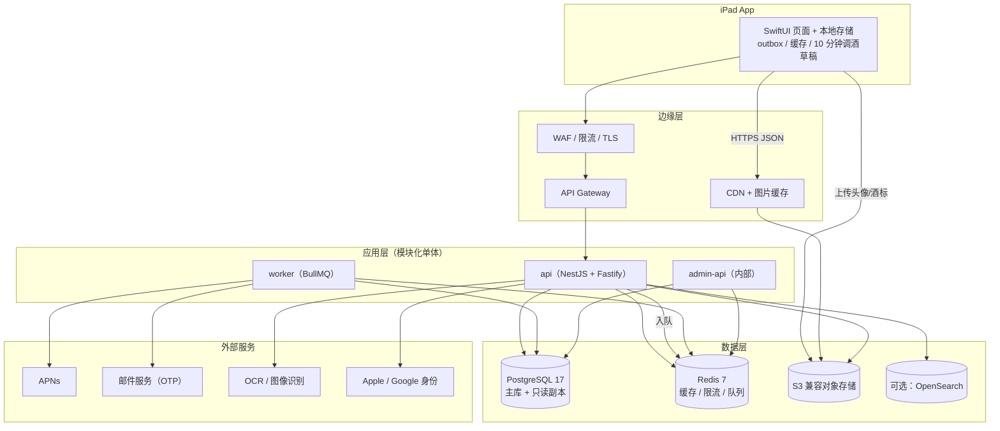
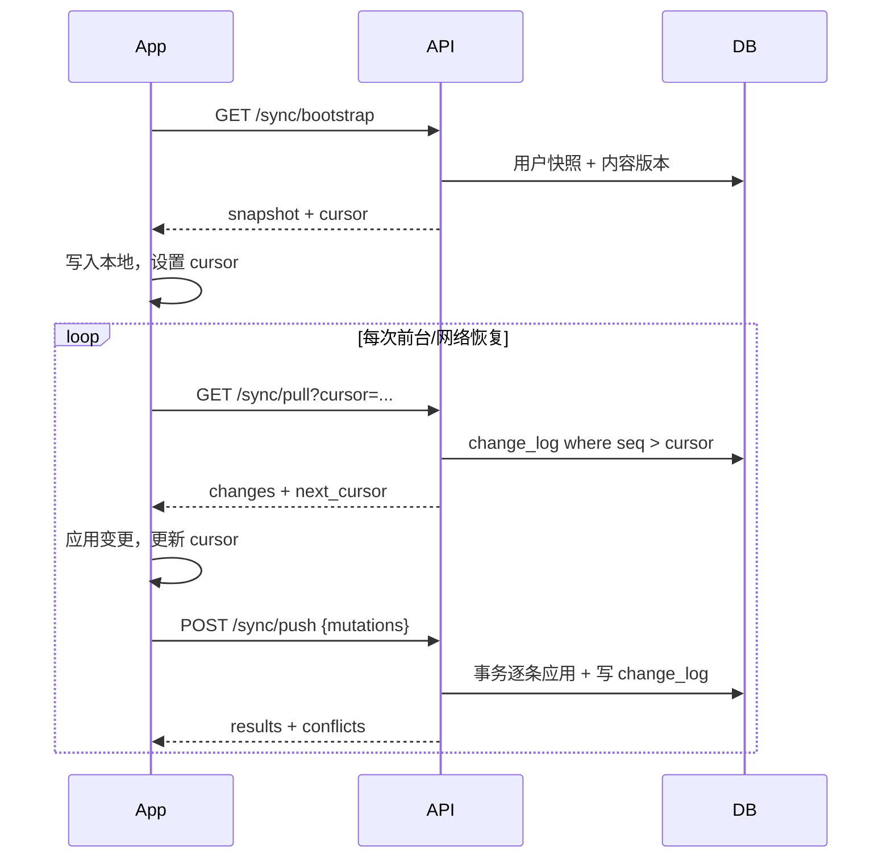
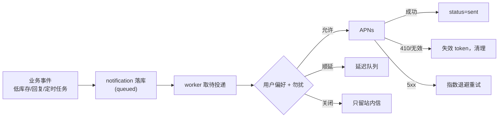
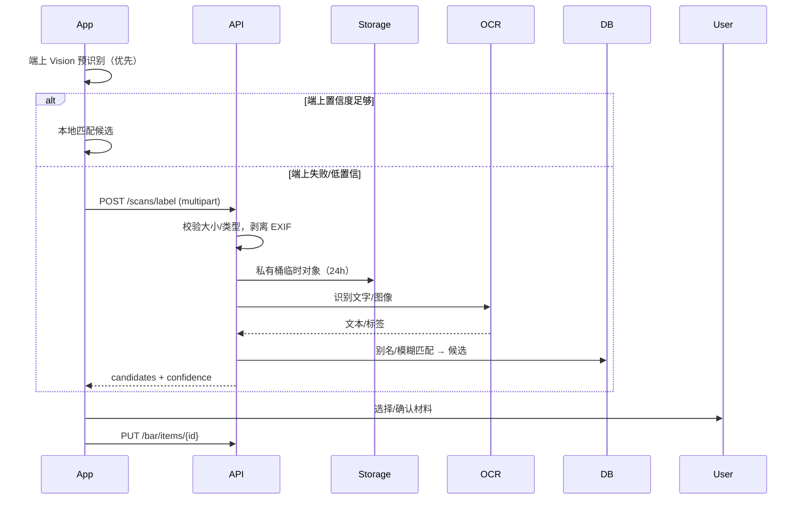

# Luceria Cocktail Atelier · 后端开发文档

> 版本：1.0 ・ 2026-11-15
> 适用产品：Luceria iPadOS 横屏应用（1194 × 834 pt，界面全英文）
> 上游设计：[DEVELOPER_GUIDE.md](Figma_design/DEVELOPER_GUIDE.md)（下称“开发指南”）、[README.md](Figma_design/README.md)、[tokens.json](Figma_design/data/tokens.json)、[prototype-links.json](Figma_design/data/prototype-links.json)，以及 `Figma_design/pages/`、`Figma_design/screens/` 中的 82 屏设计稿。
> 本文目的：把开发指南第三部分（3.1 数据模型、3.2 服务与接口、3.3 配方授权）落成一份可以直接拆任务、写代码、做测试和上线的后端方案。

**文档约定**

- **必须 / 建议 / 待确认**：分别表示接口契约或数据约束、可优化项、需要产品/法务拍板的事项。
- 字段名、接口路径、枚举值使用英文；正文使用中文。
- 所有时间在服务端以 UTC 存储、以 RFC 3339（`2026-11-15T09:20:00Z`）传输；只有“周统计”“日记日期”“勿扰时段”等业务日期使用用户时区的本地日期/时间，并显式携带 `timezone`。
- 标注 **[决策]** 的条目是本文给出的默认落地方案。若产品没有相反意见，开发按此执行；标注 **[待确认]** 的条目必须在上线前关闭。
- 设计稿中的屏幕编号（如 `M06`、`R02`）就是 Figma 帧名，接口、测试用例和缺陷单都直接引用编号。

**按角色阅读**

| 角色 | 先读 | 再查 |
|---|---|---|
| 后端 | 0 → 2 → 4 → 5 → 6 | 7–9、14–16 |
| iOS | 6.1、6.3、7.5、7.7、8 | 附录 A、C |
| QA | 16、17、附录 A/C | 6.3、7 |
| DevOps | 2、14、15 | 3、9.8 |
| 产品/法务 | 0、1.5、9.5–9.7、12 | 18 |

---

## 目录

0. 一页摘要
1. 背景、现状与后端范围
2. 总体架构与技术选型
3. 非功能需求与容量假设
4. 领域模型
5. 数据库设计
6. API 规范与接口清单
7. 核心业务规则与算法
8. 离线优先与同步
9. 认证、账号、隐私与安全
10. 通知服务
11. 酒标扫描识别
12. 配方内容、数据授权与素材
13. 运营后台
14. 性能、缓存与容量
15. 可观测性与运维
16. 测试策略
17. 交付计划、团队与验收
18. 风险、开放问题与决策记录
附录 A：屏幕 → 接口 → 数据 追溯表
附录 B：演示吧台种子（复现 `B01`）
附录 C：错误码目录
附录 D：术语表
附录 E：参考文件与事实来源

---

## 0. 一页摘要

### 0.1 后端要解决的三类问题

1. **内容与数据**：120 款经典配方、300+ 种材料、器具/冰块/技巧、法务与授权信息；一套可审核、可版本化的内容管线。
2. **状态与规则**：我的吧台库存、能调/只差一样/下一瓶买什么、份数换算、替代品、购物清单解锁、派对批量、日记与周统计、理性饮酒上限。
3. **同步与触达**：离线优先的数据合并、账号与游客、推送通知、社区审核、酒标识别、数据导出与删除。

### 0.2 关键产品约束（来自设计稿）

| 约束 | 值 | 来源 |
|---|---|---|
| 平台与界面 | iPadOS 横屏，1194 × 834 pt，全英文 | README、开发指南 1.1 |
| 经典配方目标 | 120 款；设计稿已画 7 款 | `R01` 文案、开发指南 4.2 |
| 材料库 | 300+ 种可搜索材料 | `L04`、`B02` |
| 库存档位 | Full / Half / Low / Out，四档 | 开发指南 3.1、`B05` |
| 份数 | 默认 2 杯；按杯等比缩放 | `X06`、`D01`、`M10` |
| 体积单位 | ml（存储）；UI 可切 ml / oz / cl | 开发指南 3.2、`X06` |
| 邮箱验证码 | 6 位数字，10 分钟有效，60 秒后可重发 | `L09`、`L10`、开发指南 3.2 |
| 昵称/头像修改 | 每 7 天一次 | `X09`、`U01` |
| 删除账号 | 30 天冷静期，支持数据导出 | 开发指南 3.2 |
| 调酒进度保留 | 离开调酒页保留 10 分钟 | 开发指南 2.6 |
| 今晚推荐通知 | 每周五 18:00（用户本地时间） | `N01`、`X07` |
| 每周总结 | 每周一 | `X07` |
| 勿扰时段 | 默认 23:00–09:00，可开可关 | `X07` |
| 社区发帖限制 | 注册满 2 分钟才能发；10 分钟内最多 6 条 | `C01`、开发指南 3.2 |
| 每周饮酒上限 | 用户自设，达到后优先零酒精 | `X08`、`J01` |
| 配方来源 | Difford's Guide，上线前必须确认授权 | 开发指南 3.3、`X10` |

### 0.3 推荐方案（一句话版）

**TypeScript / NestJS 模块化单体 + PostgreSQL + Redis + S3 兼容对象存储 + BullMQ 队列 + APNs**。先按模块化单体交付，按领域分 schema/模块，保留水平拆分能力；iPad 端离线优先，服务端提供增量同步与幂等写入；内容（配方/材料）走版本化发布，用户数据走按用户变更日志。

### 0.4 交付物

| 交付物 | 说明 | 负责 |
|---|---|---|
| OpenAPI 3.1 契约 | 由 DTO/Zod 生成，CI 校验向后兼容 | 后端 |
| 数据库迁移 | 可重复执行、向前兼容的 SQL 迁移 | 后端 |
| 种子内容包 | 6 款已确认配方 + 300+ 材料 + 器具/冰块词表 | 内容 + 后端 |
| 同步协议 | push/pull、冲突矩阵、幂等键 | 后端 |
| 运维手册 | 告警、备份、回滚、故障演练 | 后端 + DevOps |
| 验收报告 | 第 17 章清单逐项签字 | QA + 产品 |

---

## 1. 背景、现状与后端范围

### 1.1 产品闭环

Luceria 的核心闭环是：

> **我的吧台有什么 → 今晚能调什么 → 看配方与步骤 → 跟着调出来 → 记进日记 → 影响下一次推荐与补货**

围绕闭环的支撑面：

- 配方库与筛选（`R01`–`R05`）、配方详情与替代品（`D01`–`D06`）、可选的逐步调制（`M00`–`M12`）。
- 我的吧台与扫码入库（`B01`–`B05`）、购物清单与分享（`S01`–`S04`）。
- 日记、收藏、自创配方（`J01`–`J04`）、社区故事与回复（`C01`–`C02`）、学习内容（`K01`–`K02`）、派对与游戏（`P01`–`P04`）。
- 设置、无障碍、账号、系统状态（`X01`–`X11`、`A01`–`A02`、`Y01`–`Y03`）。

### 1.2 工作区现状核对

| 项目 | 现状 | 对后端的影响 |
|---|---|---|
| 代码 | 工作区只有 `Figma_design/` 设计交付物，没有任何后端代码 | 全新项目，无历史迁移包袱 |
| 设计稿 | 12 页 Figma、82 屏、5 条原型流程、409 个交互 | 屏幕编号可直接作为接口用例编号 |
| 配方数据 | 11 Handoff 只给出 6 款经典配方规格；设计稿展示 7 款酒 | 需要内容团队补齐 120 款；本文给出导入契约 |
| 配方步骤 | `D02` 展示了 Negroni 的 6 步、每步时长与计时器；其他酒款步骤未完整给出 | 步骤表结构先定，内容后补 |
| 授权 | Difford's 授权尚未确认 | 上线门禁；未确认前只能用自有配方 |
| API 契约 | 不存在 | 本文第 6 章作为初版契约 |
| 服务端环境 | 不存在 | 需从零搭建 CI/CD、监控、备份 |

### 1.3 后端负责与不负责

| 后端负责 | 端上负责（不要做成接口） |
|---|---|
| 账号、会话、游客升级、删除/导出 | 主题切换、Dynamic Type、字体缩放 |
| 配方/材料/器具内容与检索 | 页面转场、动效、减少动态效果 |
| 库存、推荐、份数换算、替代品 | 屏幕常亮、震动、提示音 |
| 日记、收藏、自创配方、购物清单、派对 | 语音识别与语音播报（设备端优先） |
| 社区、审核、举报、屏蔽 | 相机取景、本地条码/酒标预识别 |
| 同步、幂等、冲突合并 | 本地缓存、离线队列、重试调度 |
| 通知编排与推送 | 通知权限弹窗时机、角标显示 |
| 内容发布、法务文档、What's New | 高对比度描边、Hero 渐变等纯视觉规则 |

> 语音：开发指南 3.2 明确“设备端识别优先（隐私）”。因此后端**不接收音频**；命令集 `next`、`back`、`repeat`、`pause timer`、`add 10 seconds`、`how much <ingredient>` 全部在设备端解析与执行。如未来改为云端识别，必须单独做隐私评估与用户授权，不属于 V1。

### 1.4 角色

| 角色 | 说明 | 权限 |
|---|---|---|
| 游客（Guest） | 首次启动可跳过登录；有匿名账号用于跨设备前的本机体验 | 只读写自己的数据；可升级为正式账号 |
| 注册用户 | Apple / Google / 邮箱登录 | 全部 C 端能力 |
| 内容编辑 | 内部 | 配方/材料/学习内容草稿、提交审核 |
| 审核员 | 内部 | 社区举报、隐藏/删除、封禁建议 |
| 管理员 | 内部 | 发布、用户数据处理、功能开关、审计 |
| 服务账号 | 内部 | 定时任务、通知、导入；最小权限 |

### 1.5 V1 范围与优先级

| 优先级 | 能力 | 对应屏幕/指南 |
|---|---|---|
| P0 | 邮箱 OTP、Apple、Google、游客、刷新/登出 | `L08`–`L10`、`X09` |
| P0 | 材料库、我的吧台、库存四档、自动加清单 | `L04`、`B01`–`B05` |
| P0 | 配方列表/筛选/搜索/详情、份数与单位换算 | `R01`–`R05`、`D01`–`D02` |
| P0 | 今晚推荐、能调/差一样、下一瓶推荐、换一杯 | `T01`–`T03` |
| P0 | 日记、周统计、每周上限、零酒精模式 | `J01`、`X08` |
| P0 | 收藏与合集、自创配方 | `J02`–`J04`、`D05` |
| P0 | 购物清单、解锁数量、分享、清空已勾选 | `S01`–`S04` |
| P0 | 增量同步、幂等、离线冲突 | `Y01`、`Y02` |
| P0 | 通知偏好、设备注册、五类通知 | `N01`、`X07` |
| P0 | 账号删除 30 天、数据导出 | `X09`、`X11` |
| P1 | 配方评价、故事/回复/点赞/收藏、举报/屏蔽 | `D04`、`C01`–`C02` |
| P1 | 酒标扫描（服务端兜底） | `B03`–`B04` |
| P1 | 派对批量、采购建议、准备时间线入口 | `P01`、`P05` |
| P1 | 学习内容（器具/冰块/技巧）、What's New | `K01`–`K02`、`Y03` |
| P2 | 游戏选项同步、准备时间线细化、合集详情 | `P02`–`P04`、开发指南第五部分 |
| 不做 | 支付、实时多人、位置追踪、音频上云、图片生成 | — |

### 1.6 成功标准

- 开发指南第六部分验收清单中的后端项全部满足：3.2 的服务与接口可用、配方授权已确认。
- 5 条原型流程（首次启动、今晚→配方→调制、吧台→清单、日记/社区/派对/学习、设置与无障碍）在真实接口下可完整走通。
- 冷启动到“今晚”首屏：弱网 3 秒内出本地缓存，联网 p95 400 ms 内完成增量刷新。
- 离线修改不丢：飞行模式下的库存、日记、清单改动，恢复网络后 10 秒内合并成功。
- 任一用户可自助导出全部数据、发起删除；30 天后数据按策略清除。

---

## 2. 总体架构与技术选型

### 2.1 架构原则

1. **模块化单体优先**：V1 的团队规模、流量和领域耦合度不支持微服务。按领域分模块、分 schema、分数据库账号，模块间只通过应用服务/事件通信，禁止跨模块直接改表。
2. **读多写少、内容可缓存**：配方/材料是准静态内容，走版本号 + ETag + Redis/CDN；用户态数据（吧台、日记）短 TTL 缓存，写后失效。
3. **离线优先**：客户端永远先读本地；服务端不假设实时在线。所有写接口幂等，所有列表接口可分页、可增量。
4. **内容与用户数据分离**：内容库（配方、材料、法务）由 CMS 发布，版本化；用户库（吧台、日记、社区）按用户分区。
5. **先正确后智能**：推荐先用可解释的规则/加权评分，数据足够后再考虑学习模型；任何推荐都要能回答“为什么”。

### 2.2 逻辑架构



### 2.3 模块划分

| 模块 | 职责 | 主要数据 | 对外接口前缀 |
|---|---|---|---|
| `identity` | 账号、身份、OTP、会话、游客升级、删除/导出 | `user_account`、`user_identity`、`auth_session`、`otp_code` | `/v1/auth`、`/v1/me` |
| `catalog` | 材料、别名、替代品、配方、步骤、器具、来源与授权 | `ingredient*`、`recipe*`、`equipment` | `/v1/ingredients`、`/v1/recipes` |
| `bar` | 库存四档、自动补货标记、消耗事件 | `user_bar_item`、`bar_event` | `/v1/bar` |
| `recommend` | 能调/差一样/下一瓶/今晚推荐、换一杯 | 读模型 + 缓存 | `/v1/tonight`、`/v1/recommendations` |
| `journal` | 调酒记录、评分、口味反馈、周统计 | `journal_entry` | `/v1/journal` |
| `collections` | 收藏夹、自创配方 | `collection*`、`user_recipe*` | `/v1/collections`、`/v1/my-recipes` |
| `shopping` | 购物清单、分区、解锁模拟、分享 | `shopping_list`、`shopping_item`、`share_link` | `/v1/shopping-list` |
| `party` | 派对计划、批量换算、采购建议、准备时间线 | `party_plan`、`party_menu_item` | `/v1/parties` |
| `community` | 故事、回复、评价、点赞、收藏、举报、屏蔽 | `story*`、`review*`、`comment*`、`report*` | `/v1/stories`、`/v1/reviews` |
| `notifications` | 站内通知、偏好、设备令牌、推送编排 | `notification*`、`push_token` | `/v1/notifications` |
| `sync` | 变更日志、推送合并、幂等、设备游标 | `sync_change`、`idempotency_key`、`device_sync_state` | `/v1/sync` |
| `scan` | 酒标上传、OCR、别名匹配、候选 | `scan_request` | `/v1/scans` |
| `platform` | 配置、功能开关、法务、What's New、维护模式 | `app_config`、`content_document` | `/v1/config`、`/v1/legal` |
| `admin` | 内容导入/发布、审核队列、用户查询、通知活动 | 跨模块只读 + 受控写 | `/admin/v1` |

**模块边界规则**

- 只有 `admin` 和 `worker` 可以跨模块调用应用服务；C 端 API 的控制器不得直接跨模块查表。
- 跨模块异步副作用（评分聚合、通知、导出）走 `outbox_event` + worker，保证“写业务表和发事件”同事务。
- 每个模块独立 schema（如 `identity.*`、`catalog.*`），迁移文件按模块编号，避免大爆炸式迁移。

### 2.4 技术选型

| 层 | 选择 | 版本基线 | 理由 | 备选 |
|---|---|---|---|---|
| 语言 | TypeScript | 5.6+ | 与前端/原型工具链一致，生态成熟 | Go（团队更熟时） |
| 运行时 | Node.js | 22 LTS | 长期支持，原生 fetch/测试工具完善 | Bun（暂不用于生产） |
| Web 框架 | NestJS + Fastify adapter | 11.x | 模块化、DI、OpenAPI 集成好；Fastify 性能足够 | Fastify + TypeBox |
| 校验/契约 | Zod + `nestjs-zod` | 3.x | 运行时校验与类型同源，能生成 OpenAPI | class-validator |
| 数据库 | PostgreSQL | 17 | JSONB、全文检索、`pg_trgm`、事务与部分索引齐全 | MySQL 8（不推荐） |
| 数据访问 | Drizzle ORM + SQL | 最新稳定 | SQL 可控，推荐/聚合查询不被 ORM 限制 | Kysely、Prisma |
| 迁移 | Atlas 或 `node-pg-migrate` | 最新稳定 | 版本化、可 review、支持 expand-contract | Flyway |
| 缓存/限流 | Redis | 7.4 | 缓存、分布式锁、限流、队列一体 | KeyDB、Valkey |
| 队列 | BullMQ | 5.x | 延迟任务、重试、去重；适合通知/导出/聚合 | SQS + Lambda |
| 对象存储 | S3 兼容 + CDN | — | 头像、自创配方照片、酒标临时图 | GCS、R2 |
| 搜索 | PostgreSQL FTS + `pg_trgm` | — | 120 配方/300 材料规模足够 | OpenSearch（>1 万内容再上） |
| 认证 | 自建 JWT（`jose`）+ 不透明 refresh token | — | 可控、轻量；Apple/Google 只做身份验证 | Auth0、Cognito |
| 密码/验证码 | Argon2id + HMAC  peppers | — | 无密码体系；OTP 只存哈希 | — |
| 图片处理 | `sharp` | 最新 | 头像裁剪、去 EXIF、生成多尺寸 | 云图片服务 |
| 推送 | APNs（HTTP/2） | — | iPad 唯一正式通道 | — |
| 邮件 | Postmark / SES | — | 事务邮件到达率与模板 | Resend |
| OCR | Apple Vision（端上优先）+ 云 OCR 兜底 | — | 隐私与离线优先；服务端仅兜底 | Textract、Vision API |
| 可观测 | OpenTelemetry + Pino + Prometheus/Grafana | — | 统一 trace/metric/log | Datadog |
| 测试 | Vitest + Testcontainers + Supertest + k6 | — | 单元/集成/契约/压测 | Jest |
| CI/CD | GitHub Actions + Docker | — | 与代码托管一致 | GitLab CI |
| 部署 | 托管容器（ECS/Fargate 或 K8s） | — | 小团队少运维；多 AZ | 裸机 |

> **不建议** V1 上微服务、服务网格、CQRS 全套、图数据库。当前领域规模用 PostgreSQL + 少量物化视图即可；过早拆分只会增加同步与排障成本。

### 2.5 仓库结构

```text
luceria-backend/
├─ apps/
│  ├─ api/                 # C 端 REST API（NestJS）
│  ├─ admin-api/           # 内部后台 API
│  └─ worker/              # 队列消费者：通知、导出、聚合、清理
├─ packages/
│  ├─ domain/              # 领域服务：推荐、换算、库存、派对
│  ├─ db/                  # Drizzle schema、迁移、仓储
│  ├─ contracts/           # Zod DTO、OpenAPI、共享枚举
│  ├─ config/              # 环境变量 schema、密钥加载
│  └─ testing/             # fixture、测试容器、假时钟
├─ infra/
│  ├─ docker/              # 本地 docker compose
│  ├─ terraform/           # 云资源（按需）
│  └─ k8s/                 # 若使用 K8s
├─ docs/                   # ADR、运行手册、本文件的副本/链接
└─ package.json            # pnpm workspace + turborepo
```

### 2.6 环境

| 环境 | 用途 | 数据 | 外部服务 |
|---|---|---|---|
| `local` | 开发 | 种子内容 + 测试用户 | Mailpit、假 APNs、假 OCR |
| `dev` | 联调 | 匿名化种子 | 沙盒 APNs、测试邮件 |
| `staging` | 验收/压测 | 生产同构脱敏数据 | 沙盒 APNs、测试 OCR |
| `prod` | 生产 | 真实 | 正式 APNs/邮件/OCR |

**配置原则**：12-Factor；所有密钥进 Secret Manager；环境变量用 Zod 在启动时校验，缺失即拒绝启动；禁止把 `prod` 凭据放进开发者本机。

---

## 3. 非功能需求与容量假设

### 3.1 性能目标

| 场景 | 指标 | 目标 |
|---|---|---|
| 缓存命中的读接口（配方列表、今晚） | p95 | ≤ 150 ms |
| 未命中缓存的读接口 | p95 | ≤ 400 ms |
| 写接口（库存、日记、清单） | p95 | ≤ 300 ms |
| 同步 push（≤ 50 条变更） | p95 | ≤ 500 ms |
| 酒标扫描（不含用户上传时间） | p95 | ≤ 3 s |
| 首屏增量同步 | p95 | ≤ 800 ms（100 条变更内） |
| 错误率 | 5xx / 总请求 | < 0.1% |
| 可用性 | 月度 | 99.9%（允许约 43 分钟） |

### 3.2 容量假设（用于选型与压测，不是承诺）

| 指标 | 上线 6 个月 | 上线 18 个月 |
|---|---|---|
| MAU | 20,000 | 200,000 |
| DAU | 2,000 | 20,000 |
| 峰值读 RPS | 60 | 400 |
| 峰值写 RPS | 15 | 80 |
| 同步 push 峰值 | 5 req/s | 40 req/s |
| 推送/日 | 10,000 | 120,000 |
| 扫描/日 | 500 | 5,000 |
| 数据库 | 10 GB | 80 GB |
| 对象存储 | 20 GB | 300 GB |

> 以 120 款配方、300+ 材料计算，配方相关表在 1 万行量级，单机 PostgreSQL 足够。真正的增长点是日记、通知、社区和同步变更日志，按用户分区/归档。

### 3.3 可用性与灾备

- 多 AZ 部署 API 与数据库；数据库开启 PITR（时间点恢复）。
- **RPO ≤ 5 分钟，RTO ≤ 1 小时**；每季度做一次恢复演练，记录实际 RTO。
- 对象存储开启版本化与生命周期；用户照片 30 天软删除后物理删除。
- 外部依赖降级：
  - 邮件服务故障：OTP 接口返回 503 + `retry_after`，客户端提示“稍后再试”，不得静默失败。
  - APNs 故障：通知落库，恢复后重投；超过 24 小时的通知丢弃。
  - OCR 故障：返回 `scan_unavailable`，引导手动搜索材料。
  - Redis 故障：读路径回源数据库；限流退化为单机令牌桶（保护数据库）。

### 3.4 安全与合规底线

- 全站 TLS 1.2+，HSTS；管理后台独立域名与 SSO。
- OWASP ASVS L2 为目标；每年至少一次渗透测试。
- 酒精类应用：年龄门、理性饮酒提示、不得向未成年人营销；遵守 App Store 1.4.3 与当地酒类广告法规。
- 隐私：只收集必要数据；**不上传出生年份**（`L03` 明确“This stays on your device”），只存 `age_gate_passed_at` 与法域；不采集精确位置（购物提醒由端上地理围栏触发）。
- 数据主体权利：导出、删除、更正、撤回同意；30 天冷静期；法务保留数据单独标注。
- 日志脱敏：邮箱、令牌、验证码、酒标原图、位置一律不写日志。

### 3.5 成本护栏

- 图片走 CDN，原图不直出；头像/自创配方图生成 256/512/1024 三档。
- 推荐结果按 `user_id + bar_version + date` 缓存 10 分钟，避免每次刷新重算。
- 通知合并：低库存同类 24 小时最多 1 条；每周总结按用户时区分批。
- 扫描原图 24 小时删除，只保留识别结果与置信度。
- 日志保留 30 天，审计日志 1 年；变更日志 90 天后归档。

---

## 4. 领域模型

### 4.1 实体关系图

```mermaid
erDiagram
  USER_ACCOUNT ||--o{ USER_IDENTITY : has
  USER_ACCOUNT ||--|| USER_SETTINGS : has
  USER_ACCOUNT ||--o{ AUTH_SESSION : has
  USER_ACCOUNT ||--o{ DEVICE : uses
  USER_ACCOUNT ||--o{ USER_BAR_ITEM : owns
  USER_ACCOUNT ||--o{ JOURNAL_ENTRY : writes
  USER_ACCOUNT ||--o{ COLLECTION : owns
  USER_ACCOUNT ||--o{ USER_RECIPE : creates
  USER_ACCOUNT ||--o{ SHOPPING_ITEM : adds
  USER_ACCOUNT ||--o{ STORY : posts
  USER_ACCOUNT ||--o{ REVIEW : writes
  USER_ACCOUNT ||--o{ NOTIFICATION : receives

  INGREDIENT ||--o{ INGREDIENT_ALIAS : has
  INGREDIENT ||--o{ INGREDIENT_SUBSTITUTION : source
  INGREDIENT ||--o{ USER_BAR_ITEM : stocked_as
  INGREDIENT ||--o{ RECIPE_INGREDIENT : used_in

  RECIPE ||--o{ RECIPE_INGREDIENT : contains
  RECIPE ||--o{ RECIPE_STEP : has
  RECIPE ||--o{ RECIPE_EQUIPMENT : needs
  RECIPE ||--o{ REVIEW : receives
  RECIPE ||--o{ COLLECTION_RECIPE : saved_in
  RECIPE ||--o{ JOURNAL_ENTRY : logged_as
  RECIPE ||--o{ PARTY_MENU_ITEM : served_at

  RECIPE_SOURCE ||--o{ RECIPE : licenses

  COLLECTION ||--o{ COLLECTION_RECIPE : contains
  USER_RECIPE ||--o{ USER_RECIPE_INGREDIENT : contains
  USER_RECIPE ||--o{ USER_RECIPE_STEP : has

  STORY ||--o{ COMMENT : receives
  REVIEW ||--o{ COMMENT : receives
  STORY ||--o{ STORY_LIKE : liked_by
  STORY ||--o{ STORY_SAVE : saved_by
  REVIEW ||--o{ REVIEW_VOTE : voted_by

  SHOPPING_LIST ||--o{ SHOPPING_ITEM : contains
  PARTY_PLAN ||--o{ PARTY_MENU_ITEM : plans

  USER_ACCOUNT ||--o{ MODERATION_REPORT : reports
  USER_ACCOUNT ||--o{ USER_BLOCK : blocks
```



### 4.2 聚合与一致性边界

| 聚合根 | 包含 | 强一致规则 | 最终一致 |
|---|---|---|---|
| `UserAccount` | 身份、设置、设备 | 邮箱唯一；删除状态不可逆（30 天内可恢复） | 头像裁剪、导出打包 |
| `Ingredient` | 别名、替代关系 | 同义词不能指向两个不同材料 | 搜索索引更新 |
| `Recipe` | 配料、步骤、器具、来源 | 发布态配方必须至少 1 个配料、1 个步骤、ABV 已校准 | 评分聚合、搜索索引、推荐缓存 |
| `BarItem` | 库存档位、自动补货 | 一个用户一个材料只有一行 | 消耗事件、低库存通知 |
| `JournalEntry` | 一次调酒 | 评分 1–5；`servings > 0`；同一客户端 ID 只建一次 | 周统计、推荐画像 |
| `Collection` | 成员关系 | 默认 `Favourites` 不可删 | 成员计数 |
| `ShoppingList` | 条目 | 每个用户只有一份活跃清单 | 解锁模拟、分享快照 |
| `PartyPlan` | 菜单、人数 | 菜单杯数之和 = 计划总杯数（可少于） | 采购建议、准备时间线 |
| `Story` / `Review` | 正文、点赞、回复 | 作者可删；被隐藏后不可再互动 | 计数、审核队列 |
| `Notification` | 站内信、投递 | 同一 `dedupe_key` 只投一次 | 推送回执 |

### 4.3 关键枚举与词表

**库存档位 `stock_level`**

| 值 | UI 文案 | 是否可用于调酒 | 说明 |
|---|---|---|---|
| `full` | 未标注 | 是 | 默认新加入 |
| `half` | 未标注 | 是 | 约剩一半 |
| `low` | Low | 是 | 还能做，但提示补货 |
| `out` | Out | 否 | 虚线卡片；不参与“能调”计算 |

**材料类别 `ingredient_category`**

| 值 | UI 分组 | 例子 |
|---|---|---|
| `spirit` | Spirits | Gin、Bourbon、Vodka、Tequila、Rum、Mezcal |
| `liqueur` | Liqueurs | Campari、Cointreau、Coffee liqueur、Sweet vermouth |
| `fresh` | Fresh & mixers | Lemons、Limes、Fresh mint、Sugar syrup |
| `mixer` | Fresh & mixers | Soda water、Cranberry juice |
| `bitters` | Liqueurs | Angostura |

> UI 只显示三组（Spirits / Liqueurs / Fresh & mixers），“Running low”是筛选器而非类别。后端保留五类，前端按映射表分组；后续加“Garnish”时只加 `other`，不破坏已有数据。

**调制方法 `recipe_method`**

| 值 | UI 筛选 | 说明 |
|---|---|---|
| `stirred` | Stirred | 搅拌 |
| `shaken` | Shaken | 摇和（含 dry shake 作为步骤属性） |
| `built` | Built | 直接在杯中构建 |
| `blended` | Blended | 电动搅拌 |
| `churn` | Built | Mojito 的“捣压/提拉”；UI 仍归入 Built |

**风味 `flavour_tag`**

` sour`、`sweet`、`bitter`、`herbal`、`fruity`、`creamy`、`smoky`

- 筛选器显示 6 个：Sour、Bitter、Sweet、Herbal、Fruity、Creamy（`smoky` 只在详情/推荐画像中使用）。
- 入门偏好（`L05`）显示 6 个：Sour & bright、Sweet、Bitter & herbal、Smoky、Fruity、Rich & creamy。`Bitter & herbal` 映射到 `bitter` + `herbal` 两个标签。

**强度 `strength_band`**

| 值 | UI | 建议阈值（成酒 ABV） |
|---|---|---|
| `zero_proof` | Zero-proof | ≤ 0.5% |
| `light` | Light | 0.5%–10% |
| `balanced` | Balanced | 10%–20% |
| `strong` | Strong | > 20% |

> 阈值放在 `app_config`，可按市场调整。`R02` 的 Strength 筛选只有 Any / Zero-proof / Light / Strong，`balanced` 不显示但数据保留。

**计量单位 `amount_unit`**

`ml`、`dash`、`leaf`、`piece`、`bunch`、`top_up`

- 配方以“每杯”为基准存储；`ml` 是主单位。
- `dash` 用于苦精；`leaf` 用于薄荷叶；`piece` 用于柠檬/青柠/樱桃；`bunch` 用于采购单位；`top_up` 表示“加满”，不参与精确换算，但派对采购按经验值补齐。

**购物分区 `shopping_section`**

`produce`、`bottles`、`mixers`、`other`

> UI 显示“Produce”和“Bottles & mixers”两组；`mixers` 与 `bottles` 在前端合并展示，后端保留四值以满足开发指南 3.1。

**其他枚举**

| 枚举 | 值 |
|---|---|
| `identity_provider` | `apple`、`google`、`email` |
| `user_status` | `active`、`suspended`、`pending_deletion`、`deleted` |
| `volume_unit` | `ml`、`oz`、`cl` |
| `theme_mode` | `auto`、`dark`、`light`、`high_contrast` |
| `recipe_status` | `draft`、`published`、`retired` |
| `visibility` | `private`、`shared` |
| `moderation_status` | `pending`、`published`、`hidden`、`removed` |
| `notification_type` | `low_stock`、`tonight_pick`、`reply`、`weekly_summary`、`shopping` |
| `report_reason` | `spam`、`harassment`、`hate`、`sexual`、`dangerous`、`minor`、`other` |
| `report_status` | `open`、`reviewing`、`resolved`、`dismissed` |
| `sync_op` | `upsert`、`delete` |
| `consumption_reason` | `mixing`、`manual`、`correction`、`party` |

### 4.4 核心对象说明

**材料（Ingredient）**

- 全局共享，不区分用户；`slug` 稳定，供导入与深链使用。
- `abv_percent` 用于酒精计算；无酒精材料为 0。
- `default_unit`、`purchase_unit`、`purchase_pack_size` 支持“Buy 6”“Buy 1 bunch”这类建议。
- 别名用于搜索、酒标 OCR 和用户输入归一化；别名唯一，避免歧义。
- 替代关系是有向的：`ingredient_substitution.ingredient_id` 是“缺的材料”，`substitute_id` 是“可用的替代品”；允许一对多，带换算比例和配方调整。

**配方（Recipe）**

- 内容团队维护，`draft → published → retired`；发布后不可物理删除，只能退役，保证历史日记可追溯。
- `abv_percent` 是**成酒 ABV**（含稀释/融化水），与 `D01` 的 21.6% 对齐；不是基酒 ABV。
- `hue_dark` / `hue_light` 是该酒的 Hero 底色令牌值；后端只存值，不计算渐变。新增酒款必须同时提供 Dark/Light/HC 规则要求的颜色（见开发指南 2.4）。
- `rating_avg` / `rating_count` 是聚合缓存，不参与强一致；评价写入后异步更新。

**配方配料（RecipeIngredient）**

- `amount` + `unit` 按“一杯”存储；`amount` 允许小数（22.5 ml）。
- `optional=true` 表示缺少也能做（如装饰）；可用性计算只强制非可选配料。
- `prep_note` 用于“orange zest”“mint bouquet”等准备说明。
- 排序即 UI 顺序；同一材料在同一配方中只出现一次。

**配方步骤（RecipeStep）**

- `duration_seconds` 是常规耗时提示（如 15 s）；`timer_seconds` 是需要倒计时的步骤（如 20 s）。
- `tools` 是字符串数组，展示在步骤下方；同时通过 `recipe_equipment` 汇总到“备料”清单。
- `D02` 的 Negroni 六步是基准格式：标题 + 说明 + 时间/计时器。

**用户吧台（UserBarItem）**

- 一个用户 × 一个材料唯一；`level` 四档；`auto_add_to_list` 控制“用完了自动加清单”。
- 不存“瓶数/毫升数”——设计只给了档位。派对的采购建议因此是**档位启发式**（见 7.8）；若未来要精确到 ml，增加 `remaining_ml` 可选列，不破坏现有逻辑。
- 任何库存变更写 `bar_event`，用于审计、撤销与“调酒后自动降档”。

**日记（JournalEntry）**

- 记录“我调了这杯”：`made_at`、`servings`、`rating`、`taste_feedback`、`notes`、`duration_seconds`。
- `recipe_id` 与 `user_recipe_id` 二选一（检查约束）。
- `local_date` 由客户端按用户时区计算并上传，服务端校验偏差不超过 1 天，避免跨时区周统计错位。
- `client_mutation_id` 唯一，保证离线重放不重复。

**购物清单（ShoppingItem）**

- 每个用户一份活跃清单（`shopping_list.status='active'`），但数据模型允许多份历史清单。
- 条目可以关联材料（推荐）或纯文本（用户手输）。
- `source_type` / `source_id` 记录来源：哪个配方、低库存、派对或手动；用于 UI 副标题（“For Mojito”“Running low”）。
- 勾选只改 `checked`，不删除；`Clear checked items` 做软删除。

**社区（Story / Review / Comment）**

- 故事是独立内容；评价挂在配方上；回复同时服务故事和评价，用 `subject_type` 区分。
- 计数（like/reply/save）是缓存列，异步更新；互动表是事实来源。
- 所有内容有 `moderation_status`；被隐藏的内容作者可见、他人不可见；被删除的内容保留墓碑 30 天供申诉。

**通知（Notification）**

- 站内信与推送解耦：先落 `notification`，再由 worker 投递 APNs。
- `dedupe_key` 唯一（如 `low_stock:{user}:{ingredient}:{week}`），避免重复打扰。
- `payload` 存深链参数，不存敏感信息；客户端按 `deep_link` 跳转。

---

## 5. 数据库设计

### 5.1 约定

| 项 | 约定 |
|---|---|
| 主键 | `uuid`，由应用生成 UUIDv7（可排序、索引友好）；导入脚本可用确定性 UUID |
| 时间 | `timestamptz`，UTC；业务日期用 `date`（用户本地日） |
| 金额 | 本期无支付，不建金额字段 |
| 软删除 | 用户数据统一 `deleted_at timestamptz`；内容用 `status='retired'` |
| 并发 | 可同步实体带 `version integer`；每次写 +1；`If-Match` 或 `base_version` 比对 |
| 命名 | 小写蛇形；表名单数；枚举类型全局唯一 |
| Schema | 按模块分 schema；跨 schema 只允许应用服务访问，禁止跨模块 JOIN 写 |
| 字符集 | UTF-8；邮箱用 `citext`；JSON 用 `jsonb` |
| 约束 | 能在数据库表达的强约束尽量下沉（唯一、检查、外键） |
| 大字段 | 图片只存对象键/URL，不存二进制；正文 `text` |

### 5.2 完整 DDL（核心表）

> 以下 DDL 是契约基线，不是最终迁移文件。落地时拆成按模块编号的迁移，并补充注释、权限与触发器。默认 schema `public` 放枚举，业务表按模块 schema 隔离。

#### 5.2.1 扩展与枚举

```sql
create extension if not exists citext;
create extension if not exists pg_trgm;

create type stock_level          as enum ('full', 'half', 'low', 'out');
create type ingredient_category  as enum ('spirit', 'liqueur', 'fresh', 'mixer', 'bitters');
create type recipe_method        as enum ('stirred', 'shaken', 'built', 'blended', 'churn');
create type strength_band        as enum ('zero_proof', 'light', 'balanced', 'strong');
create type flavour_tag          as enum ('sour', 'sweet', 'bitter', 'herbal', 'fruity', 'creamy', 'smoky');
create type amount_unit          as enum ('ml', 'dash', 'leaf', 'piece', 'bunch', 'top_up');
create type volume_unit          as enum ('ml', 'oz', 'cl');
create type theme_mode           as enum ('auto', 'dark', 'light', 'high_contrast');
create type identity_provider    as enum ('apple', 'google', 'email');
create type user_status          as enum ('active', 'suspended', 'pending_deletion', 'deleted');
create type age_gate_status      as enum ('unknown', 'adult', 'underage');
create type recipe_status        as enum ('draft', 'published', 'retired');
create type visibility           as enum ('private', 'shared');
create type moderation_status    as enum ('pending', 'published', 'hidden', 'removed');
create type taste_feedback       as enum ('too_bitter', 'just_right', 'too_sweet');
create type shopping_section     as enum ('produce', 'bottles', 'mixers', 'other');
create type shopping_source      as enum ('recipe', 'low_stock', 'manual', 'party');
create type shopping_list_status as enum ('active', 'archived');
create type party_status          as enum ('draft', 'planned', 'archived');
create type notification_type    as enum ('low_stock', 'tonight_pick', 'reply', 'weekly_summary', 'shopping');
create type notification_status  as enum ('queued', 'sent', 'failed');
create type report_reason        as enum ('spam', 'harassment', 'hate', 'sexual', 'dangerous', 'minor', 'other');
create type report_status        as enum ('open', 'reviewing', 'resolved', 'dismissed');
create type sync_op              as enum ('upsert', 'delete');
create type consumption_reason   as enum ('mixing', 'manual', 'correction', 'party');
create type push_environment     as enum ('sandbox', 'production');
create type scan_status          as enum ('pending', 'succeeded', 'failed');
create type export_status        as enum ('queued', 'running', 'ready', 'failed', 'expired');
```

#### 5.2.2 身份与账号

```sql
create schema if not exists identity;

create table identity.user_account (
  id                    uuid primary key,
  email                 citext unique,
  email_verified_at     timestamptz,
  display_name          text not null check (char_length(display_name) between 1 and 60),
  avatar_url            text,
  locale                text not null default 'en',
  timezone              text not null default 'UTC',
  is_guest              boolean not null default false,
  status                user_status not null default 'active',
  age_gate_status       age_gate_status not null default 'unknown',
  age_gate_passed_at    timestamptz,
  age_gate_country      char(2),
  age_gate_version      text,
  profile_updated_at    timestamptz,
  deletion_scheduled_at timestamptz,
  created_at            timestamptz not null default now(),
  updated_at            timestamptz not null default now(),
  version               integer not null default 1
);

create table identity.user_identity (
  id               uuid primary key,
  user_id          uuid not null references identity.user_account(id) on delete cascade,
  provider         identity_provider not null,
  provider_subject text not null,
  email            citext,
  created_at       timestamptz not null default now(),
  unique (provider, provider_subject)
);
create index user_identity_user_idx on identity.user_identity(user_id);

create table identity.auth_session (
  id                 uuid primary key,
  user_id            uuid not null references identity.user_account(id) on delete cascade,
  family_id          uuid not null,
  refresh_token_hash text not null unique,
  device_id          uuid,
  user_agent         text,
  ip                 inet,
  expires_at         timestamptz not null,
  revoked_at         timestamptz,
  last_used_at       timestamptz not null default now(),
  created_at         timestamptz not null default now()
);
create index auth_session_user_idx on identity.auth_session(user_id, expires_at desc);
create index auth_session_family_idx on identity.auth_session(family_id);

create table identity.otp_code (
  id          uuid primary key,
  email       citext not null,
  code_hash   text not null,
  expires_at  timestamptz not null,
  consumed_at timestamptz,
  attempts    smallint not null default 0,
  request_ip  inet,
  created_at  timestamptz not null default now()
);
create index otp_email_created_idx on identity.otp_code(email, created_at desc);

create table identity.device (
  id           uuid primary key,
  user_id      uuid not null references identity.user_account(id) on delete cascade,
  name         text,
  model        text,
  os_version   text,
  app_version  text,
  last_seen_at timestamptz not null default now(),
  created_at   timestamptz not null default now()
);
create index device_user_idx on identity.device(user_id, last_seen_at desc);

create table identity.user_settings (
  user_id                    uuid primary key references identity.user_account(id) on delete cascade,
  theme                      theme_mode not null default 'auto',
  text_scale                 numeric(4,2) not null default 1.00 check (text_scale between 0.80 and 2.00),
  read_steps_aloud           boolean not null default false,
  reduce_motion              boolean not null default false,
  larger_touch_targets       boolean not null default false,
  one_instruction_per_screen boolean not null default false,
  extra_time_on_timers       boolean not null default false,
  volume_unit                volume_unit not null default 'ml',
  default_servings           numeric(4,1) not null default 2 check (default_servings between 0.5 and 20),
  keep_screen_awake          boolean not null default true,
  start_timers_automatically boolean not null default true,
  update_bar_after_mixing    boolean not null default true,
  weekly_drink_limit         smallint check (weekly_drink_limit between 1 and 70),
  zero_proof_mode            boolean not null default false,
  remind_water               boolean not null default false,
  show_alcohol_per_drink     boolean not null default true,
  favourite_flavours         flavour_tag[] not null default '{}',
  strength_preference        strength_band,
  onboarding_state           jsonb not null default '{}'::jsonb,
  updated_at                 timestamptz not null default now(),
  version                    integer not null default 1
);

create table identity.user_taste_event (
  id          bigserial primary key,
  user_id     uuid not null references identity.user_account(id) on delete cascade,
  flavour     flavour_tag not null,
  delta       numeric(5,2) not null,
  source      text not null,
  created_at  timestamptz not null default now()
);
create index user_taste_event_user_idx on identity.user_taste_event(user_id, created_at desc);
```

#### 5.2.3 内容目录

```sql
create schema if not exists catalog;

create table catalog.ingredient (
  id                  uuid primary key,
  slug                text not null unique,
  name                text not null,
  category            ingredient_category not null,
  abv_percent         numeric(5,2) not null default 0 check (abv_percent between 0 and 100),
  is_alcohol          boolean not null default false,
  default_unit        amount_unit not null default 'ml',
  bottle_ml           numeric(8,2) check (bottle_ml > 0),
  purchase_unit       text,
  purchase_pack_size  numeric(8,2),
  party_rule          text not null default 'volume' check (party_rule in ('volume', 'per_drink', 'unit')),
  notes               text,
  created_at          timestamptz not null default now(),
  updated_at          timestamptz not null default now()
);
create index ingredient_category_idx on catalog.ingredient(category);
create index ingredient_name_trgm_idx on catalog.ingredient using gin (name gin_trgm_ops);

create table catalog.ingredient_alias (
  id            uuid primary key,
  ingredient_id uuid not null references catalog.ingredient(id) on delete cascade,
  alias         citext not null unique,
  source        text not null default 'manual',
  created_at    timestamptz not null default now()
);
create index ingredient_alias_ingredient_idx on catalog.ingredient_alias(ingredient_id);

create table catalog.ingredient_substitution (
  id              uuid primary key,
  ingredient_id   uuid not null references catalog.ingredient(id) on delete cascade,
  substitute_id   uuid not null references catalog.ingredient(id) on delete cascade,
  ratio           numeric(6,3) not null default 1.000 check (ratio > 0),
  adjustments     jsonb not null default '{}'::jsonb,
  note            text,
  priority        smallint not null default 100,
  created_at      timestamptz not null default now(),
  unique (ingredient_id, substitute_id),
  check (ingredient_id <> substitute_id)
);
create index ingredient_sub_ingredient_idx on catalog.ingredient_substitution(ingredient_id, priority);

create table catalog.recipe_source (
  id                uuid primary key,
  name              text not null,
  url               text,
  license_type      text not null,
  license_ref       text,
  attribution_text  text not null,
  permission_status text not null check (permission_status in ('pending', 'cleared', 'denied', 'expired')),
  evidence_url      text,
  valid_until       date,
  created_at        timestamptz not null default now(),
  updated_at        timestamptz not null default now()
);

create table catalog.recipe (
  id            uuid primary key,
  slug          text not null unique,
  name          text not null,
  tagline       text,
  description   text,
  base_spirit_id uuid references catalog.ingredient(id),
  method        recipe_method not null,
  glassware     text not null,
  ice           text,
  garnish       text,
  abv_percent   numeric(5,2) check (abv_percent between 0 and 80),
  minutes       smallint not null check (minutes between 1 and 180),
  difficulty    smallint not null default 1 check (difficulty between 1 and 5),
  flavours      flavour_tag[] not null default '{}',
  allergens     text[] not null default '{}',
  strength      strength_band not null,
  hue_dark      char(7) check (hue_dark ~ '^#[0-9A-Fa-f]{6}$'),
  hue_light     char(7) check (hue_light ~ '^#[0-9A-Fa-f]{6}$'),
  image_url     text,
  source_id     uuid not null references catalog.recipe_source(id),
  status        recipe_status not null default 'draft',
  published_at  timestamptz,
  rating_avg    numeric(2,1) not null default 0 check (rating_avg between 0 and 5),
  rating_count  integer not null default 0,
  search_text   text not null default '',
  created_at    timestamptz not null default now(),
  updated_at    timestamptz not null default now()
);
create index recipe_status_published_idx on catalog.recipe(status, published_at desc);
create index recipe_flavours_idx on catalog.recipe using gin (flavours);
create index recipe_method_idx on catalog.recipe(method);
create index recipe_strength_idx on catalog.recipe(strength);
create index recipe_abv_idx on catalog.recipe(abv_percent);
create index recipe_search_idx on catalog.recipe using gin (to_tsvector('simple', search_text));
create index recipe_name_trgm_idx on catalog.recipe using gin (name gin_trgm_ops);

create table catalog.recipe_ingredient (
  id            uuid primary key,
  recipe_id     uuid not null references catalog.recipe(id) on delete cascade,
  ingredient_id uuid not null references catalog.ingredient(id),
  amount        numeric(8,2),
  unit          amount_unit not null default 'ml',
  optional      boolean not null default false,
  prep_note     text,
  sort_order    smallint not null default 0,
  check (
    (unit = 'top_up' and amount is null)
    or (unit <> 'top_up' and amount is not null and amount > 0)
  ),
  unique (recipe_id, ingredient_id)
);
create index recipe_ingredient_recipe_idx on catalog.recipe_ingredient(recipe_id, sort_order);
create index recipe_ingredient_ingredient_idx on catalog.recipe_ingredient(ingredient_id);

create table catalog.recipe_step (
  id               uuid primary key,
  recipe_id        uuid not null references catalog.recipe(id) on delete cascade,
  step_no          smallint not null check (step_no > 0),
  title            text not null,
  instruction      text not null,
  duration_seconds smallint check (duration_seconds between 0 and 7200),
  timer_seconds    smallint check (timer_seconds between 1 and 7200),
  tools            text[] not null default '{}',
  unique (recipe_id, step_no)
);
create index recipe_step_recipe_idx on catalog.recipe_step(recipe_id, step_no);

create table catalog.equipment (
  id   uuid primary key,
  slug text not null unique,
  name text not null
);

create table catalog.recipe_equipment (
  recipe_id    uuid not null references catalog.recipe(id) on delete cascade,
  equipment_id uuid not null references catalog.equipment(id),
  quantity     numeric(6,2) not null default 1 check (quantity > 0),
  optional     boolean not null default false,
  primary key (recipe_id, equipment_id)
);

create table catalog.recipe_asset (
  id               uuid primary key,
  recipe_id        uuid not null references catalog.recipe(id) on delete cascade,
  kind             text not null check (kind in ('hero', 'thumbnail', 'step')),
  url              text not null,
  width            integer,
  height           integer,
  license          text not null,
  attribution      text,
  created_at       timestamptz not null default now()
);
```

#### 5.2.4 我的吧台

```sql
create schema if not exists bar;

create table bar.user_bar_item (
  user_id            uuid not null references identity.user_account(id) on delete cascade,
  ingredient_id      uuid not null references catalog.ingredient(id),
  level              stock_level not null default 'full',
  poured_ml          numeric(8,2) not null default 0 check (poured_ml >= 0),
  auto_add_to_list   boolean not null default true,
  updated_at         timestamptz not null default now(),
  version            integer not null default 1,
  primary key (user_id, ingredient_id)
);
create index bar_item_ingredient_idx on bar.user_bar_item(ingredient_id);
create index bar_item_low_idx on bar.user_bar_item(user_id) where level in ('low', 'out');

create table bar.stock_event (
  id            bigserial primary key,
  user_id       uuid not null references identity.user_account(id) on delete cascade,
  ingredient_id uuid not null references catalog.ingredient(id),
  from_level    stock_level,
  to_level      stock_level not null,
  reason        consumption_reason not null,
  recipe_id     uuid,
  session_id    uuid,
  created_at    timestamptz not null default now()
);
create index stock_event_user_idx on bar.stock_event(user_id, created_at desc);
create index stock_event_session_idx on bar.stock_event(session_id);
create unique index stock_event_session_ingredient_idx
  on bar.stock_event(session_id, ingredient_id)
  where session_id is not null;
```

#### 5.2.5 日记

```sql
create schema if not exists journal;

create table journal.journal_entry (
  id                 uuid primary key,
  user_id            uuid not null references identity.user_account(id) on delete cascade,
  recipe_id          uuid references catalog.recipe(id),
  user_recipe_id     uuid,
  made_at            timestamptz not null,
  local_date         date not null,
  servings           numeric(4,1) not null default 1 check (servings > 0 and servings <= 20),
  rating             smallint not null check (rating between 1 and 5),
  taste_feedback     taste_feedback,
  notes              text check (char_length(notes) <= 2000),
  duration_seconds   integer check (duration_seconds between 0 and 86400),
  client_mutation_id uuid,
  created_at         timestamptz not null default now(),
  updated_at         timestamptz not null default now(),
  deleted_at         timestamptz,
  version            integer not null default 1,
  check ((recipe_id is null) <> (user_recipe_id is null))
);
create unique index journal_client_mutation_idx on journal.journal_entry(user_id, client_mutation_id)
  where client_mutation_id is not null;
create index journal_user_date_idx on journal.journal_entry(user_id, local_date desc)
  where deleted_at is null;
create index journal_user_made_idx on journal.journal_entry(user_id, made_at desc)
  where deleted_at is null;
```

#### 5.2.6 收藏与自创配方

```sql
create schema if not exists collections;

create table collections.collection (
  id         uuid primary key,
  user_id    uuid not null references identity.user_account(id) on delete cascade,
  name       text not null check (char_length(name) between 1 and 60),
  is_default boolean not null default false,
  created_at timestamptz not null default now(),
  updated_at timestamptz not null default now(),
  deleted_at timestamptz
);
create unique index collection_one_default_idx on collections.collection(user_id)
  where is_default and deleted_at is null;
create index collection_user_idx on collections.collection(user_id) where deleted_at is null;

create table collections.collection_recipe (
  collection_id uuid not null references collections.collection(id) on delete cascade,
  recipe_id     uuid not null references catalog.recipe(id),
  added_at      timestamptz not null default now(),
  deleted_at    timestamptz,
  primary key (collection_id, recipe_id)
);
create index collection_recipe_recipe_idx on collections.collection_recipe(recipe_id);

create table collections.user_recipe (
  id                uuid primary key,
  user_id           uuid not null references identity.user_account(id) on delete cascade,
  name              text not null check (char_length(name) between 1 and 80),
  base_spirit_id    uuid references catalog.ingredient(id),
  method            recipe_method not null,
  glassware         text,
  ice               text,
  garnish           text,
  abv_percent       numeric(5,2) check (abv_percent between 0 and 80),
  minutes           smallint check (minutes between 1 and 180),
  visibility        visibility not null default 'private',
  photo_url         text,
  save_count        integer not null default 0,
  moderation_status moderation_status not null default 'published',
  created_at        timestamptz not null default now(),
  updated_at        timestamptz not null default now(),
  deleted_at        timestamptz,
  version           integer not null default 1
);
create index user_recipe_user_idx on collections.user_recipe(user_id, updated_at desc)
  where deleted_at is null;
create index user_recipe_shared_idx on collections.user_recipe(visibility, created_at desc)
  where visibility = 'shared' and deleted_at is null and moderation_status = 'published';

create table collections.user_recipe_ingredient (
  id            uuid primary key,
  user_recipe_id uuid not null references collections.user_recipe(id) on delete cascade,
  ingredient_id uuid references catalog.ingredient(id),
  free_text     text,
  amount        numeric(8,2),
  unit          amount_unit not null default 'ml',
  sort_order    smallint not null default 0,
  check (ingredient_id is not null or free_text is not null)
);
create index user_recipe_ingredient_recipe_idx on collections.user_recipe_ingredient(user_recipe_id, sort_order);

create table collections.user_recipe_step (
  id             uuid primary key,
  user_recipe_id uuid not null references collections.user_recipe(id) on delete cascade,
  step_no        smallint not null check (step_no > 0),
  instruction    text not null,
  timer_seconds  smallint check (timer_seconds between 1 and 7200),
  unique (user_recipe_id, step_no)
);

create table collections.user_recipe_save (
  user_recipe_id uuid not null references collections.user_recipe(id) on delete cascade,
  user_id        uuid not null references identity.user_account(id) on delete cascade,
  created_at     timestamptz not null default now(),
  primary key (user_recipe_id, user_id)
);

-- journal 先于 collections 建表，这里补自创配方外键；物理删除被限制，避免日记悬空
alter table journal.journal_entry
  add constraint journal_user_recipe_fk
  foreign key (user_recipe_id) references collections.user_recipe(id);
```

#### 5.2.7 购物清单

```sql
create schema if not exists shopping;

create table shopping.shopping_list (
  id         uuid primary key,
  user_id    uuid not null references identity.user_account(id) on delete cascade,
  status     shopping_list_status not null default 'active',
  created_at timestamptz not null default now(),
  updated_at timestamptz not null default now()
);
create unique index shopping_one_active_idx on shopping.shopping_list(user_id) where status = 'active';

create table shopping.shopping_item (
  id            uuid primary key,
  list_id       uuid not null references shopping.shopping_list(id) on delete cascade,
  ingredient_id uuid references catalog.ingredient(id),
  name          text not null check (char_length(name) between 1 and 120),
  section       shopping_section not null default 'other',
  quantity      numeric(8,2),
  unit          amount_unit,
  checked       boolean not null default false,
  source_type   shopping_source not null default 'manual',
  source_id     uuid,
  note          text,
  sort_order    integer not null default 0,
  created_at    timestamptz not null default now(),
  updated_at    timestamptz not null default now(),
  deleted_at    timestamptz,
  version       integer not null default 1
);
create index shopping_item_list_idx on shopping.shopping_item(list_id, checked, section)
  where deleted_at is null;
create index shopping_item_ingredient_idx on shopping.shopping_item(ingredient_id);

create table shopping.share_link (
  id         uuid primary key,
  list_id    uuid not null references shopping.shopping_list(id) on delete cascade,
  token_hash text not null unique,
  created_by uuid not null references identity.user_account(id) on delete cascade,
  snapshot   jsonb not null default '{}'::jsonb,
  expires_at timestamptz not null,
  created_at timestamptz not null default now()
);
create index share_link_list_idx on shopping.share_link(list_id);
```

#### 5.2.8 派对

```sql
create schema if not exists party;

create table party.party_plan (
  id              uuid primary key,
  user_id         uuid not null references identity.user_account(id) on delete cascade,
  guests          smallint not null check (guests between 1 and 100),
  drinks_per_guest smallint not null check (drinks_per_guest between 1 and 20),
  status          party_status not null default 'draft',
  game_options    jsonb not null default '{}'::jsonb,
  created_at      timestamptz not null default now(),
  updated_at      timestamptz not null default now()
);
create index party_user_idx on party.party_plan(user_id, created_at desc);

create table party.party_menu_item (
  party_id  uuid not null references party.party_plan(id) on delete cascade,
  recipe_id uuid not null references catalog.recipe(id),
  servings  smallint not null check (servings between 1 and 500),
  primary key (party_id, recipe_id)
);
```

#### 5.2.9 社区

```sql
create schema if not exists community;

create table community.story (
  id             uuid primary key,
  user_id        uuid not null references identity.user_account(id) on delete cascade,
  title          text not null check (char_length(title) between 1 and 120),
  body           text not null check (char_length(body) between 1 and 5000),
  topics         text[] not null default '{}',
  location_text  text,
  like_count     integer not null default 0,
  reply_count    integer not null default 0,
  save_count     integer not null default 0,
  moderation_status moderation_status not null default 'published',
  created_at     timestamptz not null default now(),
  updated_at     timestamptz not null default now(),
  deleted_at     timestamptz,
  version        integer not null default 1
);
create index story_feed_idx on community.story(created_at desc)
  where deleted_at is null and moderation_status = 'published';
create index story_topics_idx on community.story using gin (topics);
create index story_user_idx on community.story(user_id, created_at desc);

create table community.story_like (
  story_id   uuid not null references community.story(id) on delete cascade,
  user_id    uuid not null references identity.user_account(id) on delete cascade,
  created_at timestamptz not null default now(),
  primary key (story_id, user_id)
);

create table community.story_save (
  story_id   uuid not null references community.story(id) on delete cascade,
  user_id    uuid not null references identity.user_account(id) on delete cascade,
  created_at timestamptz not null default now(),
  primary key (story_id, user_id)
);

create table community.review (
  id            uuid primary key,
  recipe_id     uuid not null references catalog.recipe(id) on delete cascade,
  user_id       uuid not null references identity.user_account(id) on delete cascade,
  rating        smallint not null check (rating between 1 and 5),
  body          text check (char_length(body) between 0 and 2000),
  like_count    integer not null default 0,
  reply_count   integer not null default 0,
  moderation_status moderation_status not null default 'published',
  created_at    timestamptz not null default now(),
  updated_at    timestamptz not null default now(),
  deleted_at    timestamptz
);
create unique index review_one_per_user_idx on community.review(recipe_id, user_id)
  where deleted_at is null;
create index review_recipe_idx on community.review(recipe_id, created_at desc)
  where deleted_at is null and moderation_status = 'published';

create table community.review_vote (
  review_id  uuid not null references community.review(id) on delete cascade,
  user_id    uuid not null references identity.user_account(id) on delete cascade,
  created_at timestamptz not null default now(),
  primary key (review_id, user_id)
);

create table community.reply (
  id           uuid primary key,
  subject_type text not null check (subject_type in ('story', 'review')),
  subject_id   uuid not null,
  parent_id    uuid references community.reply(id) on delete cascade,
  user_id      uuid not null references identity.user_account(id) on delete cascade,
  body         text not null check (char_length(body) between 1 and 2000),
  like_count   integer not null default 0,
  moderation_status moderation_status not null default 'published',
  created_at   timestamptz not null default now(),
  updated_at   timestamptz not null default now(),
  deleted_at   timestamptz
);
create index reply_subject_idx on community.reply(subject_type, subject_id, created_at)
  where deleted_at is null and moderation_status = 'published';
create index reply_parent_idx on community.reply(parent_id);

create table community.moderation_report (
  id           uuid primary key,
  reporter_id  uuid not null references identity.user_account(id) on delete cascade,
  subject_type text not null check (subject_type in ('story', 'review', 'reply', 'user', 'recipe')),
  subject_id   uuid not null,
  reason       report_reason not null,
  note         text check (char_length(note) <= 1000),
  status       report_status not null default 'open',
  resolved_by  uuid references identity.user_account(id),
  resolved_at  timestamptz,
  created_at   timestamptz not null default now()
);
create index report_status_idx on community.moderation_report(status, created_at);
create unique index report_once_idx on community.moderation_report(reporter_id, subject_type, subject_id)
  where status in ('open', 'reviewing');

create table community.user_block (
  blocker_id uuid not null references identity.user_account(id) on delete cascade,
  blocked_id uuid not null references identity.user_account(id) on delete cascade,
  created_at timestamptz not null default now(),
  primary key (blocker_id, blocked_id),
  check (blocker_id <> blocked_id)
);
```

#### 5.2.10 通知

```sql
create schema if not exists notify;

create table notify.notification (
  id          uuid primary key,
  user_id     uuid not null references identity.user_account(id) on delete cascade,
  type        notification_type not null,
  title       text not null,
  body        text not null,
  payload     jsonb not null default '{}'::jsonb,
  deep_link   text,
  dedupe_key  text,
  status      notification_status not null default 'queued',
  read_at     timestamptz,
  created_at  timestamptz not null default now(),
  expires_at  timestamptz
);
create unique index notification_dedupe_idx on notify.notification(user_id, dedupe_key)
  where dedupe_key is not null;
create index notification_inbox_idx on notify.notification(user_id, created_at desc);

create table notify.notification_preference (
  user_id             uuid primary key references identity.user_account(id) on delete cascade,
  low_stock           boolean not null default true,
  tonight_pick        boolean not null default true,
  shopping_reminders  boolean not null default false,
  replies             boolean not null default true,
  weekly_summary      boolean not null default true,
  quiet_hours_enabled boolean not null default true,
  quiet_hours_start   time not null default '23:00',
  quiet_hours_end     time not null default '09:00',
  timezone            text not null default 'UTC',
  updated_at          timestamptz not null default now()
);

create table notify.push_token (
  id            uuid primary key,
  user_id       uuid not null references identity.user_account(id) on delete cascade,
  device_id     uuid references identity.device(id) on delete set null,
  token         text not null unique,
  environment   push_environment not null default 'production',
  app_version   text,
  last_seen_at  timestamptz not null default now(),
  invalidated_at timestamptz,
  created_at    timestamptz not null default now()
);
create index push_token_user_idx on notify.push_token(user_id) where invalidated_at is null;
```

#### 5.2.11 同步与幂等

```sql
create schema if not exists sync;

create table sync.change_log (
  seq         bigserial primary key,
  user_id     uuid not null references identity.user_account(id) on delete cascade,
  entity_type text not null,
  entity_id   uuid not null,
  op          sync_op not null,
  version     integer,
  payload     jsonb,
  created_at  timestamptz not null default now()
);
create index change_log_user_seq_idx on sync.change_log(user_id, seq);

create table sync.device_cursor (
  device_id  uuid primary key references identity.device(id) on delete cascade,
  user_id    uuid not null references identity.user_account(id) on delete cascade,
  last_seq   bigint not null default 0,
  updated_at timestamptz not null default now()
);

create table sync.idempotency_key (
  user_id      uuid not null references identity.user_account(id) on delete cascade,
  key          text not null,
  request_hash text not null,
  status_code  smallint not null,
  response     jsonb,
  created_at   timestamptz not null default now(),
  expires_at   timestamptz not null,
  primary key (user_id, key)
);
create index idempotency_expiry_idx on sync.idempotency_key(expires_at);
```

#### 5.2.12 平台、扫描与审计

```sql
create schema if not exists platform;
create schema if not exists scan;

create table platform.app_config (
  key        text primary key,
  value      jsonb not null,
  updated_at timestamptz not null default now()
);

create table platform.content_document (
  id           uuid primary key,
  slug         text not null,
  kind         text not null check (kind in ('legal', 'whats_new', 'learn', 'help')),
  locale       text not null default 'en',
  title        text not null,
  body_md      text not null,
  version      integer not null default 1,
  published_at timestamptz,
  created_at   timestamptz not null default now(),
  unique (slug, locale, version)
);
create index content_document_kind_idx on platform.content_document(kind, locale, published_at desc);

create table platform.data_export_job (
  id          uuid primary key,
  user_id     uuid not null references identity.user_account(id) on delete cascade,
  status      export_status not null default 'queued',
  object_key  text,
  error       text,
  created_at  timestamptz not null default now(),
  completed_at timestamptz,
  expires_at  timestamptz
);
create index export_user_idx on platform.data_export_job(user_id, created_at desc);

create table platform.deletion_request (
  id            uuid primary key,
  user_id       uuid references identity.user_account(id) on delete set null,
  requested_at  timestamptz not null default now(),
  scheduled_for timestamptz not null,
  cancelled_at  timestamptz,
  completed_at  timestamptz,
  reason        text
);
create index deletion_due_idx on platform.deletion_request(scheduled_for)
  where completed_at is null and cancelled_at is null;

create table platform.audit_log (
  id           bigserial primary key,
  actor_id     uuid,
  actor_type   text not null default 'user',
  action       text not null,
  subject_type text,
  subject_id   uuid,
  metadata     jsonb not null default '{}'::jsonb,
  ip           inet,
  created_at   timestamptz not null default now()
);
create index audit_subject_idx on platform.audit_log(subject_type, subject_id, created_at desc);
create index audit_actor_idx on platform.audit_log(actor_id, created_at desc);

create table platform.outbox_event (
  id             bigserial primary key,
  aggregate_type text not null,
  aggregate_id   uuid not null,
  event_type     text not null,
  payload        jsonb not null,
  created_at     timestamptz not null default now(),
  processed_at   timestamptz,
  attempts       smallint not null default 0
);
create index outbox_pending_idx on platform.outbox_event(created_at)
  where processed_at is null;

create table scan.scan_request (
  id          uuid primary key,
  user_id     uuid not null references identity.user_account(id) on delete cascade,
  status      scan_status not null default 'pending',
  image_key   text,
  candidates  jsonb not null default '[]'::jsonb,
  provider    text,
  error       text,
  created_at  timestamptz not null default now(),
  expires_at  timestamptz not null
);
create index scan_user_idx on scan.scan_request(user_id, created_at desc);
```

### 5.3 索引与查询模式

| 查询 | 索引 | 备注 |
|---|---|---|
| 配方详情 | `recipe.slug` 唯一索引 | 客户端用 slug 深链 |
| 配方列表筛选 | `recipe_method_idx`、`recipe_strength_idx`、`recipe_flavours` GIN | 组合筛选先走选择性最高的列 |
| 配方搜索 | `recipe_search_idx` + `recipe_name_trgm_idx` | 名称/描述全文；错拼走 trigram |
| 某材料被哪些配方使用 | `recipe_ingredient_ingredient_idx` | “Used in 12 recipes” |
| 我的吧台 | `user_bar_item` 主键 | 按用户一次取全量（≤300 行） |
| 能调/差一样 | 内存计算 + `ready_recipes` 物化视图可选 | 配方量小，不必每次复杂 SQL |
| 日记列表 | `journal_user_date_idx` | `local_date desc`，软删除过滤 |
| 周统计 | `journal_user_date_idx` | 按 `local_date` 范围聚合 |
| 评价列表 | `review_recipe_idx` | 只取 published |
| 故事 feed | `story_feed_idx` | 时间倒序；Popular 另算 |
| 话题筛选 | `story_topics_idx` GIN | `topics && array[...]` |
| 通知收件箱 | `notification_inbox_idx` | 未读可加部分索引 |
| 同步拉取 | `change_log_user_seq_idx` | 按 seq 递增 |
| 清单 | `shopping_item_list_idx` | 分区 + 勾选状态 |
| 举报队列 | `report_status_idx` | 内部后台 |

### 5.4 数据保留与归档

| 数据 | 保留 | 处理 |
|---|---|---|
| OTP | 24 小时 | 定时删除 |
| 过期会话 | 30 天 | 软撤销后删除 |
| 用户数据 | 账号存续期 | 删除账号后 30 天物理清除 |
| 社区软删除 | 30 天 | 之后物理删除或匿名化 |
| 审计日志 | 1 年 | 归档到冷存储 |
| 变更日志 | 90 天 | 归档；客户端游标过期则全量重建 |
| 通知 | 180 天 | 过期删除 |
| 酒标原图 | 24 小时 | 对象存储生命周期删除 |
| 导出包 | 7 天 | 签名 URL 过期后删除 |
| 举报证据 | 1 年 | 仅审核员可见 |

### 5.5 迁移策略

1. **expand-contract**：先加列/表并双写，再回填，最后切读、删旧列；禁止在同一发布里删列。
2. 每个迁移必须可在生产数据量下 ≤ 30 秒完成；大表加索引用 `CREATE INDEX CONCURRENTLY`。
3. 上线前在 staging 的生产快照上演练；设置 `lock_timeout` 与 `statement_timeout`。
4. 重要数据变更先写审计与回滚脚本；不可逆迁移需要双人 review。
5. 内容导入与 schema 迁移分开：内容变更走 CMS，不走 DDL。

---

## 6. API 规范与接口清单

### 6.1 通用约定

#### 6.1.1 基地址与版本

| 项 | 值 |
|---|---|
| 生产 | `https://api.luceria.app/v1`（示例，部署时确认） |
| Staging | `https://api.staging.luceria.app/v1` |
| 管理后台 | `https://admin.luceria.app/admin/v1`（独立域名/SSO） |
| 版本 | URL 主版本 `/v1`；增量字段不升版本；破坏性变更升 `/v2` 并保留 90 天 |
| 内容协商 | 请求/响应 `application/json; charset=utf-8`；错误 `application/problem+json` |

#### 6.1.2 请求头

| Header | 必填 | 说明 |
|---|---|---|
| `Authorization: Bearer <token>` | 除公开接口外 | 访问令牌 |
| `X-Device-Id` | 建议 | 设备 UUID；用于会话绑定与同步游标 |
| `X-App-Version` | 建议 | 如 `2.1.214` |
| `X-Content-Version` | 可选 | 客户端缓存的内容版本，服务端可返回 304 |
| `Idempotency-Key` | 变更写必填 | UUID；24 小时内同键同体返回原响应 |
| `If-Match` | 可选 | 单资源乐观锁，值为 `"<version>"` |
| `Accept-Language` | 可选 | 本期只返回 `en`，保留扩展 |
| `X-Request-Id` | 可选 | 客户端链路 ID；服务端没有则生成 |

#### 6.1.3 成功响应包络

```json
{
  "data": { "id": "0193f0c2-..." },
  "meta": { "request_id": "req_01J...", "server_time": "2026-11-15T09:20:00Z" }
}
```

列表：

```json
{
  "data": [],
  "page": { "next_cursor": "eyJpZCI6Ii4uLiJ9", "has_more": true, "limit": 20 },
  "meta": { "total": 120, "request_id": "req_01J..." }
}
```

- 删除成功返回 `204 No Content`。
- 创建成功返回 `201 Created` + `Location`。
- 幂等重放返回原状态码与原响应，并带 `Idempotent-Replayed: true`。

#### 6.1.4 时间、ID 与单位

- 时间：RFC 3339 UTC，精确到秒；需要毫秒时保留毫秒。
- 业务日期：`YYYY-MM-DD`，必须带 `timezone` 字段或用户设置。
- ID：UUIDv7 字符串；前缀化对外 ID（如 `rec_`）可选，不作为 V1 要求。
- 体积：配方内部以 ml 存储；响应同时给 `amount` + `unit`。**服务端不擅自决定显示单位**：客户端通过 `unit` 参数指定 ml/oz/cl，服务端只返回对应换算数值与 `display_amount`，排版仍由客户端负责。见 6.3.6 与 7.5。
- 杯数：`servings` 支持 0.5 的倍数；UI 默认 2。

#### 6.1.5 分页、排序与筛选

- `limit` 默认 20，最大 100；`cursor` 为不透明字符串，客户端不得解析。
- 排序白名单：`recent`、`popular`、`rating`、`name`、`minutes`、`abv`；非法值返回 400。
- 筛选参数使用扁平命名：`base_spirit`、`flavour`（可重复或逗号分隔）、`method`、`strength`、`max_minutes`、`available`（`ready` / `almost` / `all`）。

#### 6.1.6 错误格式（RFC 9457）

```json
{
  "type": "https://api.luceria.app/problems/email-code-expired",
  "title": "Verification code expired",
  "status": 422,
  "code": "email_code_expired",
  "detail": "The code expired. Request a new one.",
  "instance": "/v1/auth/email/verify",
  "request_id": "req_01J...",
  "retryable": false,
  "errors": []
}
```

- `code` 是稳定枚举，客户端据此做文案/逻辑；`detail` 只用于日志与调试，不直接展示。
- 所有错误带 `request_id`；5xx 不泄露堆栈、SQL、内部主机名。

#### 6.1.7 幂等与并发

- `Idempotency-Key` 对 `POST`、`PUT`、`PATCH`、`DELETE` 生效；键与请求体哈希绑定。
- 同键不同体 → `409 idempotency_key_reuse`。
- 单资源更新建议带 `If-Match`；版本不匹配 → `412 version_conflict`，响应体附当前服务端资源（便于客户端合并）。
- 同步推送的每个 mutation 自带 `mutation_id` 与 `base_version`，不依赖 `If-Match`。

#### 6.1.8 限流

| 范围 | 默认 | 超限 |
|---|---|---|
| 匿名 IP | 60 req/min | `429 rate_limited` + `Retry-After` |
| 登录用户 | 600 req/min | 同上 |
| OTP 发送 | 3 次/邮箱/小时；10 次/IP/小时 | `429 otp_rate_limited` |
| OTP 校验 | 5 次/验证码；20 次/邮箱/小时 | `429 otp_attempts_exceeded` |
| 发帖 | 注册 2 分钟后；6 条/10 分钟 | `429 post_rate_limited` |
| 评价 | 10 条/天 | `429 review_rate_limited` |
| 扫描 | 20 次/天/用户 | `429 scan_rate_limited` |
| 导出 | 1 次/24 小时 | `429 export_rate_limited` |

响应头：`RateLimit-Limit`、`RateLimit-Remaining`、`RateLimit-Reset`、`Retry-After`。

#### 6.1.9 认证与权限

- 访问令牌：JWT（EdDSA），15 分钟；包含 `sub`、`sid`、`scope`、`iat`、`exp`、`jti`。
- 刷新令牌：不透明随机串，30 天，旋转；哈希存储；检测重用并撤销整个 family。
- 公开接口：`/auth/*`、`/shares/{token}`、`/config`、`/legal/*`、`/whats-new`、`/health*`。
- 管理接口：独立 JWT（内部 SSO），角色 `content_editor`、`moderator`、`admin`。

### 6.2 端点总表

> `Auth` 列：`—` 公开；`U` 登录用户；`A` 管理员；`G` 游客令牌也可。

#### 6.2.1 认证与账号

| 方法 | 路径 | Auth | 说明 |
|---|---|---|---|
| POST | `/v1/auth/email/start` | — | 发送 6 位验证码；返回 `retry_after_seconds` |
| POST | `/v1/auth/email/verify` | — | 校验验证码；创建/登录；可带 `guest_access_token` 升级 |
| POST | `/v1/auth/apple` | — | 校验 Apple identity token；可带游客令牌升级 |
| POST | `/v1/auth/google` | — | 校验 Google ID token；可带游客令牌升级 |
| POST | `/v1/auth/guest` | — | 创建匿名账号与令牌 |
| POST | `/v1/auth/refresh` | — | 旋转刷新令牌 |
| POST | `/v1/auth/logout` | U | 撤销当前会话 |
| POST | `/v1/auth/logout-all` | U | 撤销所有会话 |
| GET | `/v1/me` | U G | 当前用户 + 设置 + 统计摘要 |
| PATCH | `/v1/me` | U | 修改昵称/头像（7 天限制） |
| POST | `/v1/me/avatar` | U | 上传头像（multipart，≤5 MB） |
| PUT | `/v1/me/settings` | U G | 全量更新设置（含无障碍、单位、周上限） |
| PUT | `/v1/me/age-gate` | U G | 提交年龄门结果（`adult` / `underage`，不含出生年） |
| GET | `/v1/me/stats` | U G | 调酒数、材料数、自创配方数 |
| POST | `/v1/me/export` | U | 发起数据导出 |
| GET | `/v1/me/export/{jobId}` | U | 查询导出状态/下载链接 |
| GET | `/v1/me/deletion` | U | 查询删除状态与冷静期 |
| DELETE | `/v1/me` | U | 发起删除（30 天冷静期） |
| POST | `/v1/me/restore` | U | 冷静期内恢复账号 |

#### 6.2.2 内容与配方

| 方法 | 路径 | Auth | 说明 |
|---|---|---|---|
| GET | `/v1/catalog/bootstrap` | U G | 内容版本、全量材料、器具、词表；支持 `If-None-Match` |
| GET | `/v1/ingredients` | U G | 搜索/分类；`q` 支持别名；可带 `unlocks=true` |
| GET | `/v1/ingredients/{id}` | U G | 材料详情与替代品 |
| GET | `/v1/ingredients/{id}/unlocks` | U | 加入该材料能解锁的配方 |
| GET | `/v1/equipment` | U G | 器具词表 |
| GET | `/v1/recipes` | U G | 列表、筛选、搜索；返回 `ready_count` 等元数据 |
| GET | `/v1/recipes/facets` | U | 筛选计数（结合当前吧台） |
| GET | `/v1/recipes/ready` | U | “All 7 you can make”完整列表 |
| GET | `/v1/recipes/{idOrSlug}` | U G | 详情；`servings`、`unit` 可选 |
| GET | `/v1/recipes/{id}/substitutions` | U | 缺料替代候选（含用量调整） |
| GET | `/v1/recipes/{id}/reviews` | U G | 评价列表 + 聚合 |
| POST | `/v1/recipes/{id}/reviews` | U | 写评价（1–5） |
| PATCH | `/v1/reviews/{id}` | U | 编辑自己的评价 |
| DELETE | `/v1/reviews/{id}` | U | 删除自己的评价 |
| POST | `/v1/reviews/{id}/like` | U | 点赞/取消（幂等 toggle） |
| GET | `/v1/reviews/{id}/replies` | U G | 评价回复 |
| POST | `/v1/reviews/{id}/replies` | U | 回复评价 |

> 路由注册顺序：`/recipes/ready`、`/recipes/facets` 必须早于 `/recipes/{idOrSlug}`，否则会被当作 slug 匹配。

#### 6.2.3 今晚与推荐

| 方法 | 路径 | Auth | 说明 |
|---|---|---|---|
| GET | `/v1/tonight` | U G | 今晚 Hero + Also ready + 计数 + 理性饮酒状态 |
| POST | `/v1/tonight/shuffle` | U | 换一杯；可传 `exclude_recipe_ids` |
| GET | `/v1/tonight/starters` | U G | 空吧台时的 3 款经典 |

#### 6.2.4 我的吧台

| 方法 | 路径 | Auth | 说明 |
|---|---|---|---|
| GET | `/v1/bar` | U G | 全部库存、分组计数、下一瓶推荐 |
| POST | `/v1/bar/bulk` | U G | 入门批量添加（事务） |
| PUT | `/v1/bar/items/{ingredientId}` | U | 设置档位/自动补货 |
| DELETE | `/v1/bar/items/{ingredientId}` | U | 从吧台移除 |
| GET | `/v1/bar/impact` | U | `?ingredient_id=` 返回 used_in / ready / unlocks |
| POST | `/v1/mixing/sessions/{sessionId}/complete` | U | 调酒完成；按策略降档，幂等 |

#### 6.2.5 日记、收藏、自创配方

| 方法 | 路径 | Auth | 说明 |
|---|---|---|---|
| GET | `/v1/journal` | U G | 日记列表；按本地日期倒序 |
| POST | `/v1/journal` | U | 新建记录（幂等） |
| PATCH | `/v1/journal/{id}` | U | 修改评分/笔记 |
| DELETE | `/v1/journal/{id}` | U | 软删除 |
| GET | `/v1/journal/stats` | U | `?week_start=2026-11-09` 周统计 |
| GET | `/v1/collections` | U | 合集列表（含默认收藏） |
| POST | `/v1/collections` | U | 新建合集 |
| GET | `/v1/collections/{id}` | U | 合集详情与配方 |
| PATCH | `/v1/collections/{id}` | U | 重命名 |
| DELETE | `/v1/collections/{id}` | U | 删除（默认不可删） |
| PUT | `/v1/collections/{id}/recipes/{recipeId}` | U | 加入（幂等） |
| DELETE | `/v1/collections/{id}/recipes/{recipeId}` | U | 移出 |
| GET | `/v1/my-recipes` | U G | 我的配方 |
| POST | `/v1/my-recipes` | U | 新建 |
| GET | `/v1/my-recipes/{id}` | U G | 详情 |
| PATCH | `/v1/my-recipes/{id}` | U | 编辑 |
| DELETE | `/v1/my-recipes/{id}` | U | 删除 |
| POST | `/v1/my-recipes/{id}/share` | U | 公开分享 |
| DELETE | `/v1/my-recipes/{id}/share` | U | 取消分享 |
| POST | `/v1/my-recipes/{id}/save` | U | 收藏他人分享的配方（幂等，`save_count +1`） |

#### 6.2.6 购物清单

| 方法 | 路径 | Auth | 说明 |
|---|---|---|---|
| GET | `/v1/shopping-list` | U G | 清单 + 分组 + 解锁摘要 |
| POST | `/v1/shopping-list/items` | U | 添加条目（按材料去重） |
| POST | `/v1/shopping-list/items/bulk` | U | 批量添加（配方/派对） |
| PATCH | `/v1/shopping-list/items/{id}` | U | 勾选、数量、分区 |
| DELETE | `/v1/shopping-list/items/{id}` | U | 移除 |
| POST | `/v1/shopping-list/clear-checked` | U | 清除已勾选 |
| GET | `/v1/shopping-list/impact` | U | 整张清单能解锁的配方 |
| POST | `/v1/shopping-list/from-recipe/{recipeId}` | U | 把缺料加入清单 |
| POST | `/v1/shopping-list/share` | U | 生成只读分享链接/文本 |
| DELETE | `/v1/shopping-list/share/{token}` | U | 撤销分享 |
| GET | `/v1/shares/{token}` | — | 只读清单快照 |

#### 6.2.7 派对

| 方法 | 路径 | Auth | 说明 |
|---|---|---|---|
| POST | `/v1/parties` | U | 创建计划并计算需求 |
| GET | `/v1/parties/{id}` | U | 计划详情 |
| PATCH | `/v1/parties/{id}` | U | 人数/杯数/菜单 |
| DELETE | `/v1/parties/{id}` | U | 删除 |
| POST | `/v1/parties/{id}/shopping-list` | U | 把缺料加入清单 |
| GET | `/v1/parties/{id}/prep-timeline` | U | 准备时间线聚合 |
| PUT | `/v1/parties/{id}/games/options` | U | 转盘选项/上次结果 |

#### 6.2.8 社区

| 方法 | 路径 | Auth | 说明 |
|---|---|---|---|
| GET | `/v1/stories` | U G | `sort=latest / popular / mine`、`topic` |
| POST | `/v1/stories` | U | 发故事（限流） |
| GET | `/v1/stories/{id}` | U G | 详情 + 回复摘要 |
| PATCH | `/v1/stories/{id}` | U | 编辑自己的 |
| DELETE | `/v1/stories/{id}` | U | 删除自己的 |
| POST | `/v1/stories/{id}/like` | U | 点赞 toggle |
| POST | `/v1/stories/{id}/save` | U | 收藏 toggle |
| GET | `/v1/stories/{id}/replies` | U G | 回复列表 |
| POST | `/v1/stories/{id}/replies` | U | 回复 |
| PATCH | `/v1/replies/{id}` | U | 编辑自己的回复 |
| DELETE | `/v1/replies/{id}` | U | 删除自己的回复 |
| GET | `/v1/topics` | U G | 话题与计数 |
| POST | `/v1/reports` | U | 举报内容/用户 |
| POST | `/v1/blocks` | U | 屏蔽用户 |
| DELETE | `/v1/blocks/{userId}` | U | 取消屏蔽 |

#### 6.2.9 通知与设备

| 方法 | 路径 | Auth | 说明 |
|---|---|---|---|
| GET | `/v1/notifications` | U | 站内通知，支持 `unread_only` |
| POST | `/v1/notifications/read` | U | 按 ID 标记已读 |
| POST | `/v1/notifications/read-all` | U | 全部已读 |
| GET | `/v1/notification-preferences` | U | 五类开关 + 勿扰 |
| PUT | `/v1/notification-preferences` | U | 更新 |
| POST | `/v1/devices` | U | 注册设备与推送令牌 |
| PATCH | `/v1/devices/{id}` | U | 更新令牌/版本/时区 |
| DELETE | `/v1/devices/{id}` | U | 注销设备 |

#### 6.2.10 同步、扫描与平台

| 方法 | 路径 | Auth | 说明 |
|---|---|---|---|
| GET | `/v1/sync/bootstrap` | U G | 首次/重装同步快照（分页） |
| GET | `/v1/sync/pull` | U G | 按 `cursor` 拉增量变更 |
| POST | `/v1/sync/push` | U G | 批量提交本地变更 |
| GET | `/v1/sync/state` | U | 游标、待处理数、冲突数 |
| POST | `/v1/scans/label` | U | 上传酒标（multipart）→ 候选材料 |
| GET | `/v1/scans/{id}` | U | 查询识别结果 |
| POST | `/v1/scans/{id}/confirm` | U | 确认候选（用于改进匹配统计） |
| GET | `/v1/config` | — | 版本、维护、功能开关、法务链接、标准杯 |
| GET | `/v1/legal/{slug}` | — | 隐私/条款/许可 |
| GET | `/v1/whats-new` | — | 当前版本更新说明 |
| GET | `/v1/learn/articles` | U G | 学习内容列表（tools/ice/techniques） |
| GET | `/v1/learn/articles/{slug}` | U G | 学习内容详情 |
| GET | `/health` | — | 存活探针 |
| GET | `/health/ready` | — | 就绪探针（DB/Redis/队列） |

### 6.3 关键接口详细定义

以下示例统一省略 `meta.request_id` 等公共字段；金额、图片 URL 为示意值。所有写接口都要求 `Idempotency-Key`（示例中省略）。

#### 6.3.1 邮箱验证码：发送与校验

**发送**

```http
POST /v1/auth/email/start
Content-Type: application/json

{ "email": "mira@luceria.app" }
```

```json
{
  "data": {
    "retry_after_seconds": 60,
    "expires_in_seconds": 600
  }
}
```

- 无论邮箱是否已注册都返回 `202`，防止账号枚举。
- 同一邮箱 60 秒内重复请求返回 `429 otp_rate_limited`，并带 `retry_after_seconds`。
- 验证码只存 HMAC-SHA-256（服务端 pepper），不存明文；日志不打印。

**校验**

```http
POST /v1/auth/email/verify
Content-Type: application/json

{
  "email": "mira@luceria.app",
  "code": "48201",
  "device_id": "9f1c2e40-...",
  "guest_access_token": "eyJhbGciOi..."
}
```

```json
{
  "data": {
    "access_token": "eyJhbGciOi...",
    "refresh_token": "rt_7Kx...",
    "token_type": "Bearer",
    "expires_in": 900,
    "is_new_user": true,
    "user": {
      "id": "0193f0c2-7a1e-7c3d-9b2f-1a2b3c4d5e6f",
      "display_name": "Mira",
      "email": "mira@luceria.app",
      "avatar_url": null,
      "is_guest": false,
      "timezone": "Europe/Berlin",
      "created_at": "2026-11-15T09:20:00Z"
    }
  }
}
```

错误：`email_code_invalid`（422）、`email_code_expired`（422）、`otp_attempts_exceeded`（429）、`guest_merge_conflict`（409）。

#### 6.3.2 Apple / Google / 游客

```http
POST /v1/auth/apple
Content-Type: application/json

{
  "identity_token": "eyJraWQiOi...",
  "authorization_code": "c1a2...",
  "nonce": "raw-nonce",
  "device_id": "9f1c2e40-...",
  "guest_access_token": null
}
```

- 校验签名、`iss`、`aud`（Bundle ID / Client ID）、`exp`、`nonce`；Apple 的 `sub` 按应用稳定。
- Apple 只会在首次返回姓名/邮箱；后续为空时不得覆盖已有昵称。
- Google 要求 `email_verified=true`。
- 同一邮箱已存在其他登录方式时，返回 `409 identity_already_linked`，由客户端引导“已有账号，先登录再绑定”，**不自动合并**。
- 游客升级：请求带 `guest_access_token` 时，把游客数据迁到正式账号；冲突按第 8 章处理。

**游客**

```json
POST /v1/auth/guest

{ "device_id": "9f1c2e40-...", "timezone": "Europe/Berlin", "locale": "en" }
```

返回与邮箱登录相同的令牌结构，`user.is_guest=true`。游客账号 30 天不活跃可清理；升级后 `is_guest=false`。

#### 6.3.3 内容引导（bootstrap）

```http
GET /v1/catalog/bootstrap?content_version=2026.11.1
If-None-Match: "2026.11.1"
```

```json
{
  "data": {
    "content_version": "2026.11.1",
    "generated_at": "2026-11-14T00:00:00Z",
    "ingredients": [
      {
        "id": "0193f0c2-1111-7c3d-9b2f-1a2b3c4d5e6f",
        "slug": "gin",
        "name": "Gin",
        "category": "spirit",
        "abv_percent": 40.0,
        "default_unit": "ml",
        "aliases": ["London dry gin", "Dry gin"]
      }
    ],
    "equipment": [
      { "id": "0193f0c2-2222-...", "slug": "jigger", "name": "Jigger" }
    ],
    "recipe_index": [
      {
        "id": "0193f0c2-3333-...",
        "slug": "negroni",
        "name": "Negroni",
        "base_spirit": "gin",
        "method": "stirred",
        "strength": "strong",
        "flavours": ["bitter", "herbal"],
        "abv_percent": 21.6,
        "minutes": 2,
        "hue_dark": "#2E1C1D",
        "hue_light": "#F4E2DA",
        "image_url": "https://cdn.luceria.app/recipes/negroni/hero@2x.png",
        "rating": { "avg": 4.8, "count": 326 }
      }
    ],
    "vocabularies": {
      "flavour_tags": ["sour", "sweet", "bitter", "herbal", "fruity", "creamy", "smoky"],
      "strength_bands": ["zero_proof", "light", "balanced", "strong"],
      "units": ["ml", "oz", "cl"]
    }
  }
}
```

- `If-None-Match` 命中返回 `304`，无响应体。
- 配方详情不放在 bootstrap，按需拉取；客户端本地缓存 30 天，内容版本变化后增量刷新。
- 300+ 材料约 150 KB，配方索引约 120 × 1 KB，整体控制在 500 KB 内。

#### 6.3.4 今晚（Tonight）

```http
GET /v1/tonight
```

```json
{
  "data": {
    "date": "2026-11-15",
    "hero": {
      "recipe": {
        "id": "0193f0c2-3333-...",
        "slug": "negroni",
        "name": "Negroni",
        "tagline": "Bittersweet and balanced — gin, Campari and sweet vermouth in equal parts.",
        "base_spirit": { "id": "...", "name": "Gin" },
        "method": "stirred",
        "abv_percent": 21.6,
        "minutes": 2,
        "image_url": "https://cdn.luceria.app/recipes/negroni/hero@2x.png",
        "hue_dark": "#2E1C1D",
        "hue_light": "#F4E2DA"
      },
      "reason": "Everything is already in your bar.",
      "availability": { "status": "ready", "missing": [] }
    },
    "also_ready": [
      {
        "recipe": { "id": "...", "slug": "whiskey-sour", "name": "Whiskey Sour", "minutes": 4 },
        "availability": { "status": "ready", "missing": [] }
      }
    ],
    "counts": { "ready": 7, "almost": 2, "total": 120 },
    "mindful": {
      "weekly_limit": 7,
      "drinks_this_week": 4,
      "remaining": 3,
      "zero_proof_preferred": false
    },
    "content_version": "2026.11.1"
  }
}
```

**换一杯**

```http
POST /v1/tonight/shuffle

{ "exclude_recipe_ids": ["0193f0c2-3333-..."], "variant": "any" }
```

- 同一天同一用户，相同 `variant` 返回相同结果（确定性哈希），避免“每次刷新都变”。
- 排除列表最多 20 个；排除完后回退到“几乎能调”的配方并提示缺料。
- 空吧台返回 `hero=null`，客户端展示 `T02`；`GET /tonight/starters` 返回 3 款经典。

#### 6.3.5 配方列表与筛选

```http
GET /v1/recipes?available=almost&max_minutes=3&limit=24&cursor=
```

```json
{
  "data": [
    {
      "id": "0193f0c2-4444-...",
      "slug": "mojito",
      "name": "Mojito",
      "image_url": "https://cdn.luceria.app/recipes/mojito/hero@2x.png",
      "hue_dark": "#2A281D",
      "hue_light": "#F3EECB",
      "minutes": 3,
      "abv_percent": 12.0,
      "base_spirit": { "id": "...", "name": "Rum" },
      "method": "built",
      "strength": "balanced",
      "flavours": ["sour", "herbal"],
      "availability": {
        "status": "almost",
        "missing": [
          { "ingredient_id": "...", "name": "Fresh mint", "optional": false }
        ]
      },
      "rating": { "avg": 4.8, "count": 326 }
    }
  ],
  "page": { "next_cursor": null, "has_more": false, "limit": 24 },
  "meta": { "total": 2, "ready_count": 7, "almost_count": 2, "content_version": "2026.11.1" }
}
```

**筛选计数**

```http
GET /v1/recipes/facets?available=all
```

```json
{
  "data": {
    "base_spirit": [
      { "value": "gin", "label": "Gin", "count": 12 },
      { "value": "bourbon", "label": "Bourbon", "count": 9 }
    ],
    "flavour": [
      { "value": "bitter", "label": "Bitter", "count": 18 }
    ],
    "method": [
      { "value": "stirred", "label": "Stirred", "count": 40 }
    ],
    "strength": [
      { "value": "zero_proof", "label": "Zero-proof", "count": 8 }
    ],
    "availability": { "ready": 7, "almost": 2, "all": 120 }
  }
}
```

- `facets` 的计数基于当前吧台；`availability` 是顶部胶囊“Almost · 2”的来源。
- 搜索 `q` 同时匹配配方名、材料名/别名、描述；`R03` 的输入防抖由客户端做。

#### 6.3.6 配方详情

```http
GET /v1/recipes/negroni?servings=2&unit=ml
```

```json
{
  "data": {
    "id": "0193f0c2-3333-...",
    "slug": "negroni",
    "name": "Negroni",
    "tagline": "Bittersweet and balanced — gin, Campari and sweet vermouth in equal parts.",
    "description": "Stirred over one big cube, orange zest expressed over the top.",
    "base_spirit": { "id": "...", "name": "Gin" },
    "method": "stirred",
    "glassware": "Old-fashioned glass",
    "ice": "Cubed ice",
    "garnish": "Orange zest",
    "abv_percent": 21.6,
    "abv_estimated": false,
    "alcohol_g_per_serving": 15.3,
    "standard_drinks_per_serving": 1.1,
    "standard_drink_grams": 14,
    "minutes": 2,
    "difficulty": 1,
    "flavours": ["bitter", "herbal"],
    "allergens": [],
    "strength": "strong",
    "hue_dark": "#2E1C1D",
    "hue_light": "#F4E2DA",
    "image_url": "https://cdn.luceria.app/recipes/negroni/hero@2x.png",
    "rating": { "avg": 4.8, "count": 326, "distribution": { "1": 3, "2": 8, "3": 24, "4": 61, "5": 230 } },
    "servings": 2,
    "unit": "ml",
    "ingredients": [
      {
        "ingredient_id": "...",
        "name": "London dry gin",
        "category": "spirit",
        "amount_per_serving": 30,
        "amount_total": 60,
        "unit": "ml",
        "optional": false,
        "prep_note": null,
        "in_bar": true,
        "stock_level": "full",
        "substitutes": []
      },
      {
        "ingredient_id": "...",
        "name": "Orange zest",
        "category": "fresh",
        "amount_per_serving": 1,
        "amount_total": 2,
        "unit": "piece",
        "optional": true,
        "prep_note": "Coin-sized strip",
        "in_bar": false,
        "stock_level": null,
        "substitutes": []
      }
    ],
    "steps": [
      {
        "step_no": 1,
        "title": "Fill both glasses with ice",
        "instruction": "Old-fashioned glasses, pre-chilled, filled to the top with cubed ice.",
        "duration_seconds": 15,
        "timer_seconds": null,
        "tools": []
      },
      {
        "step_no": 5,
        "title": "Stir until well chilled",
        "instruction": "About 20 seconds per glass. Move the ice, not the drink.",
        "duration_seconds": 20,
        "timer_seconds": 20,
        "tools": ["Bar spoon"]
      }
    ],
    "equipment": [
      { "name": "Old-fashioned glass", "quantity": 2, "optional": false },
      { "name": "Jigger", "quantity": 1, "optional": false },
      { "name": "Bar spoon", "quantity": 1, "optional": false }
    ],
    "availability": {
      "status": "ready",
      "missing": [],
      "optional_missing": [
        { "ingredient_id": "...", "name": "Orange zest" }
      ]
    },
    "source": {
      "name": "Difford's Guide",
      "url": "https://www.diffordsguide.com/",
      "license_type": "licensed",
      "attribution": "Recipe spec adapted from Difford's Guide; artwork © Luceria."
    }
  }
}
```

- `amount_per_serving` 是配方基准量；`amount_total = per_serving × servings`，由服务端算好，避免客户端各自舍入。
- `unit=oz` / `cl` 时，服务端按 7.5 的规则换算并返回 `display_amount`；**原始 ml 始终同时返回**，防止精度丢失。
- 缺料时 `availability.status` 为 `almost` / `missing`，`missing` 只列非可选材料；可选缺料进 `optional_missing`，对应 D01 “Not in your bar · optional”。
- `source.attribution` 必须透传到 App 的 Recipe specs 页面（`X10`）。

#### 6.3.7 我的吧台

```http
GET /v1/bar
```

```json
{
  "data": {
    "items": [
      {
        "ingredient_id": "...",
        "slug": "gin",
        "name": "Gin",
        "category": "spirit",
        "level": "full",
        "poured_ml": 0,
        "auto_add_to_list": true,
        "used_in_count": 12,
        "ready_count": 5,
        "updated_at": "2026-11-15T09:20:00Z",
        "version": 1
      }
    ],
    "counts": { "total": 15, "spirits": 5, "liqueurs": 5, "fresh_mixers": 5, "low": 2, "out": 0 },
    "ready_count": 7,
    "best_next_buy": {
      "ingredient": { "id": "...", "slug": "fresh-mint", "name": "Fresh mint" },
      "unlocks_count": 3,
      "unlocks": [
        { "slug": "mojito", "name": "Mojito" },
        { "slug": "mint-julep", "name": "Mint Julep" },
        { "slug": "southside", "name": "Southside" }
      ]
    }
  }
}
```

**设置库存**

```http
PUT /v1/bar/items/fresh-mint
Content-Type: application/json
If-Match: "2"

{ "level": "out", "auto_add_to_list": true }
```

```json
{
  "data": {
    "ingredient_id": "...",
    "level": "out",
    "poured_ml": 0,
    "auto_add_to_list": true,
    "version": 3,
    "impact": {
      "used_in_count": 6,
      "ready_count": 4,
      "unlocks_count": 0
    }
  }
}
```

- 手动设置 `level` 时，服务端把 `poured_ml` 归一到该档位的中位值（`full=0`、`half=0.5×bottle_ml`、`low=0.8×bottle_ml`、`out=bottle_ml`），保证后续自动降档连续。
- `If-Match` 不匹配 → `412 version_conflict`，响应附当前服务端对象。

**批量添加（入门）**

```http
POST /v1/bar/bulk

{
  "replace": false,
  "items": [
    { "ingredient_id": "...", "level": "full" },
    { "ingredient_id": "...", "level": "half" }
  ]
}
```

- 最多 300 条；整体事务；已存在则更新档位。
- 返回 `added`、`updated`、`ready_count`，UI 显示“11 selected · 7 cocktails unlocked”。

#### 6.3.8 日记

```http
POST /v1/journal
Idempotency-Key: 0b7e...

{
  "id": "0193f0c2-5555-...",
  "recipe_id": "0193f0c2-3333-...",
  "user_recipe_id": null,
  "made_at": "2026-11-15T18:30:00Z",
  "local_date": "2026-11-15",
  "servings": 2,
  "rating": 4,
  "taste_feedback": "just_right",
  "notes": "A touch less Campari next time.",
  "duration_seconds": 420,
  "client_mutation_id": "0193f0c2-5555-..."
}
```

```json
{
  "data": {
    "id": "0193f0c2-5555-...",
    "recipe": { "slug": "negroni", "name": "Negroni" },
    "made_at": "2026-11-15T18:30:00Z",
    "local_date": "2026-11-15",
    "servings": 2,
    "rating": 4,
    "taste_feedback": "just_right",
    "notes": "A touch less Campari next time.",
    "created_at": "2026-11-15T18:35:12Z",
    "version": 1
  },
  "meta": {
    "weekly": { "drinks": 4, "nights": 3, "limit": 7, "remaining": 3 }
  }
}
```

- 同一 `client_mutation_id` 重放返回同一条记录。
- `local_date` 与服务端按 `made_at` + 用户时区推导的日期相差超过 1 天 → `422 invalid_local_date`。
- 评分必填 1–5；口味反馈可空。

**周统计**

```http
GET /v1/journal/stats?week_start=2026-11-09
```

```json
{
  "data": {
    "week_start": "2026-11-09",
    "week_end": "2026-11-15",
    "drinks": 4,
    "nights": 3,
    "by_day": [
      { "date": "2026-11-10", "drinks": 1 },
      { "date": "2026-11-12", "drinks": 2 },
      { "date": "2026-11-14", "drinks": 1 }
    ],
    "limit": 7,
    "remaining": 3,
    "zero_proof_drinks": 0
  }
}
```

- 周起始固定周一（与 `J01` 的 M–S 一致）；`week_start` 不合法（不是周一）→ 400。
- “drinks” = `sum(servings)`，不是记录条数；“nights” = 去重本地日期数。

#### 6.3.9 购物清单

```http
GET /v1/shopping-list
```

```json
{
  "data": {
    "id": "0193f0c2-6666-...",
    "items": [
      {
        "id": "0193f0c2-7777-...",
        "ingredient_id": "...",
        "name": "Fresh mint",
        "section": "produce",
        "quantity": 1,
        "unit": "bunch",
        "checked": false,
        "source": { "type": "recipe", "id": "...", "label": "For Mojito" },
        "note": null,
        "sort_order": 0
      }
    ],
    "sections": ["produce", "bottles", "mixers", "other"],
    "counts": { "total": 5, "checked": 1, "unchecked": 4 },
    "impact": {
      "unlock_count": 6,
      "recipes": [
        { "slug": "mojito", "name": "Mojito", "image_url": "..." },
        { "slug": "cosmopolitan", "name": "Cosmopolitan", "image_url": "..." }
      ],
      "more_count": 4
    }
  }
}
```

**添加条目**

```http
POST /v1/shopping-list/items

{
  "ingredient_id": "...",
  "name": "Fresh mint",
  "section": "produce",
  "quantity": 1,
  "unit": "bunch",
  "source": { "type": "recipe", "id": "0193f0c2-3333-..." }
}
```

- 同一 `ingredient_id` 的未删除条目只保留一条；重复添加返回已有条目并合并来源。
- 纯文本条目允许 `ingredient_id=null`，`name` 必填。

**从配方加入缺料**

```http
POST /v1/shopping-list/from-recipe/0193f0c2-3333-...

{ "servings": 2, "include_optional": false }
```

```json
{
  "data": {
    "added": [
      { "shopping_item_id": "...", "name": "Orange zest", "section": "produce" }
    ],
    "skipped": [
      { "name": "Fresh mint", "reason": "already_on_list" }
    ]
  }
}
```

- `include_optional=false`：只加非可选缺料；D01 的 “Add to list” 针对单个可选缺料时，客户端直接调 `POST /items`。
- 低库存来源用 `source.type='low_stock'`，副标题显示 “Running low”。

**清单解锁**

```http
GET /v1/shopping-list/impact
```

```json
{
  "data": {
    "unlock_count": 6,
    "recipes": [
      { "slug": "mojito", "name": "Mojito" },
      { "slug": "cosmopolitan", "name": "Cosmopolitan" },
      { "slug": "margarita", "name": "Margarita" }
    ],
    "more_count": 3
  }
}
```

- 模拟“把清单里所有未勾选条目加入吧台”后能调的配方，去重、排除当前已能调的。
- 只算非可选缺料；结果按可解释顺序（解锁数量、评分、名称）排序。

#### 6.3.10 派对计划

```http
POST /v1/parties

{
  "guests": 8,
  "drinks_per_guest": 2,
  "menu": [
    { "recipe_id": "0193f0c2-3333-...", "servings": 6 },
    { "recipe_id": "0193f0c2-8888-...", "servings": 6 },
    { "recipe_id": "0193f0c2-9999-...", "servings": 4 }
  ],
  "unit": "ml"
}
```

```json
{
  "data": {
    "id": "0193f0c2-aaaa-...",
    "guests": 8,
    "drinks_per_guest": 2,
    "total_drinks": 16,
    "menu_drinks": 16,
    "needs": [
      {
        "ingredient_id": "...",
        "name": "Gin",
        "amount": 180,
        "unit": "ml",
        "bottles": 1,
        "status": "in_bar",
        "buy_quantity": null,
        "buy_unit": null,
        "purchase_hint": null
      },
      {
        "ingredient_id": "...",
        "name": "Campari",
        "amount": 180,
        "unit": "ml",
        "bottles": 1,
        "status": "running_low",
        "buy_quantity": 1,
        "buy_unit": "bottle",
        "purchase_hint": "1 bottle"
      },
      {
        "ingredient_id": "...",
        "name": "Limes",
        "amount": 10,
        "unit": "piece",
        "status": "buy",
        "buy_quantity": 6,
        "buy_unit": "piece",
        "purchase_hint": "Buy 6"
      },
      {
        "ingredient_id": "...",
        "name": "Fresh mint",
        "amount": 56,
        "unit": "leaf",
        "status": "buy",
        "buy_quantity": 1,
        "buy_unit": "bunch",
        "purchase_hint": "Buy 1 bunch"
      }
    ],
    "shopping_item_count": 3
  }
}
```

- `menu_drinks` 应等于 `total_drinks`；小于时提示“还差 N 杯”，大于时拒绝 `422 party_menu_over_capacity`。
- 状态映射：`full/half → in_bar`，`low → running_low`，`out/未加入 → buy`。
- `bottles = ceil(amount / bottle_ml)`，只对 `party_rule='volume'` 且有 `bottle_ml` 的材料返回；`P01` 的 “Bottles” 切换用它，`ml` 切换用 `amount`。
- `amount` 对 `party_rule='per_drink'` 的材料（如青柠）按“用到它的杯数”计；对 `party_rule='unit'`（如薄荷叶）按配方单位累计；其余按 ml。
- `purchase_hint` 来自 `purchase_unit` / `purchase_pack_size`，是**采购建议**而非精确缺口（设计只给档位，没有瓶内余量）。
- `Add 3 items to list` 只把 `running_low` 与 `buy` 的条目加入清单。

#### 6.3.11 同步：pull 与 push

**拉取**

```http
GET /v1/sync/pull?cursor=1024&limit=200
```

```json
{
  "data": {
    "changes": [
      {
        "seq": 1025,
        "entity_type": "bar_item",
        "entity_id": "0193f0c2-bbbb-...",
        "op": "upsert",
        "version": 4,
        "payload": { "level": "low", "poured_ml": 520, "auto_add_to_list": true },
        "created_at": "2026-11-15T09:20:00Z"
      }
    ],
    "next_cursor": "1025",
    "has_more": false,
    "server_time": "2026-11-15T09:20:01Z"
  }
}
```

**推送**

```http
POST /v1/sync/push
Idempotency-Key: 6f2a...

{
  "device_id": "9f1c2e40-...",
  "mutations": [
    {
      "mutation_id": "0193f0c2-cccc-...",
      "entity_type": "bar_item",
      "entity_id": "0193f0c2-bbbb-...",
      "op": "upsert",
      "base_version": 3,
      "client_ts": "2026-11-15T09:19:58Z",
      "payload": { "level": "low", "poured_ml": 520, "auto_add_to_list": true }
    }
  ]
}
```

```json
{
  "data": {
    "results": [
      {
        "mutation_id": "0193f0c2-cccc-...",
        "status": "applied",
        "entity_type": "bar_item",
        "entity_id": "0193f0c2-bbbb-...",
        "version": 4,
        "seq": 1026
      }
    ],
    "conflicts": [],
    "server_time": "2026-11-15T09:20:01Z"
  }
}
```

- 单批最多 100 条；超过返回 413/422。
- 结果按请求顺序返回；`status` 为 `applied`、`conflict`、`rejected`、`duplicate`。
- 冲突时 `server` 字段返回当前服务端对象，客户端按第 8 章策略合并。
- 每个 `mutation_id` 全局幂等；重复投递返回 `duplicate`，不重复写。

#### 6.3.12 酒标扫描

```http
POST /v1/scans/label
Content-Type: multipart/form-data; boundary=----luceria

------luceria
Content-Disposition: form-data; name="file"; filename="label.jpg"
Content-Type: image/jpeg

<binary>
------luceria--
```

```json
{
  "data": {
    "scan_id": "0193f0c2-dddd-...",
    "status": "succeeded",
    "candidates": [
      {
        "ingredient_id": "...",
        "slug": "campari",
        "name": "Campari",
        "confidence": 0.94,
        "matched_alias": "campari",
        "already_in_bar": false
      },
      {
        "ingredient_id": "...",
        "slug": "aperol",
        "name": "Aperol",
        "confidence": 0.41,
        "matched_alias": "aperol",
        "already_in_bar": false
      }
    ],
    "expires_at": "2026-11-16T09:20:00Z"
  }
}
```

- 只接受 JPEG/PNG/HEIC，≤10 MB；服务端解码后剥离 EXIF 与 GPS，再上传私有桶。
- 置信度 ≥0.85 直接给 1 个候选并置顶；0.50–0.85 给最多 3 个候选；<0.50 返回空候选并提示手动搜索。
- 识别结果 24 小时后删除原图，只保留候选与置信度用于评估。
- 客户端应先尝试 Apple Vision 端上识别；服务端仅兜底（`feature_flags.scan_server_fallback`）。

#### 6.3.13 配置与法务

```http
GET /v1/config
```

```json
{
  "data": {
    "min_supported_version": "2.0.0",
    "latest_version": "2.1.214",
    "maintenance": { "enabled": false, "message": null },
    "content_version": "2026.11.1",
    "standard_drink_grams": 14,
    "feature_flags": {
      "party_prep_timeline": true,
      "scan_server_fallback": true,
      "community_reviews": true
    },
    "legal": {
      "privacy": "/v1/legal/privacy",
      "terms": "/v1/legal/terms",
      "licenses": "/v1/legal/licenses"
    },
    "whats_new_slug": "whats-new-2-1"
  }
}
```

- 客户端启动时拉取；`min_supported_version` 高于当前版本时展示强制更新页。
- 法务文档按 `slug + locale + version` 发布；`X10` 的 “Recipe specs / Artwork / Open-source licences” 分别对应 `legal/recipe-specs`、`legal/artwork`、`legal/open-source`。

#### 6.3.14 社区、通知与导出（补充示例）

**个人统计**

```http
GET /v1/me/stats
```

```json
{
  "data": {
    "drinks_mixed": 38,
    "ingredients": 11,
    "own_recipes": 6,
    "collections": 3,
    "reviews": 12,
    "stories": 3
  }
}
```

> `drinks_mixed` 是 lifetime 的 `sum(servings)`；`ingredients` 是吧台材料数；`own_recipes` 不含私密草稿的物理删除项。

**故事列表**

```http
GET /v1/stories?sort=popular&topic=homebar&limit=20
```

```json
{
  "data": [
    {
      "id": "0193f0c2-ffff-...",
      "author": { "id": "...", "display_name": "Kirishima", "avatar_url": null, "location_text": "Kyoto" },
      "title": "The Highball that changed my mind",
      "body": "The bartender spent a full minute cutting the ice and poured the soda down the spoon.",
      "topics": ["homebar", "iceLab"],
      "like_count": 128,
      "reply_count": 24,
      "save_count": 12,
      "liked_by_me": false,
      "saved_by_me": false,
      "created_at": "2026-11-15T09:08:00Z",
      "moderation_status": "published"
    }
  ],
  "page": { "next_cursor": null, "has_more": false, "limit": 20 }
}
```

**发故事**

```http
POST /v1/stories
Idempotency-Key: 1c9d...

{
  "title": "Clear ice at home, after six failures",
  "body": "Directional freezing is the trick: a small cooler, lid off, 18–30 hours...",
  "topics": ["iceLab"]
}
```

```json
{
  "data": {
    "id": "0193f0c2-aaaa-...",
    "title": "Clear ice at home, after six failures",
    "moderation_status": "published",
    "created_at": "2026-11-15T09:20:00Z"
  }
}
```

- 注册不足 2 分钟 → `429 post_rate_limited`；10 分钟超过 6 条 → 同样。
- 命中敏感词 → `moderation_status='pending'`，仅作者可见，进入审核队列。

**通知列表**

```http
GET /v1/notifications?limit=20
```

```json
{
  "data": [
    {
      "id": "0193f0c2-bbbb-...",
      "type": "low_stock",
      "title": "Campari is running low",
      "body": "You need it for 5 of the drinks you can make. Add it to your list?",
      "payload": { "ingredient_id": "...", "ingredient_slug": "campari", "ready_count": 5 },
      "deep_link": "luceria://bar/ingredient/campari",
      "read_at": null,
      "created_at": "2026-11-15T17:02:00Z"
    },
    {
      "id": "0193f0c2-cccc-...",
      "type": "tonight_pick",
      "title": "Tonight's pick is ready",
      "body": "Negroni — everything is already in your bar.",
      "payload": { "recipe_slug": "negroni" },
      "deep_link": "luceria://recipe/negroni",
      "read_at": null,
      "created_at": "2026-11-14T18:00:00Z"
    }
  ],
  "page": { "next_cursor": null, "has_more": false, "limit": 20 },
  "meta": { "unread_count": 2 }
}
```

**发起导出**

```http
POST /v1/me/export
```

```json
{
  "data": {
    "job_id": "0193f0c2-dddd-...",
    "status": "queued",
    "created_at": "2026-11-15T09:20:00Z",
    "expires_at": null
  }
}
```

```http
GET /v1/me/export/0193f0c2-dddd-...
```

```json
{
  "data": {
    "job_id": "0193f0c2-dddd-...",
    "status": "ready",
    "download_url": "https://exports.luceria.app/...?sig=...",
    "expires_at": "2026-11-22T09:20:00Z",
    "size_bytes": 482113
  }
}
```

### 6.4 兼容性与演进

- **只做加法**：新增字段、枚举值、端点不升版本；客户端必须忽略未知字段。
- **废弃流程**：先标注 `Deprecation`，至少保留 90 天；响应头 `Sunset` 给日期；文档 changelog 同步。
- **内容版本 ≠ API 版本**：配方/材料更新通过 `content_version` 增量下发；接口结构变化才动 API 版本。
- **功能开关**：新功能默认关闭，按 App 版本/用户白名单灰度；`/config` 下发，服务端同时校验。
- **契约测试**：OpenAPI 变更在 CI 跑 `oasdiff`，破坏性变更直接失败；每月生成一次客户端 SDK 快照。

---

## 7. 核心业务规则与算法

### 7.1 库存语义与“能不能调”

**定义**

- 配方配料分两类：`optional=false`（必需）与 `optional=true`（可选，如装饰）。
- 库存档位 `full/half/low` 都算“有”；`out` 算“没有”。
- `missing` = 必需配料中，没有吧台记录或 `level='out'` 的集合。
- 可用性状态：
  - `ready`：`missing` 为空；
  - `almost`：`missing` 恰好 1 个；
  - `missing`：`missing` ≥ 2 个（列表里不单独展示，但详情可提示）。

**为什么 low 也算有**：设计上 Low 仍可调（`B01` 里 Low 的 Campari 仍在“能调”集合中），只是会触发补货提示。若产品希望 Low 不计入，只改一个配置开关，不改数据结构。

**伪代码**

```text
function availability(recipe, bar):
  missing = []
  for ri in recipe.ingredients where not ri.optional:
    item = bar.get(ri.ingredient_id)
    if item is null or item.level == 'out':
      missing.push(ri)
  if missing.empty: return READY
  if missing.size == 1: return ALMOST
  return MISSING
```

**缓存键**

```text
ready:{user_id}:{bar_version}:{content_version}
```

`bar_version` 是用户吧台所有 `(ingredient_id, level)` 排序后的哈希；任意库存变更后失效。配方量小（120 款），也可在内存中一次算完。

### 7.2 能调、差一样与“解锁”计数

**能调数量**（`T01` 的 “All 7 you can make”、`R01` 的 “7 you can make now”）

```sql
with bar as (
  select ingredient_id, level
  from bar.user_bar_item
  where user_id = $1 and level <> 'out'
),
missing as (
  select r.id as recipe_id, ri.ingredient_id
  from catalog.recipe r
  join catalog.recipe_ingredient ri on ri.recipe_id = r.id
  left join bar b on b.ingredient_id = ri.ingredient_id
  where r.status = 'published'
    and ri.optional = false
    and b.ingredient_id is null
)
select
  count(*) filter (where missing_count = 0) as ready_count,
  count(*) filter (where missing_count = 1) as almost_count,
  count(*) as total_count
from (
  select r.id, count(m.ingredient_id) as missing_count
  from catalog.recipe r
  left join missing m on m.recipe_id = r.id
  where r.status = 'published'
  group by r.id
) x;
```

**加入某材料能解锁多少**（`B02` 的 “Unlocks 4 · Martini, Perfect Manhattan…”）

```sql
-- $1 = user_id, $2 = 候选 ingredient_id
with bar as (
  select ingredient_id from bar.user_bar_item
  where user_id = $1 and level <> 'out'
),
missing as (
  select r.id as recipe_id, ri.ingredient_id
  from catalog.recipe r
  join catalog.recipe_ingredient ri on ri.recipe_id = r.id
  left join bar b on b.ingredient_id = ri.ingredient_id
  where r.status = 'published' and ri.optional = false and b.ingredient_id is null
),
single_missing as (
  select recipe_id
  from missing
  group by recipe_id
  having count(*) = 1
)
select
  count(*) as unlocks_count,
  (array_agg(r.name order by r.rating_avg desc, r.name))[1:3] as top_recipes
from single_missing s
join missing m on m.recipe_id = s.recipe_id
join catalog.recipe r on r.id = s.recipe_id
where m.ingredient_id = $2;
```

**“Used in 12 recipes · 5 you can make”**（`B05`）

- `used_in_count`：包含该材料的已发布配方数（可选 + 必需）。
- `ready_count`：这些配方中当前 `ready` 的数量。
- 不需要单独存列，按 `recipe_ingredient(ingredient_id)` 聚合即可。

> 性能：120 配方 × 平均 5 个配料 = 600 行，单用户全量计算在 1 ms 级；无需物化视图。到 1 万配方再考虑 `recipe_availability` 物化表。

### 7.3 “最值得买的下一瓶”

**目标**：推荐一个材料，让用户“买这一样，能解锁最多新配方”。

**算法**

1. 找出所有“只差一个必需材料”的配方（`single_missing`）。
2. 按缺失材料分组，统计解锁配方数。
3. 打分：

```text
score = 10 × unlock_count
      + 2 × avg_rating_of_unlocked
      + 1 × log(1 + used_in_count)
      - 0.5 × already_low_penalty
```

4. 排序：`score desc` → `unlock_count desc` → `max_rating desc` → `name asc`。
5. 最多返回 1 个主推荐 + 3 个解锁配方名；UI 文案 “Unlocks Mojito, Mint Julep and Southside”。

**SQL 骨架**

```sql
with bar as (
  select ingredient_id from bar.user_bar_item
  where user_id = $1 and level <> 'out'
),
missing as (
  select r.id as recipe_id, ri.ingredient_id
  from catalog.recipe r
  join catalog.recipe_ingredient ri on ri.recipe_id = r.id
  left join bar b on b.ingredient_id = ri.ingredient_id
  where r.status = 'published' and ri.optional = false and b.ingredient_id is null
),
single_missing as (
  select recipe_id from missing group by recipe_id having count(*) = 1
)
select
  m.ingredient_id,
  i.name,
  count(*) as unlock_count,
  avg(r.rating_avg) as avg_rating,
  (array_agg(r.name order by r.rating_avg desc, r.name))[1:3] as top_recipes
from single_missing s
join missing m on m.recipe_id = s.recipe_id
join catalog.recipe r on r.id = s.recipe_id
join catalog.ingredient i on i.id = m.ingredient_id
group by m.ingredient_id, i.name
order by unlock_count desc, avg_rating desc, i.name
limit 1;
```

**排除规则**

- 用户已屏蔽/过敏的材料不推荐（需要 `user_ingredient_avoid` 表，V1.1）。
- 零酒精模式下只推荐无酒精材料。
- 若没有“只差一样”的配方，退化为“使用频率最高且未在吧台”的材料，文案改为 “A bottle worth having”。

### 7.4 今晚推荐（Hero）

**硬过滤**

- `status='published'`。
- 若 `zero_proof_mode=true`：`strength='zero_proof'`。
- 若吧台非空：默认只从 `ready` 中选；无 `ready` 时退到 `almost` 并在 UI 提示缺料。
- 排除最近 7 天已调过的同一配方（可配置），除非候选不足 3 个。

**评分**

```text
score =
  3.0 × availability_fit      // ready=1, almost=0.4
+ 2.0 × taste_match           // 0..1
+ 1.5 × rating_score          // 贝叶斯评分归一化
+ 1.0 × novelty                // 最近没做过、没推荐过
+ 0.8 × strength_match         // 与用户偏好/时段匹配
+ 0.5 × season_fit             // 夏季清爽、冬季厚重
+ 0.5 × time_fit               // 18:00 前清淡、21:00 后厚重
- 2.0 × repeat_penalty         // 近 3 天出现过
```

| 因子 | 计算 |
|---|---|
| `taste_match` | 用户 `favourite_flavours` 与配方 `flavours` 的加权 Jaccard；日记 4–5 星加权，1–2 星减权 |
| `rating_score` | `(rating_avg × count + 4.0 × 10) / (count + 10) / 5` |
| `novelty` | 从未做过=1；30 天前=0.7；7 天内=0 |
| `strength_match` | 与 `strength_preference` 一致=1；相邻=0.5；相反=0 |
| `season_fit` | 由 `month` 与 `flavours` 映射，配置在 `app_config` |
| `time_fit` | 由本地小时与 `strength` 映射，配置在 `app_config` |

**确定性换一杯**

- 用 `hash(user_id, local_date, variant)` 作为随机种子，在 Top 5 候选里选一个；同一天同 variant 稳定。
- `exclude_recipe_ids` 先去重再打分；排除全部候选时回退到 `almost`，并允许重复。

**理性饮酒**

- `drinks_this_week` 来自日记 `sum(servings)`。
- 达到/超过 `weekly_drink_limit` 时：
  - `mindful.zero_proof_preferred=true`；
  - 评分中零酒精配方 +1000；
  - 若存在零酒精 `ready` 配方，Hero 选它；否则照常推荐，但显示 “You're at your limit — here's a zero-proof option.”
- 不硬性阻止用户查看/调制含酒精配方（设计是“优先”，不是“禁止”）。

**空吧台**

- 返回 `hero=null`，`counts.ready=0`；客户端展示 `T02`。
- `GET /tonight/starters` 返回评分最高的 3 款经典（Negroni / Margarita / Mojito），带基酒与时间。

### 7.5 份数缩放与单位换算

**基准**

- 数据库 `recipe_ingredient.amount` 永远是**每杯**用量（`base_servings=1`）。
- 目标杯数 `servings ∈ [0.5, 20]`，步进 0.5。
- `amount_total = amount × servings`；`amount_per_serving` 原样返回。

**单位换算**

| 单位 | 换算 | 显示规则 |
|---|---|---|
| ml | 1 ml | ≥10 取整；1–10 保留 1 位小数；<1 保留 2 位 |
| oz | 1 US fl oz = 29.5735 ml | 取最近的 0.25 oz；非零最小 0.25 oz |
| cl | 1 cl = 10 ml | 取最近的 0.5 cl |
| dash | 1 dash ≈ 0.9 ml（可配置） | 整数，最小 1 |
| leaf | 1 leaf = 1 片 | 整数，四舍五入，最小 1 |
| piece | 1 piece = 1 个 | 整数，四舍五入，最小 1 |
| top_up | 加满 | 不显示数字 |

**示例：Negroni 2 杯**

| 材料 | 每杯 | 2 杯总量 | oz 显示 | cl 显示 |
|---|---|---|---|---|
| Gin | 30 ml | 60 ml | 2 oz | 6 cl |
| Campari | 30 ml | 60 ml | 2 oz | 6 cl |
| Sweet vermouth | 30 ml | 60 ml | 2 oz | 6 cl |
| Orange zest | 1 piece | 2 pieces | — | — |

**示例：Margarita 1 杯**

| 材料 | 每杯 | 1 杯 | oz 显示 |
|---|---|---|---|
| Reposado tequila | 45 ml | 45 ml | 1.5 oz |
| Cointreau | 22.5 ml | 22.5 ml | 0.75 oz |
| Lime | 22.5 ml | 22.5 ml | 0.75 oz |
| Agave | 5 ml | 5 ml | 0.25 oz |

**规则**

1. 先乘后舍入，禁止先舍入再乘（避免 2 杯时误差累积）。
2. 必需材料不得显示为 0；小于最小显示单位时取最小单位并标记 `rounded=true`。
3. `dash/leaf/piece` 按总数四舍五入，但至少 1。
4. 服务端只返回数值与 `display_amount`，不拼接 “1½ oz” 这类排版字符串；排版由客户端负责。
5. 调酒页的 jigger 提示由服务端给 `jigger_hint`：
   - `per_glass_ml=30`、`total_ml=60`、`hint="Use the 30 ml side of the jigger · 60 ml total for 2 drinks"`。
   - 该文案可本地化，V1 只英文。

**份数变更接口**

- `GET /v1/recipes/{id}?servings=4&unit=oz` 返回重算结果。
- 购物清单/派对也用同一套缩放函数，保证与详情页一致。

### 7.6 替代品

**数据**

```json
{
  "ingredient_id": "fresh-mint",
  "substitute_id": "fresh-basil",
  "ratio": 1.0,
  "adjustments": {
    "replace": [
      { "ingredient_id": "fresh-mint", "amount": 8, "unit": "leaf" }
    ],
    "remove": [],
    "note": "In your bar · herbal, a little peppery"
  },
  "priority": 10
}
```

- `ratio` 用于“同体积替换”（如 1:1 糖浆）。
- `adjustments.replace` 可以覆盖被替代材料，也可改其他材料的量；`remove` 用于“用了薄荷糖浆就跳过糖浆”。
- 例：Mojito 缺薄荷，用薄荷糖浆：
  - replace 薄荷 → 10 ml 薄荷糖浆；
  - remove 糖浆（避免双甜）；
  - note “Use 10 ml and skip the sugar syrup”。

**候选排序**

1. 用户吧台里有的优先；
2. `priority` 小的优先；
3. 同名/同类别优先；
4. 置信度（内容团队标注）高者优先。

**接口**

```http
GET /v1/recipes/mojito/substitutions?ingredient_id=fresh-mint
```

```json
{
  "data": {
    "missing": { "ingredient_id": "fresh-mint", "name": "Fresh mint" },
    "candidates": [
      {
        "substitute": { "ingredient_id": "fresh-basil", "name": "Fresh basil" },
        "in_bar": true,
        "ratio": 1.0,
        "preview": {
          "ingredients": [
            { "name": "Fresh basil", "amount_per_serving": 8, "unit": "leaf" }
          ],
          "removed": [],
          "note": "In your bar · herbal, a little peppery"
        }
      },
      {
        "substitute": { "ingredient_id": "mint-syrup", "name": "Mint syrup" },
        "in_bar": false,
        "ratio": 1.0,
        "preview": {
          "ingredients": [
            { "name": "Mint syrup", "amount_per_serving": 10, "unit": "ml" }
          ],
          "removed": ["sugar-syrup"],
          "note": "Use 10 ml and skip the sugar syrup"
        }
      }
    ]
  }
}
```

**应用替代**

`GET /v1/recipes/{id}?servings=2&substitutions=fresh-mint:fresh-basil` 返回调整后的配料、ABV 与可用性；客户端点击 “Use” 后重新拉取或本地应用同一份 preview。

- 替代不写回配方，不改变内容；仅在本次展示/调酒会话生效。
- 多个替代同时应用时按查询参数顺序处理，后一个可覆盖前一个的 `remove`。

### 7.7 ABV、酒精克数与标准杯

**两个概念**

| 字段 | 含义 | 来源 |
|---|---|---|
| `ingredient.abv_percent` | 材料本身的酒精度 | 内容库 |
| `recipe.abv_percent` | 成酒 ABV（含冰/稀释） | 内容团队校准；UI `D01` 显示 21.6% |

- **不要**用材料 ABV 加权平均直接当配方 ABV：Negroni 的 30/30/30 加权约 27%，但设计显示 21.6%，差异来自搅拌稀释与融化水。
- 若 `recipe.abv_percent` 为空，详情页显示 “—”，`abv_estimated=false`，`alcohol_g_per_serving` / `standard_drinks_per_serving` 返回 `null`；不允许猜一个值上线。若未来启用“按材料估算”，则置 `abv_estimated=true` 并在 UI 标注 “est.”。

**酒精克数**

```text
pure_alcohol_ml = Σ (ingredient_ml × ingredient.abv_percent / 100)
alcohol_g       = pure_alcohol_ml × 0.789
standard_drinks = alcohol_g / standard_drink_grams
```

- `standard_drink_grams` 由 `/config` 下发：US 14 g、UK 8 g、AU 10 g；默认 14。
- `dash` 按 0.9 ml、`leaf/piece` 按 0 ml 估算（影响可忽略）；所有换算常量放 `app_config`，可审计。
- 按“每杯”返回 `alcohol_g_per_serving` 与 `standard_drinks_per_serving`；不是整份总量。
- 若材料 ABV 缺失，按 0 计并返回 `abv_estimated=true`。

**示例：Negroni（2 杯，成酒 21.6%）**

- 每杯 90 ml 成酒 × 21.6% ≈ 19.4 ml 纯酒精 ≈ 15.3 g ≈ 1.1 标准杯（US）。
- 也可以用材料法复核：30×40% + 30×25% + 30×16% = 24.3 ml；稀释后约 19.4 ml，与 21.6% 自洽。
- 内容导入时做一致性校验：`|计算值 - recipe.abv_percent| > 3` 个百分点则告警，人工复核。

### 7.8 派对批量与采购

**总量**

```text
total_drinks = guests × drinks_per_guest
menu_drinks  = Σ menu.servings
约束：menu_drinks ≤ total_drinks（小于时提示还差几杯；大于拒绝）
```

**每种材料需求**

```text
need(ingredient) = Σ over menu items:
  if ingredient.party_rule = 'volume':
      amount_per_serving_ml × servings
  if ingredient.party_rule = 'per_drink':
      count of menu items using it × servings   // 青柠：每杯 1 个
  if ingredient.party_rule = 'unit':
      amount_per_serving × servings             // 薄荷叶
```

**P01 校验**

- 8 位客人 × 每人 2 杯 = 16 杯；菜单 6 + 6 + 4 = 16。
- Gin：30 × 6 = 180 ml；Campari 180；Sweet vermouth 180。
- Tequila：45 × 6 = 270 ml；Limes：6 + 4 = 10 个（`per_drink`）。
- Fresh mint：14 × 4 = 56 片（`unit`）。
- 状态：Gin/Sweet vermouth/Tequila 在吧台；Campari `low` → Running low；Limes/Mint 不在吧台 → 需购买。
- “Add 3 items to list”：Campari、Limes、Fresh mint。

**采购建议**

| 材料 | 规则 | 示例 |
|---|---|---|
| 烈酒/利口酒 | `bottle_ml`（默认 750）→ `ceil(need / bottle_ml)` 瓶 | 180 ml → 1 瓶 |
| 青柠/柠檬 | `purchase_unit='piece'`，`purchase_pack_size=6` | “Buy 6” |
| 薄荷 | `purchase_unit='bunch'`，`purchase_pack_size=1` | “Buy 1 bunch” |
| 糖浆 | 按 ml，建议 1 瓶 | “1 bottle” |

> 设计只给库存档位，没有“瓶里还剩多少”，所以采购建议是**保守的 pack 建议**，不是精确差额；文案用 “Buy …” 而不是 “You need exactly …”。

**准备时间线（P1）**

- 聚合菜单里所有步骤的 `duration_seconds` 与 `timer_seconds`，按“可提前/临场”分组：
  - 提前 24h：冰块、糖浆、预冷杯子；
  - 提前 2h：可批量搅拌的配方（`method in (stirred, built)` 且无碳酸补满）；
  - 临场：摇和、加冰、装饰。
- 返回 `tasks[]`，每项含 `phase`、`title`、`duration_seconds`、`recipe_id`；V1 只做聚合展示，不做排程求解。

### 7.9 购物清单生成与“解锁”模拟

**来源与优先级**

| 来源 | `source_type` | 何时产生 | 默认分区 |
|---|---|---|---|
| 配方缺料 | `recipe` | 详情页 “Add to list”、清单页 “From recipe” | 由材料类别映射 |
| 低库存 | `low_stock` | 档位变 `low/out` 且开启自动补货 | 同上 |
| 手动 | `manual` | 用户输入 | 用户选择，默认 `other` |
| 派对 | `party` | 派对 “Add N items to list” | 同上 |

**类别 → 分区映射**

| 材料类别 | 分区 |
|---|---|
| `fresh` | `produce` |
| `spirit`、`liqueur` | `bottles` |
| `mixer`、`bitters` | `mixers` |
| 其他/纯文本 | `other` |

> UI 把 `bottles` 与 `mixers` 合并显示为 “Bottles & mixers”，后端保留四值。

**去重**

- 有条目 `ingredient_id` 时按 `(list_id, ingredient_id)` 去重；
- 纯文本按 `(list_id, lower(name))` 去重；
- 重复添加不新建行，合并来源并在 `note` 中保留最新来源文案（如 “For Mojito”）。

**自动补货**

- 触发：`PUT /bar/items/{id}` 或调酒消耗导致档位变为 `low/out`，且 `auto_add_to_list=true`。
- 条件：该材料至少被 1 个“能调/差一样”的配方使用，避免为无关材料刷清单。
- 幂等：同一用户 + 材料 + 未勾选条目只保留一条。
- 若用户手动删除该条目，7 天内不再自动添加（记录 `suppressed_until`，可放 `shopping_item.note` 或单独表）。

**“这张清单能解锁几杯”**

```text
sim_bar = 当前吧台
for item in list.items where item.checked == false and item.ingredient_id != null:
    sim_bar[item.ingredient_id] = 'full'
unlocked = [r for r in published_recipes
            if availability(r, sim_bar) == READY
            and availability(r, 当前吧台) != READY]
```

- 返回 `unlock_count`、前 3 个 `recipes`、`more_count`。
- 排序：解锁配方评分降序 → 名称升序；UI 显示 “6 cocktails” + “+4 more”。
- 勾选状态不参与模拟：设计没有“勾选=已买/已入库”的明确语义，V1 以**未勾选条目**代表“还缺”。若产品改为“勾选=已买”，只需切换一个参数，并在 UI 明确。

**从配方加入**

- `include_optional=false` 时只加必需缺料。
- 数量：按 `purchase_pack_size` 取 1 份；UI 不展示 ml 总量，避免与采购包装冲突。
- 如果材料已在清单（无论勾选），跳过并返回 `already_on_list`。

**分享**

- `POST /shopping-list/share` 生成 32 字节随机 token，只存 SHA-256；返回 `https://luceria.app/l/{token}`（域名待定）。
- 默认 7 天有效，可撤销；分享页只读，展示清单名称、条目、分区，不展示邮箱、用户 ID、库存档位。
- 分享快照在生成时固化，后续修改不回溯；重新分享生成新 token。
- `GET /shares/{token}` 限流 60 req/min/IP；过期返回 410。

### 7.10 调酒完成后的库存扣减

**为什么需要数值**

设计只给四档，但 “Update my bar after mixing — Lowers stock levels as you pour”（`X06`）意味着需要连续扣减，否则每调一杯就掉一档不真实。方案：档位是用户可见的粗粒度，内部用 `poured_ml` 累计。

**字段**

- `ingredient.bottle_ml`：默认 750 ml；啤酒/苦精等可单独配置。
- `bar.user_bar_item.poured_ml`：自上次手动设定档位以来累计倒出的 ml。
- `level` 由 `poured_ml / bottle_ml` 推导，也可手动覆盖。

**推导**

```text
remaining = max(0, 1 - poured_ml / bottle_ml)
level =
  remaining > 0.50 -> full
  remaining > 0.20 -> half
  remaining > 0.02 -> low
  else             -> out
```

**手动设置档位时归一**

| 手动档位 | `poured_ml` |
|---|---|
| full | 0 |
| half | 0.50 × bottle_ml |
| low | 0.80 × bottle_ml |
| out | bottle_ml |

**调酒完成**

```text
POST /v1/mixing/sessions/{sessionId}/complete
{
  "recipe_id": "...",
  "servings": 2,
  "completed_at": "2026-11-15T19:05:00Z"
}
```

1. 校验 `session_id` 是客户端生成的 UUIDv7、属于当前用户且未处理过（幂等）。
2. 读取配方非可选 + 可选但实际使用的液体配料；只处理 `unit='ml'`，`top_up` 跳过，`dash/leaf/piece` 忽略。
3. 对每个材料：`poured_ml += amount_per_serving × servings`，上限 `bottle_ml`。
4. 重算 `level`；写 `bar.stock_event`（`reason='mixing'`）。
5. 若 `level` 变 `low/out` 且 `auto_add_to_list`，触发购物清单自动补货与低库存通知。
6. 返回更新后的吧台与 `ready_count`。

**幂等**

- `stock_event` 上建唯一索引：

```sql
create unique index stock_event_session_ingredient_idx
  on bar.stock_event(session_id, ingredient_id)
  where session_id is not null;
```

- 同一 `sessionId` 重复调用返回首次结果，不再扣减。
- 若客户端离线，调酒完成先写本地 outbox，联网后提交；服务端按 `session_id` 去重。

**关掉自动更新**

- `user_settings.update_bar_after_mixing=false` 时只记录 `stock_event`（`reason='mixing'`）但不改 `level/poured_ml`；用户可在设置里重新开启。
- 手动修正档位走 `PUT /bar/items/{id}`，会覆盖 `poured_ml`。

### 7.11 评分聚合

**写入**

- 一个用户对一个配方最多一条评价（部分唯一索引）。
- 新建/编辑后，`community.review` 写库，同时写 `outbox_event('review.changed')`。
- 删除为软删除，事件同样触发重算。

**聚合**

由 worker 按单个配方重算：

```sql
with agg as (
  select recipe_id,
         round(avg(rating)::numeric, 1) as avg_rating,
         count(*) as cnt
  from community.review
  where deleted_at is null
    and moderation_status = 'published'
    and recipe_id = $1
  group by recipe_id
)
update catalog.recipe r
set rating_avg = coalesce(agg.avg_rating, 0),
    rating_count = coalesce(agg.cnt, 0)
from agg
where r.id = agg.recipe_id;
```

- 没有评价时 `rating_avg=0, rating_count=0`；UI 显示 “New” 而不是 0 星。
- 分布（1–5 星）在评价列表接口实时聚合，最多 5 行，成本可忽略；也可缓存 5 分钟。
- 评分四舍五入到 1 位小数（4.75 → 4.8）。
- 被隐藏/删除的评价不计入；作者自己仍可见，并标注 “Under review”。

**防刷**

- 账号注册满 2 分钟才能评价；10 条/天；同一设备多账号异常进入风控。
- 评价正文 2000 字上限；禁止 URL 过多（>3 个）进入审核。
- 举报达阈值自动隐藏，见 7.13。

### 7.12 周统计与理性饮酒

**周定义**

- 周一 00:00 至周日 23:59:59，按用户 IANA 时区。
- 服务端用 `local_date` 分组，不依赖 UTC 时间戳；客户端上传时已换算。
- `week_start` 必须是周一，否则 400。

**统计**

```text
drinks = sum(servings) where deleted_at is null
nights = count(distinct local_date)
by_day = group by local_date
zero_proof_drinks = sum(servings) where recipe.strength='zero_proof'
```

- `drinks` 可以是小数（0.5 杯），显示时按 0.5 步进。
- “This week 4 drinks · 3 nights”直接来自该接口。
- 个人页 “38 drinks mixed”是 lifetime `sum(servings)`，不受周限制。

**每周上限**

- `weekly_drink_limit` 为空表示未设置；UI 的 `— 7 +` 范围 1–70。
- 达到上限后：
  - `remaining=0`；
  - 推荐排序零酒精优先（见 7.4）；
  - 日记页显示温和提示，不阻断记录；
  - 不向用户推送“你喝多了”这类评判性文案。
- 上限只统计酒精饮品；零酒精不计入。
- 修改上限立即生效，不回改历史。

**零酒精模式**

- `user_settings.zero_proof_mode=true`：配方列表、今晚、搜索、派对只返回 `strength='zero_proof'`。
- 若 `age_gate_status='underage'`，服务端**强制**零酒精且禁止关闭；客户端设置页置灰并说明原因。
- 零酒精配方仍需真实数据（Virgin Colada、Nojito、Shirley Temple 等），不能只把含酒精配方的酒去掉。

**喝水提醒**

- “After every second drink you mix”是端上本地提醒，后端只存开关 `remind_water`；不生成推送，避免隐私与打扰。

### 7.13 社区排序、限流与审核

**Feed 排序**

| 排序 | 规则 |
|---|---|
| `latest` | `created_at desc, id desc` |
| `popular` | `score = (likes + 2×replies + 3×saves) / pow(hours_since + 2, 1.5)`，同分按 `created_at desc` |
| `mine` | 当前用户，含自己可见的 pending/hidden 内容 |

- 游标包含 `(sort_key, id)`，不暴露 offset；热门排序的 `score` 随时间变化，游标需带生成时间，超过 10 分钟提示刷新。
- 屏蔽关系双向过滤：A 屏蔽 B 后，双方都看不到对方内容；举报不自动屏蔽。

**限流**

| 动作 | 限制 |
|---|---|
| 发故事 | 注册满 2 分钟；6 条/10 分钟；50 条/天 |
| 回复 | 30 条/小时；200 条/天 |
| 评价 | 注册满 2 分钟；10 条/天 |
| 点赞/收藏 | 120 次/分钟 |
| 举报 | 20 次/天 |

- 超限返回 429 + `retry_after_seconds`；客户端显示 “You're doing that a lot — try again in a few minutes.”
- 新账号 2 分钟限制来自 `C01` 文案，服务端以 `user.created_at` 判定，不能只靠客户端。

**审核状态机**

```text
published ──举报达阈值──> hidden ──审核──> published | removed
     │                         │
     └──作者删除──> deleted     └──申诉──> reviewing
```

- 3 个不同用户举报 → 自动 `hidden`，进入队列；管理员可恢复或删除。
- `hidden` 内容作者可见，标注 “Under review”；其他人 404。
- `removed` 不可恢复；作者可申诉一次，进入 `reviewing`。
- 违法/未成年人/人身威胁 → 直接 `removed` + 保留证据 + 必要时上报。

**计数一致性**

- `like_count/reply_count/save_count` 是缓存列，事实以互动表为准。
- worker 每 5 分钟对账；偏差 >1% 时全量重算。
- 点赞/收藏接口幂等 toggle：重复调用不重复计数。

**内容安全**

- 文本审核：敏感词、URL 数量、重复灌水；命中进入 `pending`，不直接发布。
- 图片：V1 故事/评价不支持图片；自创配方照片仅自己可见，公开分享前人工审核。
- 未成年人：发现疑似未成年人饮酒内容，直接移除并保留审计。

### 7.14 通知触发规则

| 类型 | 触发 | 默认 | 时间 | 去重 |
|---|---|---|---|---|
| `low_stock` | 档位变 `low/out`，且被 ≥1 个能调/差一样配方使用 | 开 | 事件后 5 分钟内，避开勿扰 | `low_stock:{user}:{ingredient}:{week}` |
| `tonight_pick` | 每周五，有 ≥1 个 ready 配方 | 开 | 用户本地 18:00 | `tonight:{user}:{date}` |
| `shopping` | 端上地理围栏进入商店附近，清单非空 | 关 | 端上本地触发 | 端上 24h 去重 |
| `reply` | 他人回复我的评价/故事 | 开 | 立即，勿扰内顺延 | `reply:{reply_id}` |
| `weekly_summary` | 每周一，且本周有记录 | 开 | 本地 09:00 | `weekly:{user}:{iso_week}` |

**勿扰时段**

- 默认 23:00–09:00；用户可关。
- 命中的即时通知（reply）顺延到结束时间；低库存顺延超过 12 小时则丢弃；今晚推荐/周总结本来就不在默认勿扰内。
- 用 IANA 时区处理 DST；不存在/重复的本地时间按 8.5 的“跳过不存在、重复取较早”规则。

**低库存文案**

- 需要具体：“Campari is running low — You need it for 5 of the drinks you can make. Add it to your list?”
- 只统计 `ready` + `almost` 的配方，不夸大。
- 同一材料 7 天内最多 1 条；用户关闭即永久关闭，直到重新打开。

**今晚推荐文案**

- “Tonight's pick is ready — Negroni — everything is already in your bar.”
- 必须真的 `ready`；没有 ready 时不发，避免“推荐了却缺料”。

**周总结文案**

- “Your week, gently — 4 drinks over 3 nights — within the limit you set.”
- 不评判、不排名、不与他人比较；超过上限时用中性事实 + 支持资源链接。

---

## 8. 离线优先与同步

### 8.1 客户端本地模型

| 本地表 | 内容 | 是否参与同步 |
|---|---|---|
| `cached_recipes` | 配方索引/详情、材料、器具、内容版本 | 只读，按内容版本刷新 |
| `bar_items` | 材料、档位、自动补货 | 是 |
| `journal_entries` | 日记（含待上传） | 是 |
| `collections` | 合集与成员 | 是 |
| `my_recipes` | 自创配方 | 是 |
| `shopping_items` | 清单 | 是 |
| `settings` | 设置 | 是 |
| `notification_reads` | 已读 ID | 是 |
| `outbox` | 待提交 mutation | — |
| `sync_cursor` | 上次拉取 seq | — |
| `mixing_draft` | 当前调酒进度（10 分钟） | 否，纯本地 |

**原则**

- 读：先本地，后后台刷新；无网络显示缓存 + `Y01` 顶部条。
- 写：先本地事务 + outbox，再异步 push；UI 立即反馈。
- 冲突：不静默覆盖用户可见数据；能合并的合并，不能合并的提示。

### 8.2 首次同步与增量同步



**bootstrap 内容**

- `user` + `settings`
- `bar_items`
- `journal_entries`（默认最近 365 天；更早分页）
- `collections` + `collection_recipes`
- `my_recipes`
- `shopping_list` + `items`
- `notification_reads`（最近 90 天）
- `server_cursor`、`content_version`

**变更日志**

- 每次用户数据写成功，同事务写 `sync.change_log`（`seq` 自增）。
- `payload` 是该实体的最小可应用快照；删除写 `op='delete'`（墓碑）。
- 客户端按 `seq` 顺序应用，保证最终一致。
- 90 天未同步的设备，`cursor` 过期 → 返回 `410 cursor_expired`，客户端重新 bootstrap。

### 8.3 冲突矩阵

| 实体 | 冲突场景 | 策略 | 客户端体验 |
|---|---|---|---|
| `settings` | 两设备改不同开关 | 整体 LWW（服务端接收时间），保留未知字段 | 拉取后以服务端为准，提示“已从另一台 iPad 更新” |
| `profile` | 同时改昵称/头像 | LWW + 7 天冷却；服务端拒绝第二次 | 显示下次可改日期 |
| `bar_item`（手动档位） | 两设备设不同档位 | 版本冲突 → 服务端返回当前值，客户端选择“保留我的/使用服务端” | 非阻塞横幅 |
| `bar_item`（调酒消耗） | 两设备都调酒 | **加法**：走 `/mixing/sessions/{id}/complete`，各自累加 `poured_ml`，不经过 sync push | 无冲突 |
| `journal` | 离线重复提交 | `client_mutation_id` 唯一，重复返回原记录 | 无感 |
| `journal` 编辑 | 两设备改同一笔记 | 版本冲突 → 后写者收到 409；保留服务端，客户端可另存 | 轻提示 |
| `collection` 成员 | 一设备加、一设备删 | 操作可交换：add/remove 各自带时间戳，删除墓碑优先于更早的 add | 最终一致 |
| `shopping_item` | 一边勾选、一边改数量 | 字段级：`checked` 单调（勾选优先），数量 LWW | 无感 |
| `my_recipe` | 两边同时编辑 | 版本冲突 → 服务端保留，客户端提示“复制为副本” | 409 + 复制按钮 |
| `story/review` | 编辑/删除与互动并发 | 服务端权威；删除后互动 410 | 提示内容已删除 |
| `notification_read` | 多设备已读 | 并集（read 单调） | 无感 |

**为什么 bar 手动档位不做自动合并**：档位是用户的物理事实，两个设备给出不同事实必须让用户决定；静默 LWW 会让“我明明设了 Out”被覆盖。

### 8.4 幂等、重试与顺序

- 每个 mutation 有客户端生成的 `mutation_id`（UUIDv7），服务端全局去重。
- 同一实体按 `client_ts` 排序应用；`client_ts` 只用于排序，不信任为权威时间。
- 重试策略：指数退避 + 抖动（1s、2s、4s…最大 5 分钟）；5xx/网络错误重试，4xx 不重试（除 408/429）。
- 401：先用 refresh token 刷新一次；失败则登出并提示。
- 429：遵守 `Retry-After`。
- outbox 上限 1,000 条；达到上限暂停新写入并提示“同步积压”，不得静默丢弃。
- 同一批次内，若前一条失败，后续仍独立处理；响应逐条返回。

### 8.5 `Y01` 与 `Y02` 的状态映射

| 客户端状态 | 触发 | UI | 数据 |
|---|---|---|---|
| 在线 | 请求成功 | 正常 | 已同步 |
| `Y01` 离线 | 无网络/超时 | 顶部条 “Offline · changes saved on this iPad” | 本地可用，outbox 累积 |
| `Y02` 同步失败 | 5xx/409/422 | 全屏 “Couldn't sync your bar” + Try again / Details | 本地保留，服务端未确认 |
| 强制更新 | `min_supported_version` 高于当前 | 更新页 | 只读/不可写 |
| 维护中 | `maintenance.enabled=true` | 维护页 | 只读 |

- `Y02` 的 “Details” 展示 `code`、`request_id`、最后尝试时间，不展示堆栈。
- 恢复联网后自动 push；用户点 “Try again” 立即重试。
- 服务端 `GET /sync/state` 返回 `pending_count`、`last_error`、`cursor`，供诊断。

### 8.6 游客升级与数据合并

**场景 A：游客 → 全新正式账号**

- 直接把游客 `user_account` 转为正式：`is_guest=false`，写 `user_identity`，保留所有数据与 ID。
- 不改 ID，避免全表迁移；客户端无感。

**场景 B：游客 → 已存在的正式账号**

- 以正式账号为目标，逐实体合并：
  - `bar_item`：目标没有 → 迁入；都有 → **目标优先**，游客的 `poured_ml` 取较大值。
  - `journal`：按 `client_mutation_id` 去重；冲突则保留两条（不同设备真实记录）。
  - `collections`：同名合集合并；默认收藏合并去重。
  - `my_recipes`：全部迁入；同名不合并（用户可能故意同名）。
  - `shopping_item`：按材料/名称去重，保留未勾选。
  - `settings`：目标优先；游客的 `onboarding_state` 若目标为空则继承。
- 合并事务 + 幂等键；成功后游客账号标记 `deleted`，写审计。
- 合并前提示“将把本机数据合并到 mira@luceria.app”；失败返回 `guest_merge_conflict` 与明细，不丢数据。

### 8.7 同步的可观测性

- 指标：push 成功率、冲突率、平均批量、pull 延迟、cursor 过期率、outbox 积压。
- 日志：`user_id` 哈希、`device_id`、`mutation_id`、`entity_type`、`status`；不打印 payload 正文。
- 告警：冲突率 >5%、push p95 >1s、cursor 过期 >1%/天。

---

## 9. 认证、账号、隐私与安全

### 9.1 登录方式

| 方式 | 流程 | 备注 |
|---|---|---|
| Apple | 客户端拿 `identityToken` → 服务端验签 → 查/建身份 → 发令牌 | 必须提供；满足 App Store 规则 |
| Google | `ID token` → 验签（JWKS）→ 查/建身份 | `email_verified` 必须为真 |
| 邮箱 | 6 位验证码 → 校验 → 查/建用户 | 无密码；验证码 10 分钟 |
| 游客 | 设备注册 → 匿名账号 | 30 天不活跃清理；可升级 |

**通用规则**

- 一个 `user_account` 可绑定多个 `user_identity`；同一 provider + subject 唯一。
- 同一邮箱已存在不同 provider：不自动合并，返回 `409 identity_already_linked`，引导先登录再绑定。
- 登录成功更新 `last_seen_at`，写审计（不含令牌）。
- 首次创建：昵称缺失时用邮箱前缀或 `Guest`，不得覆盖已有昵称；头像保持首字母。
- 连续失败触发 IP/设备限流；不透露邮箱是否存在。

### 9.2 邮箱验证码

| 项 | 值 |
|---|---|
| 长度 | 6 位数字 |
| 有效期 | 10 分钟（`L10`） |
| 重发冷却 | 60 秒（`L10` 倒计时） |
| 单码尝试 | 5 次 |
| 单邮箱/小时 | 3 次发送 |
| 单 IP/小时 | 10 次发送 |
| 存储 | HMAC-SHA-256(code, pepper)，不存明文 |
| 比较 | 常量时间 |
| 一次性 | 校验成功立即 `consumed_at` |
| 枚举保护 | 发送永远 202；校验失败统一 `email_code_invalid` |

- 验证码邮件包含：应用名、验证码、10 分钟说明、非本人操作提示；不放营销内容。
- 邮件服务商回执失败 → 记录并返回 503 `email_delivery_unavailable`，允许 60 秒后重试。
- 测试环境固定验证码仅限 `dev`，生产禁止。

### 9.3 会话与令牌

| 令牌 | 形式 | 有效期 | 存储 | 撤销 |
|---|---|---|---|---|
| Access | JWT EdDSA | 15 分钟 | 客户端内存/Keychain | 短命，靠 refresh 撤销 |
| Refresh | 随机 256-bit | 30 天 | 客户端 Keychain；服务端 SHA-256 | 旋转、family 撤销 |

- 刷新时旧 token 立即失效；检测到旧 token 重用 → 撤销整个 family 并要求重新登录。
- `auth_session` 记录设备、IP、UA；用户可在 `X09` 查看并登出其他设备（P1）。
- JWT 头带 `kid`，密钥每 90 天轮换；保留旧公钥 24 小时。
- 客户端不得把 refresh token 写入日志/分析事件。

### 9.4 昵称与头像（7 天冷却）

- `profile_updated_at` 是唯一冷却时间；改昵称或头像都刷新它。
- 服务端校验：`now - profile_updated_at >= 7 days`，否则 `429 profile_change_cooldown`，返回 `next_change_at`。
- `PATCH /me` 与 `POST /me/avatar` 共用冷却；同一次请求同时改两者只算一次。
- 头像要求：≤5 MB，JPEG/PNG/HEIC；服务端裁剪为正方形，生成 256/512/1024，剥离 EXIF；内容审核（裸露/仇恨符号）拒绝。
- 默认头像用首字母，保留设计；用户上传后显示照片。

### 9.5 年龄门与未成年人

- `L03` 的出生年份**不上传**；服务端只接收 `age_gate_status`（`adult` / `underage`）与 `age_gate_country`。

```http
PUT /v1/me/age-gate

{ "status": "underage", "country": "DE", "version": "2026-11" }
```

```json
{
  "data": {
    "age_gate_status": "underage",
    "zero_proof_enforced": true,
    "age_gate_version": "2026-11"
  }
}
```

- 提交 `underage` 后，服务端强制 `zero_proof_mode=true`；客户端不能通过设置接口关闭。
- 客户端本地判断法定年龄（按国家表），把结果传给服务端；服务端以 `age_gate_status` 作为业务开关。
- `underage`：
  - 强制 `zero_proof_mode=true`，不可关闭；
  - 配方/推荐/搜索只返回零酒精；
  - 社区只读（服务端在发帖/回复/评价写接口返回 `403 age_restricted`）；
  - 不发送任何酒精营销通知。
- `unknown`：允许浏览，但推荐与调酒前提示确认；写操作要求先完成年龄门。
- 法务需要保留“已确认”的证据时，只存时间戳 + 国家 + 版本号（`age_gate_version`），不存出生日期。
- 局限：服务端无法独立验证客户端申报的年龄。V1 采用“客户端判断 + 结果声明 + 审计”，并保留随时切换更强验证（平台年龄范围 API/第三方核验）的接口；高风险市场需法务确认。

### 9.6 删除账号与数据导出

**删除**

```http
DELETE /v1/me
{ "confirm": true, "reason": "no_longer_using" }
```

1. 立即撤销所有会话、隐藏社区内容、停止推送。
2. `status='pending_deletion'`，`deletion_scheduled_at = now + 30 days`。
3. 写 `platform.deletion_request` 与审计。
4. 30 天内用原登录方式验证后，服务端返回 `409 account_pending_deletion` + 短期 `restore_token`；客户端确认后调用 `POST /me/restore`（带 `restore_token`），状态回到 `active`。
5. 到期 worker 物理删除：用户数据级联删除；社区内容匿名化或删除；保留最小审计记录（假名化）1 年。
6. 删除前提示先导出；导出任务与删除可并行，但删除后导出链接失效。

**导出**

- `POST /me/export` 创建异步任务，24 小时内完成；`GET /me/export/{id}` 返回签名 URL（7 天）。
- ZIP 内容：`profile.json`、`settings.json`、`bar.json`、`journal.json`、`collections.json`、`my_recipes.json`、`shopping.json`、`reviews.json`、`stories.json`、`README.txt`。
- 导出文件加密存储；链接一次性签名，禁止搜索引擎索引。
- 限流 1 次/24 小时；导出中再次请求返回现有任务。

### 9.7 数据最小化与隐私

| 数据 | 是否收集 | 说明 |
|---|---|---|
| 出生年份 | 否 | 只在设备上判断 |
| 精确位置 | 否 | 购物提醒用端上地理围栏 |
| 通讯录 | 否 | — |
| 广告标识符 | 否 | 不做广告追踪 |
| 酒标原图 | 临时 | 24 小时删除，仅用于识别 |
| 语音 | 否 | 设备端识别 |
| 邮箱 | 是 | 登录/通知；可隐藏 |
| 日记/饮酒数据 | 是 | 敏感数据；仅本人可见，导出/删除可控 |

- 隐私政策与条款由法务提供，`/v1/legal/*` 下发；版本变更需重新同意（P1）。
- 分析埋点只采集聚合行为，不采集日记正文、酒标图、邮箱明文。
- 第三方处理者（邮件、OCR、APNs、云）签 DPA；跨境传输做评估。

### 9.8 安全清单

- [ ] OWASP ASVS L2 自查通过；每年渗透测试。
- [ ] 所有写接口鉴权 + 资源归属校验（防 IDOR）。
- [ ] SQL 全部参数化；ORM 禁止拼接用户输入。
- [ ] 输出编码；管理后台 CSP、防 CSRF。
- [ ] 速率限制按用户/IP/设备三维度；登录/OTP/发帖/扫描重点保护。
- [ ] 令牌、验证码、邮箱、位置、酒标图不写日志。
- [ ] 密钥放 Secret Manager；仓库无明文密钥；CI 秘密扫描。
- [ ] 依赖漏洞扫描（SCA）与镜像扫描；高危阻断发布。
- [ ] 管理后台 SSO + 2FA + IP allowlist；操作全审计。
- [ ] 数据库静态加密、备份加密；对象存储私有桶 + 短期签名 URL。
- [ ] 账号删除/导出可用；数据保留策略生效。
- [ ] 事件响应预案：泄露 72 小时内通报（如适用）。

---

## 10. 通知服务实现

### 10.1 投递管线



- 站内信永远先落库；推送失败不影响站内信。
- `notification.status` 只表达推送状态，不表达已读；已读用 `read_at`。
- 业务事件通过 `outbox_event` 进入队列，避免业务事务与推送耦合。

### 10.2 设备注册

```http
POST /v1/devices
{
  "device_id": "9f1c2e40-...",
  "name": "Mira's iPad",
  "model": "iPad13,4",
  "os_version": "iPadOS 18.1",
  "app_version": "2.1.214",
  "push_token": "a1b2c3...",
  "environment": "production",
  "timezone": "Europe/Berlin"
}
```

- 同一 token 只保留一条；换用户登录时把 token 迁到新用户并清旧设备。
- APNs 返回 410/`Unregistered` → 立即 `invalidated_at`，不再投递。
- 用户可在 `X09` 查看设备并登出；登出时删除 token。
- 不把设备型号用于广告；只用于排障与兼容性。

### 10.3 推送载荷与深链

```json
{
  "aps": {
    "alert": {
      "title": "Tonight's pick is ready",
      "body": "Negroni — everything is already in your bar."
    },
    "badge": 3,
    "sound": "default",
    "thread-id": "tonight_pick",
    "category": "TONIGHT_PICK",
    "mutable-content": 0
  },
  "notification_id": "0193f0c2-eeee-...",
  "deep_link": "luceria://recipe/negroni",
  "type": "tonight_pick"
}
```

| 类型 | 深链 |
|---|---|
| `low_stock` | `luceria://bar/ingredient/{slug}` |
| `tonight_pick` | `luceria://recipe/{slug}` |
| `reply` | `luceria://story/{id}` 或 `luceria://review/{id}` |
| `weekly_summary` | `luceria://journal/week` |
| `shopping` | `luceria://list` |

- 深链参数只放非敏感 ID；客户端校验路由，未知路由回首页。
- 角标 = 未读数；打开 App 后由 `/notifications` 未读计数校正。
- 不在 payload 放邮箱、日记正文、饮酒量。

### 10.4 定时任务与本地时间

- worker 每 5 分钟扫描一次“到点”的定时通知；按时区/本地时间计算，不靠固定 UTC。
- 今晚推荐：周五 18:00 本地；周总结：周一 09:00 本地。
- DST：
  - 不存在的本地时间（春季跳变）→ 顺延到下一个有效分钟；
  - 重复的本地时间（秋季回拨）→ 只在较早那次发送。
- 通知生成前二次校验偏好（用户可能在排队期间关闭）。
- 批量按用户时区分片，避免整点洪峰；每批 500 条，间隔 1 秒。

### 10.5 去重、重试与降级

- `dedupe_key` 唯一索引兜底；重复事件只落一条。
- 推送重试：5xx/超时 3 次（1 分钟、5 分钟、15 分钟），之后标记 failed，站内信仍可读。
- APNs token 无效：清理并记录，不重试。
- APNs 整体故障：通知留在 queued，恢复后按原时间投递；超过 24 小时丢弃并标记 expired。
- 邮件 OTP 与推送是两条独立通道，互不兜底（OTP 不走 APNs）。

### 10.6 站内通知

- `GET /notifications` 按 `created_at desc`，支持 `unread_only`。
- 标记已读是并集操作；`read-all` 只影响当前用户。
- 通知保留 180 天；过期后列表不返回，但审计可查。
- 通知内容与推送同源，避免“推送说 A、站内说 B”。

### 10.7 指标

- 发送成功率、APNs 错误码分布、token 失效率、点击率（若客户端上报）。
- 低库存通知的“加入清单”转化率。
- 勿扰顺延比例；周总结打开率。
- 告警：成功率 <95%、队列积压 >10k、token 失效率 >3%。

---

## 11. 酒标扫描识别

### 11.1 流程



- 端上优先：隐私、离线、零成本；服务端只做兜底。
- 服务端不保存原图；识别后 24 小时内对象存储生命周期删除。
- 不把酒标图用于训练，除非另行取得明确同意。

### 11.2 上传约束

| 项 | 限制 |
|---|---|
| 格式 | JPEG / PNG / HEIC |
| 大小 | ≤10 MB |
| 尺寸 | 最短边 ≥640 px，最长边 ≤6000 px |
| 频率 | 20 次/天/用户；5 次/分钟 |
| 内容 | 只允许酒标/瓶身；检测到人脸/证件拒绝 |
| 存储 | 私有桶，SSE-S3/KMS，24h 生命周期 |
| 元数据 | 剥离 EXIF、GPS、设备信息 |

- 服务端用 `sharp` 解码，拒绝损坏/超大像素图（防 decompression bomb）。
- 识别请求超时 8 秒；超时返回 `scan_timeout`，客户端可重试一次。

### 11.3 匹配算法

**归一化**

1. 转小写、去重音、去标点；
2. 合并空格；
3. 去掉容量/酒精度/“liqueur”“spirit”等通用词；
4. 品牌别名映射（如 “Campari” → `campari`，“Espolòn” → `tequila` 候选）。

**匹配顺序**

| 步骤 | 方法 | 置信度 |
|---|---|---|
| 1 | 别名精确匹配 | 0.98 |
| 2 | 材料名精确匹配 | 0.95 |
| 3 | 名称包含（长词优先） | 0.85 |
| 4 | `pg_trgm` 相似度 ≥0.55 | 0.55–0.85 |
| 5 | 品牌/类别规则 | 0.50–0.70 |
| 6 | 无匹配 | 空候选 |

**阈值**

- ≥0.85：直接给 1 个候选，置顶 “We found Campari”；
- 0.50–0.85：最多 3 个候选，让用户选；
- <0.50：空候选 + “Search manually”，不猜。

**返回**

- 每个候选带 `ingredient_id`、`name`、`confidence`、`matched_alias`、`already_in_bar`。
- 用户确认后写 `scan_request.candidates` 的 `selected_ingredient_id`（P1）用于评估。
- 识别到多个瓶子时，V1 只处理画面中心最大标签；多瓶识别 P2。

### 11.4 错误与降级

| 场景 | 错误码 | 客户端 |
|---|---|---|
| 文件过大 | `scan_file_too_large` 413 | 提示重拍/压缩 |
| 格式不支持 | `scan_unsupported_media` 415 | 提示用相机 |
| 无人脸/非酒标 | `scan_no_label_found` 422 | 提示对准酒标 |
| OCR 超时 | `scan_timeout` 504 | 重试/手动搜索 |
| OCR 不可用 | `scan_unavailable` 503 | 手动搜索 |
| 超限 | `scan_rate_limited` 429 | 显示剩余时间 |

### 11.5 成本与隐私

- 端上识别优先，服务端调用比例目标 <20%。
- 每次扫描成本（OCR）计入预算；按用户限额与缓存（同图哈希 24h 内复用结果）控制。
- 原图不落业务库；只存 `scan_request` 的候选与置信度，24 小时删除。
- 供应商不得保留图像用于训练；签 DPA。

### 11.6 评估

- 离线评估集：至少 200 张真实酒标（不同光线/角度/语言），标注正确材料。
- 指标：Top-1 准确率 ≥85%，Top-3 覆盖率 ≥95%，误识别率 <2%。
- 上线后监控：候选选择率、手动搜索率、按材料统计的失败率。
- 新品牌/别名通过运营后台补充，不需要发版。

---

## 12. 配方内容、数据授权与素材

### 12.1 来源与授权模型

每个配方必须关联一个 `recipe_source`：

| 字段 | 说明 |
|---|---|
| `name` | 来源名称（Difford's Guide、自有、委托创作） |
| `url` | 来源链接 |
| `license_type` | `licensed`、`original`、`public_domain`、`permission` |
| `license_ref` | 合同/邮件/授权书编号 |
| `attribution_text` | 必须在 App 展示的署名 |
| `permission_status` | `pending` / `cleared` / `denied` / `expired` |
| `evidence_url` | 内部证据链接（不对外） |
| `valid_until` | 授权到期日 |

**发布门禁**

- `permission_status != 'cleared'` 的配方只能 `draft`，不得 `published`。
- 未确认授权前，生产环境只使用自有配方；用功能开关 `licensed_recipes_enabled=false` 整体隐藏。
- Difford's 的**照片不得使用**；只能使用自有/委托/已授权插图。
- 每个配方的 `attribution_text` 在 `X10 → Recipe specs` 可查；API 必须返回。

### 12.2 六款经典配方（来自 11 Handoff）

> 11 Handoff 的 “Data · recipes” 表明确：配方规格来自 Difford's Guide，**以 ml 存储、UI 转 oz**。下表按“每杯”整理；`ABV` 只有设计稿明确给出的才填，其余标记 `TBD`，由内容团队按授权数据补齐。

| 酒款 | 规格（每杯） | 方法 | 杯型 · 装饰 | ABV | 时间 | 备注 |
|---|---|---|---|---|---|---|
| Negroni | Gin 30 · Campari 30 · Sweet vermouth 30 ml | stir | Old-fashioned · orange zest | 21.6% | 2 min | `D01` 显示 6 步；`D02` 有完整步骤 |
| Margarita | Reposado tequila 45 · Cointreau 22.5 · Lime 22.5 · Agave 5 ml | shake | Old-fashioned · lime wedge | TBD | 3 min | 设计图为 coupe 杯，需内容/设计核对杯型 |
| Whiskey Sour | Bourbon 60 · Lemon 30 · Rich syrup 20 · Egg white 15 ml · 3 dash Angostura | shake + dry shake | Old-fashioned · lemon & cherry | TBD | 4 min | 含蛋清，需过敏原提示 |
| Black Russian | Vodka 60 · Coffee liqueur 22.5 ml | stir | Old-fashioned · lemon & cherry | TBD | 1 min | — |
| Mojito | 14 mint leaves · Light gold rum 60 · Lime 15 · Rich syrup 10 · Soda 15 ml | churn | Collins · mint bouquet | ~12% | 5 min（`T02`）；其他屏未标注 | `T02` 标 5 min，内容 QA 需统一 |
| Cosmopolitan | Vodka 22.5 · Citrus vodka 15 · Cointreau 22.5 · Cranberry 30 · Lime 15 ml | shake | Coupe · orange zest | TBD | TBD | — |

**单位说明**

- 表中的 `30` 默认 ml；`3 dash`、`14 leaves`、`1 piece` 按单位字段存储，不强行转 ml。
- `Mojito` 的 `Soda 15 ml` 按设计原样记录；若内容团队确认是“加满”，改为 `unit='top_up'` 并同步更新采购规则。
- `Cosmopolitan` 同时有 Vodka 与 Citrus vodka，导入时保留两个材料，不合并。

### 12.3 导入格式

```json
{
  "slug": "negroni",
  "name": "Negroni",
  "tagline": "Bittersweet and balanced — gin, Campari and sweet vermouth in equal parts.",
  "description": "Stirred over one big cube, orange zest expressed over the top.",
  "base_spirit": "gin",
  "method": "stirred",
  "glassware": "Old-fashioned glass",
  "ice": "Cubed ice",
  "garnish": "Orange zest",
  "abv_percent": 21.6,
  "minutes": 2,
  "difficulty": 1,
  "flavours": ["bitter", "herbal"],
  "allergens": [],
  "strength": "strong",
  "hue_dark": "#2E1C1D",
  "hue_light": "#F4E2DA",
  "image_url": "https://cdn.luceria.app/recipes/negroni/hero@2x.png",
  "source": {
    "name": "Difford's Guide",
    "url": "https://www.diffordsguide.com/",
    "license_type": "licensed",
    "license_ref": "TBD",
    "attribution_text": "Recipe spec adapted from Difford's Guide; artwork © Luceria.",
    "permission_status": "pending"
  },
  "ingredients": [
    { "ingredient": "gin", "amount": 30, "unit": "ml", "optional": false },
    { "ingredient": "campari", "amount": 30, "unit": "ml", "optional": false },
    { "ingredient": "sweet-vermouth", "amount": 30, "unit": "ml", "optional": false },
    { "ingredient": "orange-zest", "amount": 1, "unit": "piece", "optional": true, "prep_note": "Coin-sized strip" }
  ],
  "steps": [
    {
      "step_no": 1,
      "title": "Fill both glasses with ice",
      "instruction": "Old-fashioned glasses, pre-chilled, filled to the top with cubed ice.",
      "duration_seconds": 15
    },
    {
      "step_no": 2,
      "title": "Pour the gin",
      "instruction": "London dry gin, straight over the ice.",
      "duration_seconds": 10
    },
    {
      "step_no": 3,
      "title": "Pour the Campari",
      "instruction": "Pour gently down the inside of the glass.",
      "duration_seconds": 10
    },
    {
      "step_no": 4,
      "title": "Pour the sweet vermouth",
      "instruction": "This completes the equal-parts build.",
      "duration_seconds": 10
    },
    {
      "step_no": 5,
      "title": "Stir until well chilled",
      "instruction": "About 20 seconds per glass. Move the ice, not the drink.",
      "duration_seconds": 20,
      "timer_seconds": 20,
      "tools": ["Bar spoon"]
    },
    {
      "step_no": 6,
      "title": "Garnish with orange zest",
      "instruction": "Cut a coin-sized strip, twist it over the drink, then drop it in.",
      "duration_seconds": 20
    }
  ],
  "equipment": [
    { "equipment": "old-fashioned-glass", "quantity": 2 },
    { "equipment": "jigger", "quantity": 1 },
    { "equipment": "bar-spoon", "quantity": 1 }
  ]
}
```

**字段约定**

- `base_spirit`、`ingredient`、`equipment` 用 slug；导入器负责解析为 ID，缺失即失败。
- `steps` 必须从 1 连续；`timer_seconds` 只能出现在需要计时的步骤。
- `hue_dark` / `hue_light` 必须符合设计令牌；HC 由前端固定黑色，不在数据里存。
- `source.permission_status='pending'` 时导入为草稿；改为 `cleared` 后才能发布。

### 12.4 导入校验与发布门禁

| 校验 | 规则 | 失败处理 |
|---|---|---|
| 必填 | slug、name、method、glassware、minutes、strength、source、hue | 拒绝整行 |
| 配料 | ≥1 个非可选；材料 slug 存在；amount >0（`top_up` 除外） | 拒绝整行 |
| 步骤 | ≥1 步；step_no 连续；timer ≤3600 | 拒绝整行 |
| ABV | 0–80；`strong` 应 >20，`zero_proof` ≤0.5 | 告警 + 人工确认 |
| 强度 | 与 ABV 阈值一致 | 告警 |
| 颜色 | `^#[0-9A-Fa-f]{6}$`；与插图主色一致 | 拒绝 |
| 来源 | `permission_status='cleared'` 才可发布 | 保持草稿 |
| 图片 | 自有/已授权；无文字、无边框、透明背景 | 内容审核 |
| 重复 | slug 唯一；同名不同 slug 需人工确认 | 拒绝/合并 |
| 过敏原 | 蛋清、坚果、乳制品标注 | 缺失则拒绝发布 |

**发布流程**

```text
draft → in_review → approved → published → retired
```

- `in_review`：内容编辑提交，至少一名编辑复核。
- `approved`：法务/授权检查通过（`permission_status='cleared'`）。
- `published`：写 `published_at`，清缓存，发 `content_version`。
- `retired`：不再出现在列表，但历史日记/收藏仍可解析；详情页显示 “No longer available”。

### 12.5 120 款内容计划

| 批次 | 数量 | 内容 | 验收 |
|---|---|---|---|
| B0 | 6 | 11 Handoff 的 6 款经典 | 规格、步骤、图、授权齐全 |
| B1 | 24 | 高频经典（Daiquiri、Old Fashioned、Mojito、Manhattan 等） | 每款 1 张统一风格插图 |
| B2 | 30 | 按基酒/风味覆盖 | 筛选每个维度至少 3 款 |
| B3 | 30 | 零酒精与低酒精 | `zero_proof` ≥20 款，供未成年/理性饮酒 |
| B4 | 30 | 季节/派对/自创精选 | 派对批量与预调友好 |

- 每款至少：规格、6 步以内、杯型/冰/装饰、ABV、2 个风味标签、1 张插图、来源与授权、过敏原。
- 新增酒款必须同时新增 `drink/<id>` / `glow/<id>` 令牌值（开发指南 2.4），由设计提供，后端存储。
- 内容冻结：上线前 2 周停止新增，只修错。

### 12.6 素材与授权

| 素材 | 要求 | 授权 |
|---|---|---|
| 酒插图 | 透明 PNG/SVG，约 600×750，统一墨线风格 | 自有/委托/商用授权 |
| 步骤图 | 可选，统一风格 | 同上 |
| 杯型/器具图标 | 与设计系统一致 | 自有 |
| 用户头像/自创配方照片 | 用户上传，仅自己可见；公开需审核 | 用户授权 |
| App 图标/启动页 | 全套尺寸，矢量重绘 | 自有 |

- 每个素材在 `recipe_asset` 记录 `license`、`attribution`、来源；无授权的素材不得上线。
- 设计稿中 `ASSET TODO` 的 13 项（开发指南第四部分）由前端/设计负责补齐；后端只存 URL 与授权，不做图片生成。
- Difford's 照片不得使用；若授权只覆盖文字配方，也必须把图片替换为自有插图。

### 12.7 设计数据待核对清单

| # | 问题 | 影响 | 建议 |
|---|---|---|---|
| 1 | Negroni 时间 `D01`/`T01` 2 min vs `M00` 3 min；Mojito 仅 `T02` 标 5 min | 卡片文案不一致 | 以配方数据表为唯一来源，统一各屏 |
| 2 | Margarita 杯型 handoff 写 Old-fashioned，插图为 coupe | 详情/备料不一致 | 设计确认后统一 |
| 3 | 5 款配方缺 ABV | 详情无法显示 | 内容团队按授权数据补齐 |
| 4 | `T02` 空吧台经典的时间与 `R01` 不一致 | 首屏文案 | 以配方表为准 |
| 5 | `B01` 15 材料/7 可调 vs `R01` 120 配方 | 演示数据 | 种子数据复现 15/7，便于验收 |
| 6 | `S01` 5 条清单解锁 6 款 | 模拟算法 | 用本文 7.9 模拟验证 |
| 7 | `P01` 青柠 10 个 vs 配方 ml 总量 | 采购展示 | 用 `party_rule='per_drink'` |
| 8 | `T03` “TIP 1 OF 3” 仅前端 | 是否跨设备 | V1 存 `onboarding_state`，不强制 |
| 9 | `X09` 7 天改名/头像 | 服务端强制 | 已在 9.4 定义 |
| 10 | `Y03` 版本 2.1 (214) | 配置下发 | `/config` 以构建号为准 |

### 12.8 法务与关于页

- `/v1/legal/privacy`、`/terms`、`/licenses`、`/recipe-specs`、`/artwork`、`/open-source`。
- `X10` 的每一项都要有可点击内容；`Recipe specs` 展示来源与授权说明，`Artwork` 展示插图版权。
- 关于页文案 “Please enjoy responsibly. Never drink and drive.” 由内容下发，不硬编码。
- 隐私政策版本变更需记录用户同意时间；未成年人模式单独说明。

---

## 13. 运营后台

### 13.1 角色与权限

| 能力 | 内容编辑 | 审核员 | 管理员 | 服务账号 |
|---|---|---|---|---|
| 配方草稿/编辑 | ✓ | — | ✓ | — |
| 提交审核 | ✓ | — | ✓ | — |
| 发布/退役 | — | — | ✓ | — |
| 材料/别名/替代品 | ✓ | — | ✓ | — |
| 举报队列 | — | ✓ | ✓ | — |
| 隐藏/删除内容 | — | ✓ | ✓ | — |
| 封禁用户 | — | 建议 | ✓ | — |
| 用户数据导出/删除 | — | — | ✓ | — |
| 通知活动 | — | — | ✓ | — |
| 功能开关 | — | — | ✓ | — |
| 审计日志 | 只读 | 只读 | ✓ | — |

- 后台独立域名、SSO + 2FA；管理员 IP allowlist（可选）。
- 所有写操作写 `audit_log`；高危操作（删除用户、导出、封禁）需二次确认与理由。
- 服务账号只能调用导入/通知任务，不能登录后台。

### 13.2 内容管理

- 配方列表：按状态/来源/授权/缺失素材筛选；支持批量导入、预览、差异对比。
- 材料库：别名合并、替代关系、类别、ABV、瓶容量、采购单位。
- 发布：单条/批量；发布前跑 12.4 校验；失败给出行级错误。
- 内容版本：每次发布生成 `content_version`（日期 + 序号），客户端增量刷新。
- 回滚：保留最近 10 个版本，可一键回滚（只回内容，不回用户数据）。

### 13.3 审核队列

- 按举报数/时间/类型排序；展示内容、作者历史、举报理由、相关证据。
- 操作：忽略、隐藏、删除、警告、封禁（1/7/30 天/永久）、上报。
- SLA：高危（未成年人/威胁）1 小时内；普通 24 小时内。
- 审核决定写审计；作者收到站内信（可申诉一次）。

### 13.4 用户数据请求

- 按邮箱/用户 ID 查询；默认脱敏展示（邮箱打码）。
- 导出：管理员代导出需用户请求凭证与双人审批；导出文件 7 天过期。
- 删除：仅处理用户主动请求；30 天冷静期由系统任务执行，管理员不能绕过。
- 查询/导出/删除全部审计，保留 1 年。

### 13.5 通知活动

- 仅用于运营/系统通知，不做酒精营销；遵守用户偏好与勿扰。
- 支持按用户分群（如“有清单未购买”），但分群必须基于聚合/授权数据。
- 发送前预览、测试设备、灰度 5%；可随时停止。
- 频率上限：营销类 1 条/周；系统类不受此限但受去重约束。

### 13.6 指标看板

- 内容：配方数、已发布、授权状态、缺图/缺 ABV。
- 用户：DAU/MAU、游客转正率、删除/导出请求。
- 业务：能调数量分布、下一瓶点击、清单解锁率、派对创建数。
- 质量：同步冲突率、扫描 Top-1、通知成功率、举报处理时长。

---

## 14. 性能、缓存与容量

### 14.1 缓存分层

| 层 | 内容 | TTL | 失效 |
|---|---|---|---|
| CDN | 酒插图、头像、步骤图、静态法务页 | 30 天（immutable） | 换 URL/版本号 |
| 进程内 | 枚举、器具、配置、小词表 | 5 分钟 | 配置版本变更 |
| Redis | 配方索引、配方详情、facets、今晚、评分 | 5–10 分钟 | 写后删键 + 版本号 |
| 客户端 | bootstrap、配方详情、吧台、日记 | 30 天/按版本 | `content_version` / 本地写 |

**键设计**

```text
catalog:{content_version}:recipe_index
catalog:{content_version}:recipe:{slug}:{servings}:{unit}
facets:{user_id}:{bar_version}:{content_version}
tonight:{user_id}:{local_date}:{bar_version}:{variant}
bar:{user_id}
ratings:{recipe_id}
config:current
```

- 所有键带版本，避免“删不干净”。
- 空结果缓存 60 秒，防穿透。
- 热点键用 singleflight 合并回源，防击穿。
- 用户私有数据不放进 CDN；Redis 只存短 TTL。

### 14.2 数据库访问

- 连接池：API 每实例 10–20，配合 PgBouncer；worker 独立池。
- 列表查询一律 keyset 分页，禁止深 offset。
- 用 `json_agg` 一次取配方 + 配料 + 步骤，避免 N+1；详情接口最多 3 条 SQL。
- 所有新查询必须 `EXPLAIN (ANALYZE, BUFFERS)` 通过 review；禁止全表扫描（内容表除外）。
- 写事务尽量短；外部调用（APNs、OCR、邮件）不在事务内。
- 读副本承担社区 feed、报表、导出；主库承担写与强一致读。

### 14.3 水平扩展

| 组件 | 扩展方式 | 触发 |
|---|---|---|
| API | 无状态，水平加实例 | CPU >60% 或 p95 >300 ms |
| Worker | 按队列分片 | 队列延迟 >60 s |
| PostgreSQL | 先垂直，后只读副本；再按用户哈希分库 | 写入 >5k TPS 或单库 >1 TB |
| Redis | 主从 + 集群 | 内存 >70% 或 QPS >50k |
| 对象存储 | 无限，靠 CDN | — |

**分区候选**（达到量级再做）：

- `sync.change_log` 按月分区；
- `notify.notification` 按月分区；
- `platform.audit_log` 按月分区；
- `bar.stock_event` 按年分区。

### 14.4 限流与降级

- 网关层先做 IP 级粗限流；应用层做用户/设备级细限流。
- 优先级：认证/同步 > 配方/吧台 > 社区/扫描 > 导出/报表。
- 过载时返回 503 + `Retry-After`，不排队到超时。
- 外部依赖熔断：OCR 连续 5 次失败 → 熔断 60 秒，直接走手动搜索；邮件失败 → 503，不重试到雪崩。

### 14.5 成本估算（量级）

| 项 | 上线 6 个月/月 | 说明 |
|---|---|---|
| 计算（API+worker） | 2–4 台 2 vCPU | 按峰值 60 RPS |
| PostgreSQL | 2 vCPU / 8 GB / 100 GB | 多 AZ |
| Redis | 1 GB | 缓存 + 队列 |
| 对象存储 + CDN | 20 GB + 100 GB 流量 | 图片为主 |
| APNs | 免费 | — |
| 邮件 | 1 万封 | OTP 为主 |
| OCR | 500 次/日 | 端上优先后可更低 |
| 监控 | 基础套餐 | OTel + 托管 |

> 具体金额按云厂商报价；架构上优先用托管服务，减少人力运维成本。

---

## 15. 可观测性与运维

### 15.1 日志

- 结构化 JSON；字段：`timestamp`、`level`、`service`、`env`、`request_id`、`trace_id`、`user_id_hash`、`route`、`status`、`latency_ms`、`error_code`。
- 不记录：邮箱明文、令牌、验证码、日记正文、酒标图 URL、位置。
- 级别：生产默认 `info`；错误带 `error_code` 与堆栈（仅内部）；审计单独表。
- 保留 30 天；错误日志 90 天。

### 15.2 指标与追踪

**RED / USE**

- Rate：每路由请求数、每用户操作数。
- Errors：5xx、4xx 按 `code`、同步冲突率。
- Duration：p50/p95/p99，按路由与缓存命中。
- Saturation：CPU、内存、连接池、队列深度、Redis 内存。

**业务指标**

- 能调数量分布、下一瓶点击、清单解锁率、派对创建、扫描 Top-1、通知打开。
- 内容：已发布配方、缺 ABV/图、授权过期。
- 同步：push 成功率、冲突率、cursor 过期。

**追踪**

- OpenTelemetry 自动 instrumentation：HTTP、PG、Redis、BullMQ、fetch。
- 跨服务传播 `traceparent`；worker 从 job 带 trace。
- 采样：生产 10%，错误 100%；高流量路由动态降采样。

### 15.3 SLO 与告警

| SLO | 目标 | 告警 |
|---|---|---|
| API 可用性 | 99.9%/月 | 5 分钟错误率 >1% |
| 读 p95 | ≤300 ms | 10 分钟 p95 >500 ms |
| 写 p95 | ≤300 ms | 10 分钟 p95 >600 ms |
| 同步 push p95 | ≤500 ms | 10 分钟 >1 s |
| 通知成功率 | ≥95% | 1 小时 <90% |
| 扫描 p95 | ≤3 s | 10 分钟 >5 s |
| 队列延迟 | <60 s | 5 分钟 >5 分钟 |

- 告警分级：P1 立即电话；P2 工作时间；P3 工单。
- 每个告警附 runbook 链接与最近一次变更。

### 15.4 运行手册（摘要）

| 故障 | 处理 |
|---|---|
| OTP 邮件失败 | 检查邮件服务商状态；切换备用模板/服务商；对用户显示 503；不绕过验证码 |
| 数据库主库故障 | 托管自动 failover；应用重连；检查只读副本延迟；必要时只读降级 |
| 同步风暴 | 限制 push 批次；按用户限流；扩容 worker；观察 change_log 写入 |
| APNs 故障 | 通知留在 queued；恢复后重投；24h 后过期；站内信不受影响 |
| OCR 故障 | 熔断；客户端走手动搜索；不影响吧台写入 |
| Redis 故障 | 读回源；限流退化为单机；队列暂停并告警；恢复后补投 |
| 内容发布错误 | 回滚 `content_version`；清 CDN/Redis；客户端强制刷新 |
| 数据误删 | 从 PITR 恢复到新实例；按审计定位；禁止直接改生产 |

### 15.5 备份与恢复

- PostgreSQL：每日全量 + 持续 WAL，PITR 7 天；每周全量保留 4 周。
- 对象存储：版本化 + 30 天非当前版本保留；跨区域复制（可选）。
- Redis：不作为事实来源，不备份；队列丢失可重放 outbox。
- 恢复演练：每季度一次，目标 RTO 1 小时、RPO 5 分钟；记录实际值。
- 删除账号后，备份中的副本按保留周期自然过期；不单独恢复已删除用户。

### 15.6 发布流程

1. PR → CI（lint/type/test/contract/migration/security）。
2. 合并到 `main` → 构建镜像 → 部署 staging。
3. staging 跑冒烟 + 迁移演练 + 关键 E2E。
4. 生产灰度 5% → 25% → 100%，观察 15 分钟/阶段。
5. 迁移先于代码（expand），回滚只回代码不回迁移。
6. 每次发布记录版本、迁移、开关、回滚命令。

### 15.7 安全运维

- 密钥 90 天轮换；离职 24 小时内回收权限。
- 生产数据库访问走堡垒机/临时凭据，默认无长期账号。
- 审计日志不可改；管理员操作留痕。
- 依赖与镜像每日扫描；高危 24 小时内修复。
- 每季度一次权限复核（后台、云、数据库）。

---

## 16. 测试策略

### 16.1 测试金字塔

| 层 | 范围 | 工具 | 目标 |
|---|---|---|---|
| 单元 | 换算、ABV、可用性、下一瓶、派对、冲突 | Vitest | 80% 分支覆盖核心领域 |
| 集成 | 仓储、事务、迁移、幂等、限流 | Testcontainers + Postgres/Redis | 关键路径全覆盖 |
| 契约 | OpenAPI、错误码、分页 | Schemathesis + oasdiff | 无破坏性变更 |
| E2E | 5 条原型流程 | Supertest/Playwright（API 层） | 主流程可走通 |
| 压测 | 读/写/同步/通知 | k6 | 达到 3.2 容量目标 |
| 安全 | 鉴权、IDOR、上传、注入 | ZAP + 手测 | 无高危 |
| 数据 | 6 款 + 120 款导入 | 自定义校验器 | 0 错误发布 |

### 16.2 必测用例（领域）

**可用性**

- 空吧台 → `missing`；1 个缺料 → `almost`；全部有 → `ready`。
- `low` 算有，`out` 算无；可选缺料不影响。
- 替代品不改变 `availability`，但 `substitution_available=true`。

**换算**

- 1/2/6 杯的 Negroni；0.5 杯不出现 0 ml。
- ml/oz/cl 三种单位；四舍五入边界（0.25 oz、0.5 cl）。
- dash/leaf/piece 至少 1；`top_up` 无数值。
- 先乘后舍入：2 杯 22.5 ml → 45 ml，不是 44 ml。

**ABV**

- Negroni 21.6% 的每杯克数/标准杯。
- 缺 ABV 的材料 → `abv_estimated=true`，不崩溃。
- 零酒精 → 0 g。

**推荐**

- 7 个 ready 时下一瓶解锁 3 个；无候选时退化。
- 理性饮酒达上限 → 零酒精优先，但不硬阻断。
- 同一天同一 variant 结果稳定；排除列表生效。

**同步**

- 重复 mutation 幂等；base_version 冲突返回服务端状态。
- 两设备同时改库存 → 冲突可解释。
- 离线 24h 后恢复 → 全部合并；cursor 过期 → 410。
- 游客升级合并：吧台目标优先、日记去重、合集合并。

**认证**

- OTP 过期/错误/重放/超限；60 秒重发。
- Apple/Google 错误 audience/过期 token 拒绝。
- Refresh 重用 → family 撤销。
- 7 天改名冷却；越权改他人资料 403。

**社区**

- 新账号 2 分钟内发帖 429；10 分钟 6 条上限。
- 举报 3 次自动隐藏；作者可见、他人 404。
- 屏蔽双向过滤。

**派对**

- 8×2、6+6+4 → Gin 180、Tequila 270、Limes 10、Mint 56。
- 菜单超过总杯数 → 422。
- 低库存/缺货状态正确；加入清单 3 项。

### 16.3 测试数据

- `packages/testing/fixtures`：6 款配方、300 材料、15 材料演示吧台、10 个用户。
- 固定时钟（`Clock` 接口）测 OTP/周统计/勿扰。
- 时区用例：`Europe/Berlin`、`America/New_York`、`Asia/Shanghai`、`Australia/Sydney`（DST）。
- 同步用例：两台设备 + 飞行模式模拟。

### 16.4 E2E 五条流程

| 流程 | 覆盖屏幕 | 关键断言 |
|---|---|---|
| 1 首次启动 | `L01`–`L10` | 年龄门→选吧台→口味→设置→登录→首屏 |
| 2 今晚→配方→调制 | `T01`–`D06`、`M00`–`M12` | 推荐可用、份数换算、完成扣库存、日记 |
| 3 吧台与清单 | `B01`–`B05`、`S01`–`S04` | 下一瓶、扫码、清单解锁、分享 |
| 4 日记/社区/派对/学习 | `J01`–`J04`、`C01`–`C02`、`K01`–`K02`、`P01`–`P04` | 发故事/回复、派对批量、学习内容 |
| 5 设置与无障碍 | `X01`–`X11`、`A01`–`A02`、`Y01`–`Y03` | 设置持久化、导出、删除、同步失败 |

### 16.5 压测场景

| 场景 | 负载 | 通过标准 |
|---|---|---|
| 晚高峰读 | 400 RPS，80% 缓存命中 | p95 <300 ms，错误 <0.1% |
| 周五 18:00 通知 | 2 万用户/5 分钟 | 队列不积压，APNs 成功率 >95% |
| 同步风暴 | 40 push/s，每批 50 | p95 <500 ms，无死锁 |
| 扫描 | 50 并发 | p95 <3 s，无 OOM |
| 导出 | 100 并发任务 | 24h 内完成，对象存储无泄漏 |

### 16.6 CI 门禁

```text
lint → typecheck → unit → integration → contract → migration → security → build
```

- 任一失败阻断合并。
- 迁移在空库 + 生产快照各跑一次。
- OpenAPI 破坏性变更需架构师批准。
- 核心领域覆盖率 <80% 阻断。

---

## 17. 交付计划、团队与验收

### 17.1 团队建议

| 角色 | 人数 | 职责 |
|---|---|---|
| 后端 | 3 | 领域/API/同步/社区/通知 |
| DevOps | 1 | 基础设施、CI/CD、监控、备份 |
| QA | 1 | 契约/E2E/压测/回归 |
| 内容运营 | 1 | 120 配方、材料、授权、素材 |
| 设计 | 0.5 | 新酒款插图/令牌、数据核对 |
| 产品/法务 | 0.5 | 范围、授权、隐私、验收 |

### 17.2 里程碑（按 2 周迭代）

| 里程碑 | 周期 | 交付 | 退出标准 |
|---|---|---|---|
| M0 地基 | 第 1–2 周 | 仓库、CI、Postgres、Redis、OpenAPI 骨架、健康检查 | staging 可部署 |
| M1 身份 | 第 3–4 周 | OTP、Apple、Google、游客、会话、设置 | 登录/刷新/登出 E2E |
| M2 内容与吧台 | 第 5–6 周 | 材料/配方导入、bar、facets、搜索 | 6 款配方可查、15 材料演示 |
| M3 推荐与详情 | 第 7–8 周 | tonight、next-buy、缩放的详情、替代品 | 7 款可调、换算测试通过 |
| M4 记录与清单 | 第 9–10 周 | 日记、周统计、合集、自创、清单、分享 | 5 条流程中 2/3 可走通 |
| M5 同步与账号 | 第 11–12 周 | bootstrap/pull/push、冲突、导出、删除 | 离线 24h 合并、30 天删除 |
| M6 社区与通知 | 第 13–14 周 | 故事/评价/回复、审核、APNs、偏好 | 限流/举报/勿扰通过 |
| M7 扫描与派对 | 第 15–16 周 | 扫描、派对批量、学习、配置 | P01 数字对齐、扫描 Top-3 |
| M8 硬化上线 | 第 17–18 周 | 压测、安全、DR、法务、App 审核 | 验收清单全绿 |

> 关键路径不是代码，而是**配方授权与 120 款内容**。B0 的 6 款必须先授权；否则上线只能用自己的配方。

### 17.3 验收清单（后端）

**功能（对应开发指南 3.2）**

- [ ] 推荐：能调、差一样、下一瓶、今晚、换一杯
- [ ] 换算：ml/oz/cl、份数、jigger 提示
- [ ] 账号：Apple/Google/邮箱 OTP、游客、删除 30 天、导出
- [ ] 同步：离线优先、增量、冲突、失败状态
- [ ] 通知：五类、偏好、勿扰、周五 18:00、周一
- [ ] 社区：故事/回复/评价、限流、审核、举报、屏蔽
- [ ] 扫描：端上优先、服务端兜底、候选
- [ ] 语音：确认不采集音频（端上）
- [ ] 派对：批量换算、采购、清单、准备时间线
- [ ] 理性饮酒：周统计、上限、零酒精模式
- [ ] 授权：每配方有来源/授权；Difford's 已确认

**非功能**

- [ ] p95 达标；压测报告签字
- [ ] 可用性 99.9% 架构；DR 演练通过
- [ ] OWASP ASVS L2 自查；无高危
- [ ] 数据导出/删除可用；隐私政策上线
- [ ] 监控/告警/runbook 就绪
- [ ] 备份恢复演练通过
- [ ] OpenAPI 契约与客户端联调通过

### 17.4 上线门禁

1. 6 款经典配方授权 `cleared`，或已切换自有配方。
2. 120 款中至少 40 款可发布（B0+B1），且每款有图/ABV/步骤。
3. 数据迁移在 staging 生产快照通过。
4. 压测、渗透、DR 三项报告无 P1。
5. 隐私/条款/许可/年龄门经法务确认。
6. App Store 审核材料（账号删除、隐私标签）齐备。

---

## 18. 风险、开放问题与决策记录

### 18.1 风险登记

| # | 风险 | 概率 | 影响 | 缓解 | 负责人 |
|---|---|---|---|---|---|
| 1 | Difford's 授权拿不到 | 中 | 高 | 同步准备自有配方；功能开关隔离 | 产品/法务 |
| 2 | 120 款内容延期 | 高 | 中 | 分批上线；先 6+24；内容冻结 | 内容 |
| 3 | 同步冲突导致用户数据丢失 | 中 | 高 | 幂等 + 冲突矩阵 + 端上保留副本 + 灰度 | 后端 |
| 4 | 库存四档语义不清 | 高 | 中 | `poured_ml` 数值模型 + 手动覆盖 + 文案 | 产品/后端 |
| 5 | 游客合并丢数据 | 中 | 高 | 先 dry-run、审计、失败不删游客 | 后端 |
| 6 | OCR 误识别 | 中 | 中 | 候选确认、阈值、端上优先、评估集 | 后端/设计 |
| 7 | 推送到达率低 | 中 | 中 | 站内信兜底、token 清理、APNs 监控 | 后端 |
| 8 | 年龄门/隐私合规 | 中 | 高 | 不传出生年、法务评审、未成年人模式 | 法务/产品 |
| 9 | 周五 18:00 洪峰 | 中 | 中 | 分片、批量、队列、限流 | DevOps |
| 10 | 素材授权不清 | 中 | 高 | `recipe_asset` 授权字段 + 上线门禁 | 内容/法务 |
| 11 | 社区审核人手不足 | 中 | 中 | 自动隐藏 + SLA + 举报优先级 | 运营 |
| 12 | 团队人手不足 | 中 | 中 | 砍 P2（游戏/学习/时间线），保 P0 | PM |

### 18.2 开放问题

| # | 问题 | 需要的决定 | 默认 |
|---|---|---|---|
| 1 | Difford's 授权范围/期限/地域 | 法务确认 | 未确认前只用自有 |
| 2 | 库存是否需要精确 ml/瓶数 | 产品 | 四档 + 内部 `poured_ml` |
| 3 | 游客是否跨设备同步 | 产品 | 匿名账号 + 升级合并 |
| 4 | 标准杯按哪个市场 | 产品/法务 | 按 locale，默认 14 g |
| 5 | 青柠/薄荷的包装规格 | 内容 | 6 个/包、1 把 |
| 6 | 自创配方是否可有评价 | 产品 | V1 不允许 |
| 7 | 未成年人社区权限 | 法务 | 只读 |
| 8 | 分享页是否做 Web 版 | 产品 | V1 只读快照 |
| 9 | 审核团队 SLA | 运营 | 高危 1h、普通 24h |
| 10 | 数据驻留区域 | 法务 | 单区域（待定） |
| 11 | 配方 ABV 的稀释模型 | 内容 | 用成酒 ABV，不现算 |
| 12 | 勾选清单是否等于已购买 | 产品 | 不等于，仅未勾选参与解锁 |

### 18.3 决策记录（ADR 摘要）

| ID | 决策 | 理由 | 影响 |
|---|---|---|---|
| D1 | 模块化单体，不拆微服务 | 团队小、领域耦合、流量低 | 后续可按模块拆 |
| D2 | 库存四档 + `poured_ml` | 兼容设计，支持连续扣减 | 需维护 `bottle_ml` |
| D3 | 游客=匿名账号 | 支持扫码/派对/同步，升级可控 | 需合并逻辑 |
| D4 | 配方 ABV 用成酒值 | 与 `D01` 21.6% 一致 | 内容需校准 |
| D5 | 替代品由服务端算调整 | 保证份数/ABV/清单一致 | 内容需维护 adjustments |
| D6 | 清单解锁用未勾选条目 | 与设计“还缺什么”一致 | 若语义变化需改 |
| D7 | 购物地理围栏在端上 | 不采集位置 | 后端不参与 |
| D8 | UUIDv7 | 可排序、分布式生成 | 客户端需支持 |
| D9 | 删除 30 天后物理删除，审计假名化 | 合规 + 可追溯 | 备份自然过期 |
| D10 | V1 仅英文 | 与设计一致 | 文案集中管理，预留 i18n |

### 18.4 下一步（可执行）

1. 产品/法务确认 Difford's 授权与 6 款配方上架范围（阻塞 M2）。
2. 内容团队按 12.3 导入 6 款，跑 12.4 校验，产出 B0 种子包。
3. 后端按 M0 搭仓库/CI/DB，先实现 `/config`、`/health`、`/auth/email/*`。
4. 设计/内容确认 12.7 的 10 个数据问题，冻结字段。
5. QA 用附录 A 建 5 条流程的接口用例，随 M1 开始回归。

---

## 附录 A：屏幕 → 接口 → 数据 追溯表

> 只列后端有交互的屏幕；纯视觉/动画屏幕（如 `M06` 计时圆环）不列。`M` 系列大部分是端上状态，后端只在完成时扣库存。

| 屏幕 | 主要接口 | 关键数据 |
|---|---|---|
| `L01` / `L01a` 启动 | `GET /config`、`GET /catalog/bootstrap` | 版本、维护、内容版本 |
| `L02` 欢迎 | 无（本地） | — |
| `L03` 年龄门 | `PUT /me/age-gate` | 成年/未成年、国家 |
| `L03b` 零酒精 | `PUT /me/settings` | `zero_proof_mode` |
| `L04` 选吧台 | `GET /ingredients`、`POST /bar/bulk`、`GET /ingredients/{id}/unlocks` | 材料、别名、解锁数 |
| `L05` 口味 | `PUT /me/settings` | `favourite_flavours`、`strength_preference` |
| `L06` 舒适度 | `PUT /me/settings` | 主题、字号、朗读、单位 |
| `L07` 通知 | `PUT /notification-preferences`、`POST /devices` | 三类开关、推送令牌 |
| `L08` 登录 | `POST /auth/apple`、`/google`、`/auth/guest` | 身份、游客令牌 |
| `L09` 邮箱 | `POST /auth/email/start` | 验证码冷却 |
| `L10` 验证码 | `POST /auth/email/verify` | 10 分钟、6 位 |
| `T01` / `T01b` 今晚 | `GET /tonight`、`POST /tonight/shuffle` | Hero、also ready、计数 |
| `T02` 空吧台 | `GET /tonight`、`GET /tonight/starters` | 经典 3 款 |
| `T03` 首跑提示 | `PUT /me/settings`（`onboarding_state`） | 提示进度（可选） |
| `R01` 配方库 | `GET /recipes`、`GET /recipes/facets` | 120、7、筛选计数 |
| `R02` 筛选 | `GET /recipes`、`GET /recipes/facets` | 基酒/风味/方法/强度 |
| `R03` 搜索 | `GET /recipes?q=`、`GET /ingredients?q=` | 全文 + 别名 |
| `R04` 无结果 | 同上 | 空态 |
| `R05` 加载 | 同上 | 骨架屏 |
| `D01` 配方详情 | `GET /recipes/{slug}` | 用量、评分、缺料 |
| `D02` 方法 | 同上 | 步骤、计时、器具 |
| `D03` 替代 | `GET /recipes/{id}/substitutions` | 候选、调整、in_bar |
| `D04` 评价 | `GET/POST /recipes/{id}/reviews`、`POST /reviews/{id}/like` | 评分分布、点赞 |
| `D05` 保存到合集 | `GET/POST /collections`、`PUT /collections/{id}/recipes/{recipeId}` | 合集、成员 |
| `D06` 已保存 | 同上 | 幂等 |
| `N01` 通知 | `GET /notifications`、`POST /read` | 五类、已读 |
| `U01` 个人 | `GET /me`、`GET /me/stats`、`GET /collections` | 38/11/6 |
| `M00`–`M12` 调制 | `POST /mixing/sessions/{id}/complete` | 扣库存、日记（可选） |
| `B01` 我的吧台 | `GET /bar` | 15、7、next buy |
| `B02` 添加材料 | `GET /ingredients?unlocks=true`、`PUT /bar/items/{id}` | 解锁数、候选 |
| `B03`/`B04` 扫描 | `POST /scans/label`、`GET /scans/{id}` | 候选、置信度 |
| `B05` 材料详情 | `GET /bar/impact`、`PUT/DELETE /bar/items/{id}` | used_in/ready/unlocks |
| `S01` 清单 | `GET /shopping-list` | 5 条、解锁 6 |
| `S02` 加条目 | `POST /shopping-list/items` | 分区、来源 |
| `S03` 分享 | `POST /shopping-list/share` | token、7 天 |
| `S04` 空清单 | `GET /shopping-list` | 空态 |
| `J01` 日记 | `GET /journal`、`GET /journal/stats` | 4 杯/3 晚 |
| `J02` 收藏 | `GET /collections` | 合集 |
| `J03` 我的配方 | `GET /my-recipes` | 6 款 |
| `J04` 配方编辑 | `POST/PATCH /my-recipes` | 名称、基酒、配料、步骤、可见性 |
| `C01` 故事 | `GET /stories`、`GET /topics` | Latest/Popular/Mine |
| `C02` 故事详情 | `GET /stories/{id}`、`POST /stories/{id}/replies` | 24 条回复 |
| `K01`/`K02` 学习 | `GET /learn/articles` | 器具/冰块 |
| `P01` 派对 | `POST /parties`、`POST /parties/{id}/shopping-list` | 8×2、180 ml、10 青柠、56 叶 |
| `P02`–`P04` 游戏 | `PUT /parties/{id}/games/options` | 选项、上次结果（P2） |
| `X01`–`X08` 设置 | `PUT /me/settings` | 主题/无障碍/单位/通知/理性饮酒 |
| `X09` 账号 | `GET /me`、`POST /me/export`、`DELETE /me` | 7 天、导出、删除 |
| `X10` 关于 | `GET /config`、`GET /legal/*`、`GET /whats-new` | 版本、许可 |
| `X11` 删除确认 | `DELETE /me`、`POST /me/restore` | 30 天 |
| `Y01` 离线 | 本地 outbox | 无网络 |
| `Y02` 同步失败 | `GET /sync/state`、`POST /sync/push` | 错误码、重试 |
| `Y03` What's New | `GET /whats-new` | 2.1 内容 |
| `A01`/`A02` 无障碍 | `PUT /me/settings` | 字号、朗读顺序 |

---

## 附录 B：演示吧台种子（复现 `B01`）

**目标**：新装演示账号显示 “15 ingredients · 7 cocktails ready · Running low · 2”，`Best next buy: fresh mint`。

| # | 材料 | 类别 | 初始档位 | 备注 |
|---|---|---|---|---|
| 1 | Gin | spirit | full | Negroni |
| 2 | Bourbon | spirit | full | Whiskey Sour |
| 3 | Vodka | spirit | full | Black Russian / Cosmopolitan |
| 4 | Tequila | spirit | full | Margarita |
| 5 | Light rum | spirit | low | Mojito；Running low |
| 6 | Campari | liqueur | low | Negroni；Running low |
| 7 | Sweet vermouth | liqueur | full | Negroni |
| 8 | Cointreau | liqueur | full | Margarita / Cosmopolitan |
| 9 | Coffee liqueur | liqueur | full | Black Russian |
| 10 | Angostura | bitters | full | Whiskey Sour |
| 11 | Lemons | fresh | full | Whiskey Sour |
| 12 | Limes | fresh | full | Margarita / Mojito |
| 13 | Sugar syrup | fresh | full | Mojito（rich syrup 可映射） |
| 14 | Soda water | mixer | full | Mojito |
| 15 | Fresh mint | fresh | out | 下一瓶推荐；Mojito 缺料 |

**器具种子**：old-fashioned glass、collins glass、coupe、jigger、bar spoon、shaker、strainer、muddler、ice bucket。

**验收**

- `GET /bar` 的 `counts.total=15`、`low=2`、`out=1`。
- `ready_count=7`（具体 7 款由配方库决定，测试固定）。
- `best_next_buy.ingredient.slug='fresh-mint'`，`unlocks_count=3`。
- `GET /recipes` 的 `meta.ready_count=7`、`almost_count=2`。

---

## 附录 C：错误码目录

| code | HTTP | 说明 | 客户端处理 |
|---|---|---|---|
| `validation_failed` | 400 | 字段校验失败，`errors[]` 给字段 | 标红字段 |
| `unauthorized` | 401 | 缺少/无效令牌 | 刷新或登录 |
| `token_expired` | 401 | 访问令牌过期 | 刷新 |
| `refresh_reuse` | 401 | 刷新令牌重用 | 强制登录 |
| `forbidden` | 403 | 无权限/越权 | 提示 |
| `not_found` | 404 | 资源不存在 | 空态 |
| `conflict` | 409 | 业务冲突 | 解释 |
| `version_conflict` | 412 | 乐观锁版本不匹配 | 展示服务端值 |
| `idempotency_key_reuse` | 409 | 同键不同体 | 生成新键 |
| `rate_limited` | 429 | 通用限流 | 按 `Retry-After` |
| `payload_too_large` | 413 | 请求体/文件过大 | 压缩/重拍 |
| `unsupported_media_type` | 415 | 文件类型不支持 | 换格式 |
| `maintenance_mode` | 503 | 维护中 | 维护页 |
| `client_version_unsupported` | 426 | 版本过低 | 强制更新 |
| `internal_error` | 500 | 未预期错误 | 重试 + request_id |
| `service_unavailable` | 503 | 依赖不可用 | 重试 |
| `email_code_invalid` | 422 | 验证码错误 | 重输 |
| `email_code_expired` | 422 | 验证码过期 | 重发 |
| `otp_rate_limited` | 429 | 发送太频繁 | 倒计时 |
| `otp_attempts_exceeded` | 429 | 尝试过多 | 重发/稍后 |
| `identity_already_linked` | 409 | 邮箱已被其他方式绑定 | 引导登录 |
| `guest_merge_conflict` | 409 | 游客合并冲突 | 展示明细 |
| `profile_change_cooldown` | 429 | 7 天内已改 | 显示下次日期 |
| `avatar_invalid` | 422 | 图片内容不合格 | 重选 |
| `avatar_too_large` | 413 | 头像过大 | 压缩 |
| `age_restricted` | 403 | 未成年人不可用该功能 | 只读/隐藏入口 |
| `bar_item_not_found` | 404 | 吧台无此材料 | 刷新 |
| `invalid_stock_level` | 422 | 非四档 | 修正 |
| `recipe_not_found` | 404 | 配方不存在 | 返回列表 |
| `recipe_retired` | 410 | 配方已退役 | 提示 |
| `invalid_servings` | 422 | 份数越界 | 修正 |
| `invalid_unit` | 422 | 单位不支持 | 修正 |
| `substitution_not_allowed` | 422 | 替代关系不存在 | 刷新候选 |
| `invalid_local_date` | 422 | 本地日期偏差 | 重算 |
| `journal_not_found` | 404 | 日记不存在 | 刷新 |
| `shopping_item_not_found` | 404 | 清单条目不存在 | 刷新 |
| `share_expired` | 410 | 分享过期 | 重新分享 |
| `share_revoked` | 410 | 分享已撤销 | 重新分享 |
| `party_menu_over_capacity` | 422 | 菜单超过总杯数 | 调整 |
| `party_not_found` | 404 | 派对不存在 | 返回 |
| `post_rate_limited` | 429 | 发帖超限 | 倒计时 |
| `review_rate_limited` | 429 | 评价超限 | 倒计时 |
| `content_hidden` | 404 | 内容被隐藏/删除 | 空态 |
| `reply_not_found` | 404 | 回复不存在 | 刷新 |
| `report_duplicate` | 409 | 已举报过 | 提示 |
| `notification_not_found` | 404 | 通知不存在 | 刷新 |
| `cursor_expired` | 410 | 同步游标过期 | 重新 bootstrap |
| `sync_batch_too_large` | 413 | 单批 >100 | 拆分 |
| `sync_entity_unsupported` | 422 | 实体不支持同步 | 丢弃/升级 |
| `sync_conflict` | 409 | 同步冲突 | 按矩阵处理 |
| `scan_file_too_large` | 413 | 酒标图过大 | 重拍 |
| `scan_unsupported_media` | 415 | 格式不支持 | 重拍 |
| `scan_no_label_found` | 422 | 未识别到酒标 | 重拍/手动 |
| `scan_timeout` | 504 | 识别超时 | 重试 |
| `scan_unavailable` | 503 | OCR 不可用 | 手动 |
| `scan_rate_limited` | 429 | 扫描超限 | 倒计时 |
| `export_rate_limited` | 429 | 导出太频繁 | 稍后 |
| `export_not_ready` | 409 | 导出未完成 | 轮询 |
| `deletion_already_pending` | 409 | 已在删除冷静期 | 显示状态 |
| `account_pending_deletion` | 409 | 登录时发现账号在冷静期 | 用 `restore_token` 恢复 |

---

## 附录 D：术语表

| 术语 | 含义 |
|---|---|
| `serving` | 一杯；配方用量以每杯为基准 |
| `ready` | 必需材料全部在吧台且不为 Out |
| `almost` | 只缺 1 个必需材料 |
| `unlock` | 加入某材料后新变成 ready 的配方 |
| `next buy` | 能解锁最多配方的下一个材料 |
| `batch` | 一次为多人准备的多杯总量；不是配方单位 |
| `batch ahead` | 可提前批量制作的标记（`P01`） |
| `ABV` | 成酒酒精度（体积百分比），含稀释 |
| `standard drink` | 标准杯，按市场定义（US 14 g 酒精） |
| `dash` | 苦精的计量单位，约 0.9 ml |
| `top_up` | 加满，不参与精确换算 |
| `bar level` | Full/Half/Low/Out 四档 |
| `poured_ml` | 自上次手动设档以来累计倒出的 ml |
| `content_version` | 内容发布时间戳/序号，用于缓存刷新 |
| `change_log` | 按用户递增的同步变更流 |
| `outbox` | 客户端待提交变更队列 |
| `cursor` | 不透明分页/同步游标 |
| `LWW` | Last-Write-Wins，后写覆盖 |
| `IDOR` | 越权访问他人资源 |
| `DPA` | 数据处理协议 |

---

## 附录 E：参考文件与事实来源

**本地设计文件**

- [DEVELOPER_GUIDE.md](Figma_design/DEVELOPER_GUIDE.md)：3.1 数据模型、3.2 服务与接口、3.3 授权、第四部分素材。
- [README.md](Figma_design/README.md)：产品定位、屏幕目录、82 屏/5 流程/409 交互。
- [tokens.json](Figma_design/data/tokens.json)：三种模式颜色、`drink/*`、`glow/*`、文字/间距/圆角。
- [prototype-links.json](Figma_design/data/prototype-links.json)：5 条流程与 409 个交互。
- `Figma_design/pages/11_Handoff.png`：布局、动效、无障碍、Hero 规则、素材清单、6 款配方数据表。
- `Figma_design/screens/`：82 屏 PNG，用于核对字段与文案。

**外部参考**

- Difford's Guide：<https://www.diffordsguide.com/>（配方规格来源；上线前确认授权）。
- Apple Sign In：<https://developer.apple.com/sign-in-with-apple/>
- Google Identity：<https://developers.google.com/identity>
- APNs：<https://developer.apple.com/documentation/usernotifications>
- RFC 9457 Problem Details：<https://www.rfc-editor.org/rfc/rfc9457>
- OpenAPI 3.1：<https://spec.openapis.org/oas/v3.1.0>
- WCAG 2.2：<https://www.w3.org/TR/WCAG22/>
- OWASP ASVS：<https://owasp.org/www-project-application-security-verification-standard/>

---

> 本文是后端实现的基线，不是最终合同。任何偏离都要在 PR/ADR 中记录；涉及用户数据、授权、年龄门的变化必须先过产品与法务。


